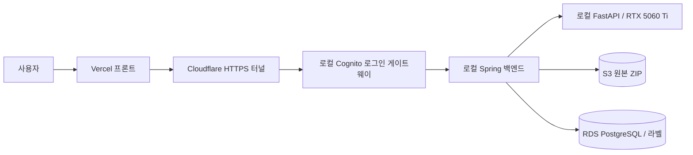
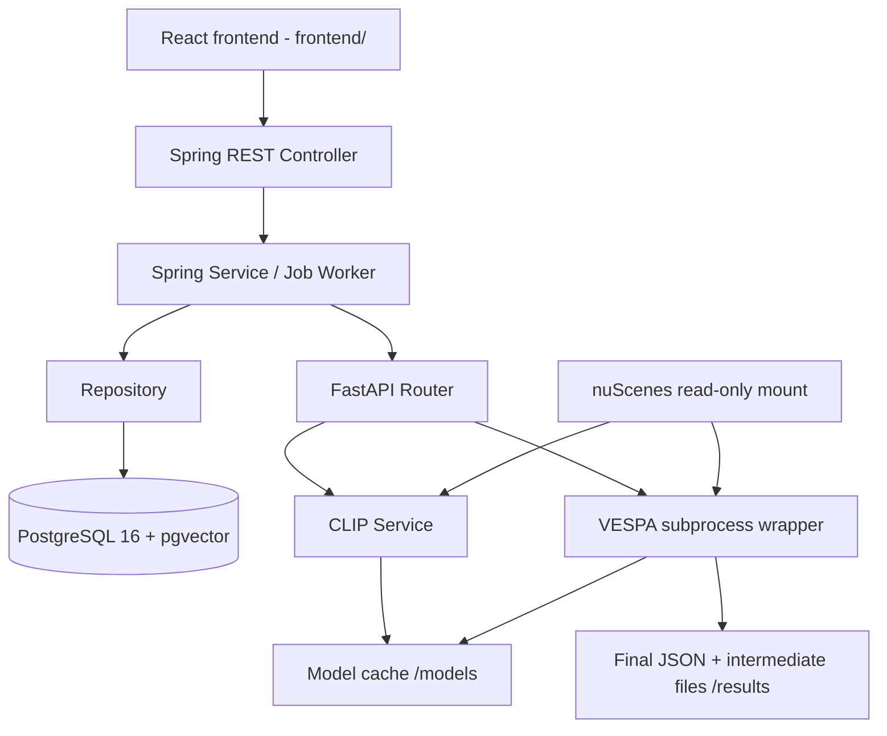
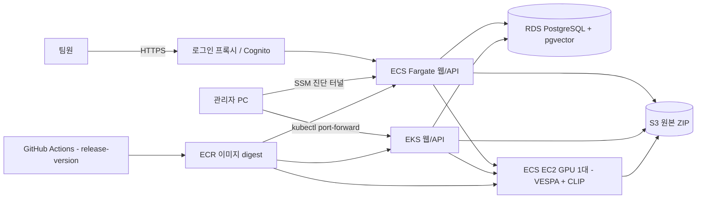

# DriveScene2Label

nuScenes 기반 **3D Auto-Labeling + 자연어 Scene Retrieval + 라벨 편집** 웹 애플리케이션입니다. 카메라 이미지를 CLIP 벡터로 저장하고 자연어로 scene을 검색합니다. 선택한 scene은 VESPA로 3D pseudo-label을 생성하여 GT와 분리해 저장합니다. 업로드한 라벨이나 완료된 자동 라벨 결과를 UI에서 수정하고, 원본을 보존하면서 수정본을 서버에 저장·다운로드할 수 있습니다.

배포 기준 브랜치는 **`release-version`**, AWS 리전은 **서울 `ap-northeast-2`**입니다. [이번 릴리스 변경사항과 JPA 선택 이유](#15-release-version-변경사항), [AWS 구성·선택 이유·배포 방법](#16-aws-배포와-구성-이유)을 먼저 확인하세요.

현재 MVP 주소: **[DriveScene2Label](https://drivescene2label.vercel.app)**. 프론트는 Vercel, 백엔드·GPU는 로컬 PC, 원본 저장소는 S3, 메타데이터·라벨 DB는 RDS를 사용합니다. 기존 ECS 공개 주소는 종료된 환경의 주소입니다. 아래 AWS 전체 배포 설명은 이전 구성의 참고 자료이며 현재 MVP 실행에 사용하지 않습니다.

## 현재 MVP와 재부팅 후 재개 (2026-11-11)



사용자는 Vercel 주소 하나로 접속합니다. `/api/*`와 `/oauth2/*`는 로컬 로그인 게이트웨이로 전달되며 기존 Cognito `team` 그룹만 API를 사용할 수 있습니다. EC2·ECS·EKS는 시작하지 않습니다.

|항목|현재 확인 상태|
|---|---|
|Vercel|제품 빌드·배포 READY, 공개 홈페이지 200, 로그인 페이지 연결 확인|
|RDS|보존 스냅샷에서 `ds2l-hybrid-database` 복원, 로컬 Spring TLS 인증서·호스트 검증 연결 성공, 기존 schema v8 유지|
|접속 제한|현재 PC 공인 IPv4 `/32`의 TCP 5432만 허용. 집 IP 변경 시 해당 규칙 갱신 필요|
|S3|기존 private 버킷 유지, 앱은 `uploads/*` 전용 1시간 임시 세션 사용. 전체 원본 복원 검증은 다음 단계|
|데이터|로컬 API에서 기존 데이터셋 4개 조회 성공. 실제 mini는 데이터셋 #4|
|GPU|이미지 빌드 완료. 이번 기동에서 Windows `GPU is lost` 오류가 발생해 실행 검증 중단. eGPU 재연결·재부팅 후 재검증 필요|
|로그인|비로그인 API 401 차단 확인. 사용자 팀 계정 로그인 후 callback·씬·편집 화면 통합 검증은 아직 남음|
|테스트|프론트 빌드 성공, 9개 파일 71개 테스트 통과|

현재 PC의 비밀 설정은 OneDrive·Git 밖인 `%LOCALAPPDATA%\DriveScene2Label\hybrid`에 있습니다. 비밀번호·AWS 세션·OAuth 비밀은 README나 소스에 넣지 않습니다.

재부팅 후 Docker Desktop을 켜고 저장소 루트에서 실행합니다.

```powershell
# GPU가 정상 표시되는지 먼저 확인
nvidia-smi -L
# AWS 로그인이 만료된 경우만 실행
aws login --profile ds2l-seoul
# 로컬 서버·GPU·로그인 게이트웨이·터널·S3 세션 갱신 시작
powershell -ExecutionPolicy Bypass -File scripts/hybrid.ps1 -Action start
# GPU 복구 전 데이터 조회용으로만 시작할 때
# powershell -ExecutionPolicy Bypass -File scripts/hybrid.ps1 -Action start -WebOnly
# 상태 확인 / 로컬 서비스 종료 (데이터 볼륨 보존)
powershell -ExecutionPolicy Bypass -File scripts/hybrid.ps1 -Action status
powershell -ExecutionPolicy Bypass -File scripts/hybrid.ps1 -Action stop
```

**임시 터널을 다시 시작하면 주소가 바뀝니다.** `.local/hybrid/tunnel.stderr.log`에 나온 새 HTTPS 주소를 Vercel 프로젝트의 `BACKEND_URL`에 반영하고 재배포해야 합니다. 사용자에게 공유하는 `https://drivescene2label.vercel.app` 주소는 유지됩니다. 이 갱신은 아직 자동화하지 않았습니다. 안정적인 상시 운영은 고정 도메인의 named tunnel로 전환하는 후속 범위입니다.

노트북·Docker·터널을 끄면 화면은 열려도 API와 GPU 작업을 사용할 수 없습니다. 로컬 종료·재부팅은 AWS RDS를 정지하지 않으므로 RDS 비용은 계속 발생합니다. 모델·압축 해제 캐시는 여전히 로컬 디스크 공간이 필요합니다. 최초 씬 접근은 S3 ZIP 전체 복원 때문에 느릴 수 있고, 4.34GB 공개 업로드는 아직 검증하지 않았습니다. 자동 작업 worker는 복원 데이터 검토 전까지 꺼 두었습니다.

`release-version` push는 CI 검사만 실행합니다. 기존 ECS/EKS 이미지 배포 workflow는 수동 실행으로 변경했습니다. Vercel은 이번에 검증한 로컬 소스로 배포했으며 Git push 자동 배포 연결은 아직 설정하지 않았습니다. 자세한 설정·제한은 [혼합 배포 기록](docs/hybrid-setup.md), [전체 로컬과 비교·통신 병목](docs/hybrid-deployment-plan-2026-11-11.md)을 참고하세요.

- [프론트엔드 REST API 명세](README_API.md)
- [Vercel + 로컬 GPU/백엔드 + S3/RDS 실행 준비](docs/hybrid-setup.md)
- [혼합 구성과 전체 로컬 비교·통신 병목 계획](docs/hybrid-deployment-plan-2026-11-11.md)
- [파일 업로드·라벨 수정본 저장·다운로드](docs/label-editing.md)
- [서울 AWS ECS·EKS·GPU 켜기/끄기와 release-version 배포](docs/aws-ecs-cicd.md)
- [DB / VESPA 결과 스키마](docs/auto-label-result-schema.md)
- [통합 검증 및 테스트 범위](docs/integration-verification.md)
- [Docker 검증 결과와 배포 제약](docs/docker-integration.md)
- [프론트엔드 개발 기획서](docs/frontend-product-plan.md)
- [프론트 구현 체크리스트](docs/frontend-implementation-checklist.md)
- [Claude Code 구현 시작 프롬프트](docs/claude-code-frontend-prompt.md)
- [Rerun recording 계약](docs/rerun-recording.md)
- [프론트 실행·구조](frontend/README.md)
- [실제 데이터·프론트 연동 개선 기획서](docs/frontend-integration-plan.md) / [개선 체크리스트](docs/frontend-integration-checklist.md)
- [작업·recording 운영 복구 절차](docs/operations-recovery.md)
- [실제 데이터·프론트 연동 개선 기획서](docs/frontend-integration-plan.md)
- [개선 구현·실제 성공 검증 체크리스트](docs/frontend-integration-checklist.md)
- [Claude Code 연동 업데이트 프롬프트](docs/claude-code-integration-prompt.md)
- [I1/I2 구현 검토 (2026-10-06)](docs/frontend-integration-audit-2026-10-06.md)
- [Claude Code I1/I2 보완·후속 검증 프롬프트](docs/claude-code-integration-followup-prompt.md)

React 프론트는 [`frontend/`](frontend/README.md)에 있습니다(씬 탐색·검색, 6카메라 작업대, 이미지 위 GT/예측 투영, VESPA 작업, 두 씬 비교, Rerun 3D). 디자인 기준은 `docs/frontend-design/`, 저장소 개발 지침은 [CLAUDE.md](CLAUDE.md), 진행·검증 상태는 [구현 체크리스트](docs/frontend-implementation-checklist.md)를 따릅니다. 실제 nuScenes mini·GPU 환경에서의 통합 확인 범위는 체크리스트의 검증 기록에 따로 적습니다.

## 1. Architecture



Spring은 Controller→Service→Repository 구조로 요청 검증, 데이터 저장/검색, job 상태를 관리합니다. FastAPI Router는 Spring Controller, AI Service는 추론 업무 Service에 대응합니다. FastAPI에는 DB driver/Repository가 없습니다. JSON 응답을 받은 Spring만 DB에 저장합니다.

AI 컨테이너에서 CLIP은 기본 Python, VESPA는 `/opt/vespa-env/bin/python`으로 실행합니다. 큰 PyTorch 설치는 공유하고 VESPA가 요구하는 NumPy/Transformers 등은 별도 환경으로 분리합니다. VESPA source는 Docker build 때 고정 commit을 checkout하며 upstream 파일을 수정하지 않습니다. OpenPCDet 모델 학습은 이 이미지의 대상이 아닙니다. 원본의 `np.bool` 사용은 subprocess에서만 호환 alias로 처리합니다. Python3.12 빌드 호환성을 위해 nuScenes devkit은 upstream Dockerfile의1.1.11 대신1.2.0을 사용합니다.

## 2. Tech Stack

|구분|구성|
|---|---|
|Backend|Java21, Spring Boot4.1.1, Spring Data JPA, JdbcClient, Flyway|
|AI|Python3.12, FastAPI, PyTorch, OpenCLIP, VESPA-Direct|
|DB|PostgreSQL16, pgvector vector(768)|
|Infrastructure|Docker/Compose, CloudFormation, ECS Fargate, EKS, GPU EC2, ECR, S3, RDS, Secrets Manager, GitHub Actions OIDC|
|Dataset|nuScenes mini 또는 trainval|

정확한 Python 버전 pin은 [CLIP requirements](ai-server/requirements.txt), [VESPA requirements](ai-server/requirements-vespa.txt)를 참조합니다.

## 3. Prerequisites

- Linux 또는 Docker Desktop의 WSL2 integration 환경, Docker Compose v2.
- nuScenes 데이터의 로컬 압축 해제본. [공식 다운로드](https://www.nuscenes.org/nuscenes).
- 최초 Docker build 및 모델 다운로드에 인터넷 연결과 충분한 디스크 공간이 필요합니다. PyTorch CUDA 패키지와 Open3D가 커서 image build에 시간이 걸립니다.
- CLIP은 CUDA가 없으면 CPU로 서버 기동/추론할 수 있습니다. CPU에서는 느리고 timeout 조정이 필요할 수 있습니다.
- VESPA의 코드에도 CPU fallback이 있지만 전체 scene 처리 성능은 보장하지 않습니다. 실제 auto-label은 NVIDIA GPU 사용을 권장합니다.
- GPU 사용 시 호스트 NVIDIA 드라이버 및 Docker GPU 지원이 필요합니다. macOS 컨테이너에서는 MPS를 사용할 수 없습니다.

## 4. Dataset Setup

아래 전체 root를 마운트합니다. `v1.0-mini` metadata 디렉터리 자체를 root로 지정하지 않습니다.

```text
/path/to/nuscenes/
├── samples/             # keyframe JPG / pointcloud
├── sweeps/              # intermediate sensors
├── maps/
└── v1.0-mini/
    ├── scene.json
    ├── sample.json
    ├── sample_data.json
    ├── sample_annotation.json
    └── ...              # official complete metadata JSON set
```

Spring metadata importer는 원본 관계/경로를 검증합니다. 같은 입력의 반복 import는 건너뛰고, 변경된 metadata를 같은 dataset에 혼합하지 않습니다. 첫 실행에는 `.env`의 `NUSCENES_IMPORT_ENABLED=true`를 사용합니다. 이후 false로 바꿔도 저장된 catalog는 유지됩니다. trainval은 version 및 데이터 모두 함께 바꿔야 합니다.

## 5. 모델 / 다운로드 / Git 제외 정책

모델 가중치, 데이터셋, DB 파일, 결과 JSON/NPZ, 로그, Python venv, `.env`는 Git에 올리지 않습니다. `.gitignore`와 Docker build allowlist를 적용합니다. 기존 `embedding/fixtures/*.npz`는 작은 테스트 기준 벡터만 예외입니다.

|역할|모델/소스|다운로드 및 저장|
|---|---|---|
|CLIP|[OpenCLIP](https://github.com/mlfoundations/open_clip), ViT-L-14-quickgelu / openai|서버 시작 시 open_clip이 다운로드, `/models/huggingface`|
|VESPA source|[TUMFTM/VESPA](https://github.com/TUMFTM/VESPA), commit `acb2b6e8683363795528f049fe0444ef9f3efdb9`|Docker build에서 `/opt/vespa`에 clone|
|Grounding DINO|[IDEA-Research/grounding-dino-base](https://huggingface.co/IDEA-Research/grounding-dino-base)|첫 VESPA 사용 시 Hugging Face cache|
|SAM ViT-base|[facebook/sam-vit-base](https://huggingface.co/facebook/sam-vit-base)|첫 VESPA 사용 시 Hugging Face cache|
|DINOv2|[facebookresearch/dinov2](https://github.com/facebookresearch/dinov2), `dinov2_vitb14_reg`|torch.hub 다운로드, `/models/torch`|

각 모델/데이터의 라이선스와 사용 조건은 원본 링크를 따릅니다. VESPA 설정은 `/opt/vespa/configs/vlm/p_final.yaml`이며 실제 설정은 DINOv2 **register variant**입니다. 로컬 Compose의 모델 캐시는 컨테이너 재생성 시 유지됩니다. AWS의 `gpu-stop`/`stop`은 GPU 호스트와 캐시 디스크를 제거하므로 다시 켤 때 모델을 다운로드합니다. 가중치를 이미지 layer에 굽지 않습니다. 첫 VESPA 요청에는 다운로드 시간이 포함될 수 있으므로 운영 전 사전 준비/연결 확인이 필요합니다.

## 6. Environment Variables

```bash
cp .env.example .env
# 편집기로 .env의 password와 실제 dataset 절대 경로를 설정
```

|변수|기본/의미|
|---|---|
|POSTGRES_DB / POSTGRES_USER|drivescene|
|POSTGRES_PASSWORD|반드시 개인 값으로 변경. 실제 .env는 Git 제외|
|NUSCENES_HOST_PATH|필수, 호스트의 dataset root 절대 경로|
|NUSCENES_VERSION|v1.0-mini; Spring과 VESPA에 동일 적용|
|NUSCENES_IMPORT_ENABLED|example=true, compose 기본false|
|NUSCENES_DATA_ORIGIN|UNKNOWN. import checksum과 함께 기록할 출처: 공식 원본이면 `NUSCENES`, 테스트 fixture면 `SYNTHETIC`. 이름·버전으로 추정하지 않으며 SYNTHETIC이면 VESPA 실행을 막는다|
|APP_PORT / AI_PORT|8080 / 8000, host loopback에만 공개|
|VESPA_NUM_THREADS|1, VESPA subprocess의 BLAS/OMP 스레드 수. CLIP 설정과 독립|
|VESPA_TIMEOUT_SECONDS|7200초 subprocess 상한|
|VESPA_EXECUTOR|local. `ssh`면 원격 Slurm 클러스터에서 실행 (`compose.seraph.yml`, [VESPA_Seraph.md](ai-server/VESPA_Seraph.md))|
|AI_SERVER_READ_TIMEOUT|30s, CPU CLIP 처리에 더 필요한 경우 조정|
|AUTO_LABEL_READ_TIMEOUT|7300s, VESPA timeout보다 길게|
|AUTO_LABEL_WORKER_ENABLED|true, Spring DB polling worker|
|RECORDING_TIMEOUT_SECONDS|600초, Rerun exporter subprocess 상한(ai-server)|
|RECORDING_READ_TIMEOUT|660s, Spring의 `POST /recordings` 대기. exporter 상한 이상으로|
|RECORDING_WORKER_ENABLED|true, Spring recording worker|

컨테이너 내부 고정 경로/주소: Spring DB_URL=`jdbc:postgresql://db:5432/<db>`, AI_SERVER_BASE_URL=`http://ai-server:8000`, NUSCENES_ROOT=`/data/nuscenes`, VESPA_ROOT=`/opt/vespa`, VESPA_OUTPUT_ROOT=`/results`, RECORDING_OUTPUT_ROOT(ai-server)/RECORDING_ROOT(backend)=`/recordings`, HF_HOME=`/models/huggingface`, TORCH_HOME=`/models/torch`. 호스트 localhost를 컨테이너 간 주소로 사용하지 않습니다.

## 7. Quick Start

```bash
git clone https://github.com/DriveScene2Label-Team/DriveScene2Label.git
cd DriveScene2Label
cp .env.example .env
# 실제 비밀번호와 NUSCENES_HOST_PATH를 .env에 입력하고 dataset 준비
docker compose up --build -d
docker compose ps
docker compose logs -f ai-server backend
```

기본 명령은 GPU 할당 없이 CPU로 동작합니다. NVIDIA GPU 사용:

```bash
docker compose -f compose.yml -f compose.gpu.yml up --build -d
```

DB healthy 후 backend가 기동합니다(2026-10-05부터 AI는 시작만 기다리고 health를 기다리지 않음). CLIP 다운로드·로딩 중에도 씬 목록·카메라·GT는 쓸 수 있고, 검색/VESPA/recording 준비 여부는 `GET /api/system/status`로 확인합니다. CLIP 로딩이 실패해도 AI 서버는 recording/VESPA를 계속 제공하며 `/health`는 503입니다(이전 fail-fast는 `AI_REQUIRE_CLIP=true`). AI health start period는15분입니다. 모델/네트워크가 준비되지 않으면 이 명령이 모든 기능의 readiness를 보장하지 않습니다. 준비 완료 후에는 컨테이너 재시작으로 모델을 매번 다운로드하지 않습니다.

기존 compose의 서비스명 `app`은 `backend`로 바뀌었습니다. 이전 app 컨테이너가 떠 있다면 현재 포트를 비운 뒤 실행하세요. 기존 `postgres_data` volume 이름은 유지하며 자동 삭제하지 않습니다.

## 8. Services / Volumes / Health

|서비스|호스트|내부|health|
|---|---|---|---|
|backend|127.0.0.1:8080|backend:8080|GET /api/datasets (DB 조회 포함)|
|ai-server|127.0.0.1:8000|ai-server:8000|GET /health|
|db|127.0.0.1:55433 (`DB_PORT`)|db:5432|pg_isready|

backend·ai-server·db 호스트 포트는 각각 `APP_PORT`·`AI_PORT`·`DB_PORT`(기본 8080·8000·55433)입니다. 같은 PC에서 두 번째 Compose project(`-p` 또는 `COMPOSE_PROJECT_NAME`)를 띄울 때는 세 값을 모두 바꿔야 합니다. project 이름만 바꾸면 volume은 분리되지만 포트는 충돌합니다. `docker compose up -d db backend`는 `depends_on` 때문에 제품 ai-server도 build·시작합니다. AI 없이(또는 recording 전용 하네스로) 띄우려면 `--no-deps`와 override 파일을 함께 사용합니다. 예와 검증 기록은 [Docker 통합](docs/docker-integration.md#별도-compose-project-포트-분리-2026-10-06)에 있습니다. `scripts/embed.sh`도 같은 우선순위(실행 시 `DB_PORT` → `ENV_FILE`의 값 → 55433)를 따르므로, 별도 project에서는 Compose와 같은 env 파일을 `ENV_FILE=<파일>`로 지정합니다.

|volume/mount|사용 서비스|내용|
|---|---|---|
|postgres_data|db|PostgreSQL persistent data|
|model_cache → /models|ai-server|CLIP/Hugging Face/torch hub caches|
|vespa_results → /results|ai-server|run별 최종 JSON, 로그, intermediate NPZ|
|rerun_recordings → /recordings|ai-server(rw), backend(ro)|recording별 `.rrd`, 요청 JSON, exporter 로그|
|uploaded_datasets → /uploads|backend, ai-server|업로드 ZIP과 추출 데이터. AWS에서는 S3 원본으로 각 서버의 캐시를 복원|
|dataset bind → /data/nuscenes:ro|backend, ai-server|동일 원본 센서/metadata 파일|

Spring은 최종 결과를 HTTP JSON으로 받으므로 `/results`를 공유하지 않습니다. DB에는 artifact storageKey/relativePath만 저장합니다. artifact download API는 아직 없습니다.

```bash
curl http://localhost:8080/api/datasets
curl http://localhost:8000/health
docker compose exec ai-server python -c 'import torch; print(torch.cuda.is_available()); print(torch.__version__)'
docker compose exec ai-server /opt/vespa-env/bin/python -c 'import sys; sys.path.insert(0,"/opt/vespa"); import main_pseudo_vlm; print("VESPA imports OK")'
```

AI health의 `vespa=configured`는 파일 경로 점검이며 모델 다운로드 완료/전체 추론 성공 의미가 아닙니다. GPU compose 파일을 사용하지 않으면 호스트에 GPU가 있어도 CUDA가 보이지 않습니다.

## 9. Main Flow

자연어 검색: camera image → Spring → FastAPI CLIP image → 768-d L2 vector → image_embedding. text → Spring → CLIP text → pgvector cosine distance `<=>` → scene별 TOP_K_AVERAGE → Scene 목록.

Auto-label: scene 선택 → Spring job PENDING → worker RUNNING → FastAPI subprocess → VESPA final JSON → Spring 검증 → predicted_annotation + artifact + job COMPLETED atomic commit. 저장 오류는 rollback 후 FAILED. 프론트엔드는 job REST polling을 사용합니다.

Rerun recording: Spring이 keyframe sample·LIDAR_TOP pose/calibration·GT·(선택) 완료 job 예측을 FastAPI `POST /recordings`로 보냄 → exporter subprocess(rerun-sdk 0.38.1)가 `/recordings/<id>-<token>/<scene>.rrd` 생성 → Spring 검증 후 READY, 브라우저는 Spring content API로 받아 Web Viewer 0.38.1에 연다. recording 실패는 VESPA job을 다시 실행하지 않는다. 계약은 [Rerun recording](docs/rerun-recording.md), exporter는 [RECORDING.md](ai-server/RECORDING.md).

## 10. API

전체 request/response/enum/error/호출 순서는 [README_API.md](README_API.md). 프론트엔드는 Spring만 호출하고 FastAPI는 내부 AI 서비스입니다.

```bash
curl -X POST http://localhost:8080/api/sensor-files/42/embedding
curl --get http://localhost:8080/api/search/scenes --data-urlencode 'q=rainy night road' --data 'k=10'
curl -X POST http://localhost:8080/api/auto-label/jobs -H 'Content-Type: application/json' -H 'Idempotency-Key: scene-run-1' -d '{"sceneToken":"REPLACE_WITH_TOKEN","datasetId":1,"classMode":8}'
curl http://localhost:8080/api/auto-label/jobs/12
curl http://localhost:8080/api/auto-label/jobs/12/results
```

ID/token은 실제 목록에서 얻은 값으로 교체합니다. 이미지가 DB에 있어도 embedding은 자동 생성되지 않으므로 검색 전에 저장 API를 호출해야 합니다. CPU inference가30초를 넘으면 `.env`의 AI_SERVER_READ_TIMEOUT을합니다.

## 11. Database

```text
dataset → scene → sample → sample_data → image_embedding
                    └── gt_annotation (GT only)
auto_label_job → auto_label_job_sample → predicted_annotation
              └── auto_label_artifact
```

토큰 FK는 dataset_id와 묶어 데이터셋 간 충돌을 방지합니다. `image_embedding` unique는 dataset/sample_data/model/preprocess, 예측 unique는 job/sample/box_index입니다. 원본 이미지는 파일에 유지하고 vector/metadata/box만 DB 저장합니다.
Flyway가 V1 catalog, V2 pgvector, V3 scene flags, V4 auto-label, V5 recording, V6 DB 식별·데이터 출처, V7 라벨 문서·수정 이력, V8 배포 maintenance gate를 startup 시 적용합니다. 이미 배포된 migration을 수정하지 말고 새 migration을 추가하세요. GT와 pseudo-label 모두 world 좌표, sizeWLH, quaternionWXYZ. VESPA score1.0은 고정값입니다.

## 12. Development / Tests

프론트 (Node 20.19+ / npm, 상세는 [frontend/README.md](frontend/README.md)):

```bash
cd frontend && npm ci
API_PROXY_TARGET=http://127.0.0.1:8080 npm run dev   # /api 를 Spring으로 proxy
npm run typecheck && npm test && npm run build
npm run test:e2e                                       # route fixture 기반 UI 흐름 (실제 서버 연동 아님)
DS2L_API=http://127.0.0.1:8080 npx playwright test -c playwright.live.config.ts   # 실행 중인 Spring 대상
```

Spring 단독 (JDK21):

```bash
export DB_URL=jdbc:postgresql://localhost:55433/drivescene
export DB_USERNAME=drivescene
export DB_PASSWORD='your-local-password'
export NUSCENES_ROOT=/absolute/path/to/nuscenes
export AI_SERVER_BASE_URL=http://localhost:8000
export VESPA_DATASET_VERSION=v1.0-mini
sh gradlew bootRun
```

FastAPI 단독:

```bash
cd ai-server
python3 -m venv .venv
.venv/bin/pip install -r requirements.txt
export CLIP_IMAGE_ROOT=/absolute/path/to/nuscenes
.venv/bin/python -m uvicorn main:app --host 127.0.0.1 --port 8000
```

로컬 VESPA 환경은 [VESPA.md](ai-server/VESPA.md), 기존 batch CLI는 [offline embedding 가이드](docs/legacy-catalog-and-embedding.md)를 참조합니다. Docker에서는 Python 환경이 자동 준비됩니다.

```bash
# 실제 별도 PostgreSQL을 띄우고 제거하는 Spring 테스트
bash scripts/docker-test.sh
# AI 테스트 (fake models/subprocess; 실제 weights 불필요)
ai-server/.venv/bin/pip install pytest httpx
(cd ai-server && .venv/bin/python -m pytest -q tests)
# 실제 실행 중인 stack: CLIP 이미지 저장→검색 검증 (DB 쓰기 발생)
python3 scripts/docker-smoke.py
# 전체 scene VESPA 실행 포함; 새 job 생성, 장시간 소요
python3 scripts/docker-smoke.py --auto-label
```

## 13. Troubleshooting

- **DB 연결 실패**: docker compose ps/logs db. 컨테이너는 db:5432, 호스트는 `DB_PORT`(기본 55433). 기존 volume의 DB password는 .env 변경만으로 바뀌지 않습니다.
- **nuScenes path 오류**: host root 존재 여부, samples/sweeps/maps/version 디렉터리 확인. bind는 없는 폴더를 자동 생성하지 않습니다.
- **CLIP 다운로드 실패**: logs ai-server에서 외부 네트워크/Hugging Face 연결 확인. model_cache를 무작정 삭제하지 마세요.
- **CUDA unavailable**: GPU overlay를 사용했는지, Docker NVIDIA 지원과 드라이버 확인. CPU fallback은 정상이나 느립니다.
- **AI health 실패**: 최초 모델 로딩을 기다리고 로그 확인. startup 모델 실패 시 서버는 준비된 것처럼 응답하지 않습니다.
- **VESPA weight/path 오류**: /opt/vespa config, /models 접근, /data/nuscenes version 및 run의 execution.log 확인. 한 번에 한 worker 사용.
- **pgvector extension 실패**: 일반 postgres 대신 compose의 pgvector 이미지를 사용하고 Flyway 로그 확인.
- **job RUNNING에 머무름**: 현재 프로세스 crash 자동 복구/lease는 없습니다. 로그와 실제 실행을 확인하고 운영자 복구가 필요합니다.
- **API 결과 없음**: 먼저 이미지 embedding 저장, model/preprocess 일치 확인. 한국어 CLIP 검색 품질은 별도 평가가 필요합니다.

## 14. Shutdown

```bash
docker compose down
```

컨테이너/network만 제거하며 DB/model cache/results/recordings는 유지됩니다. GPU 실행 시 동일한 `-f compose.yml -f compose.gpu.yml` 조합을 사용합니다.

**아래 명령은 DB 데이터·모델 캐시·VESPA 결과·Rerun recording 볼륨까지 삭제합니다. 백업 없이 실행하지 마세요.** dataset bind의 원본 파일은 삭제하지 않습니다.

```bash
docker compose down -v
```

### 기존 로컬 통합 검증

nuScenes mini scene-0061의 실제 VESPA 8class 결과 39 sample/985 boxes를 Spring으로 반환하고 PostgreSQL에 저장하여 COMPLETED 상태와 GT 분리를 확인했다. CPU/GPU CLIP 저장·Scene 검색도 확인했다. 설치 호환 수정과 캐시 재사용을 포함한 검증 방법·범위는 [Docker 검증 기록](docs/docker-integration.md)을 참고한다.

## 15. release-version 변경사항

자동 라벨을 만든 뒤 사람이 잘못된 클래스·위치·크기를 고치고 결과를 전달할 수 있도록, **업로드 → UI 편집 → 수정본 저장 → 재조회 → 다운로드** 흐름을 추가했습니다.

|추가·수정|동작과 이유|
|---|---|
|`/labels` 편집 화면|라벨 JSON 업로드, 객체 선택, 클래스·XYZ 위치·크기·quaternion 회전 편집, 이동/회전 버튼, 객체 추가·삭제|
|원본과 수정본 분리|업로드 원문과 GT/예측 원본을 유지하고, 저장할 때마다 새 revision 추가. 잘못 수정해도 이전 버전을 다시 열 수 있음|
|서버 저장 + 다운로드|수정 메모·버전 이력 조회, 원본 JSON·지정 버전 JSON 다운로드. 새로고침 후에도 서버의 저장본을 다시 읽음|
|동시 저장 충돌|문서 `@Version`과 `expectedVersion` 검사. 다른 창의 저장을 덮어쓰지 않고 HTTP 409로 충돌 전달|
|자동 라벨 결과 편집|완료된 job의 결과를 편집 문서로 복사. 원래 job 결과와 GT는 유지|
|nuScenes ZIP 업로드|파일 경로·압축 해제 크기·필수 metadata·참조 센서 파일을 검증한 뒤 별도 dataset 등록. 원본 ZIP 다운로드 지원|
|S3 저장과 캐시 복원|원본 ZIP을 비공개 S3에 저장. ECS/EKS/AI 서버가 교체돼도 필요한 원본을 다시 받아 사용|
|안전한 환경 종료|신규 쓰기와 작업 선점을 막고 진행 중 작업을 기다린 뒤 DB 스냅샷 생성. 복구 기록 확인 전에는 DB 삭제 금지|

라벨 JSON은 최대 **20 MiB**, ZIP은 **5 GB (5,000,000,000바이트)**, ZIP 압축 해제 총량은 **8 GiB**입니다. 전체 nuScenes mini를 업로드할 수 있도록 브라우저·Spring·S3 복원·GPU 캐시의 한도를 함께 맞췄습니다. 원본 ZIP 업로드에는 별도 라벨 JSON이 필요하지 않으며, 업로드한 씬에서 자동 라벨링을 실행하면 생성됩니다. 현재 원본 업로드는 nuScenes 형식 ZIP을 지원합니다. 일반 JPG/MP4를 nuScenes로 변환하는 기능, 업로드 데이터의 CLIP 인덱스 자동 생성, 업로드 데이터 Rerun 생성은 후속 범위입니다. 편집 화면은 WORLD XY 평면이며 카메라 위 드래그 편집은 포함하지 않습니다. [파일 형식과 API 예제](docs/label-editing.md).

### JPA와 JDBC를 나눈 이유

라벨 문서와 수정 이력을 entity로 관리하고 CRUD·트랜잭션·버전 충돌 처리를 일관되게 구현하기 위해 **Spring Data JPA**를 선택했습니다. 일반 catalog repository 5개와 라벨 문서 저장에 적용했습니다. `open-in-view=false`, `ddl-auto=validate`로 설정하고 스키마 변경은 Flyway가 담당합니다. 목록은 큰 라벨 payload를 읽지 않는 DTO projection을 사용합니다.

|업무|선택|이유|
|---|---|---|
|catalog 조회·라벨 문서·수정 이력|JPA|entity 매핑과 repository를 통한 CRUD, 수정 이력 추가와 문서 version 갱신을 한 트랜잭션으로 처리|
|pgvector 유사도 검색|JdbcClient/SQL|`<=>` 연산자와 검색 집계 쿼리를 명시적으로 제어|
|metadata 대량 import|JdbcClient/SQL|기존 batch insert와 검증 흐름 유지|
|작업 선점|JdbcClient/SQL|`FOR UPDATE SKIP LOCKED`로 중복 claim을 방지하는 기존 동작 유지|

JPA가 JDBC보다 항상 빠르다는 판단은 아닙니다. Spring Data JDBC도 트랜잭션과 `@Version`을 지원하며 단순 aggregate 모델에서는 더 간단할 수 있습니다. 이번 선택은 기존 catalog와 편집 이력의 유지보수 편의를 기준으로 했습니다. [JPA 선택 근거와 참고 자료](docs/label-editing.md#jpa-선택-근거).

## 16. AWS 배포와 구성 이유

프로젝트 계정 `189750306426`의 **서울 `ap-northeast-2`**를 사용합니다. ECS와 EKS에 같은 웹/API 이미지를 배포하고 데이터와 GPU는 공유합니다. 두 배포 경로를 함께 검증하기 위한 구성이며, ECS와 EKS 모두 실행 중에는 각각 실행 비용이 발생합니다.



|구성|사용 목적·선택 이유|전체 stop 이후|
|---|---|---|
|ECS Fargate|웹/API 실행. EC2 호스트를 직접 관리하지 않고 Docker 이미지로 배포. 자동 라벨 worker의 단일 실행 위치|태스크·서비스 제거|
|EKS + CPU EC2 1대|동일 이미지의 Kubernetes 배포 검증, ClusterIP 서비스, Pod Identity. CPU 노드는 SSM 접속 경유지로도 사용|노드와 클러스터 제거|
|ECS EC2 `g6.2xlarge` 1대|VESPA와 CLIP이 NVIDIA GPU를 공유해 GPU 중복 할당 방지. 초기 크기는 L4 24 GiB / 8 vCPU이며 성능은 실측 필요|인스턴스와 캐시 디스크 제거|
|RDS PostgreSQL 16 + pgvector|catalog·작업·원본 라벨·수정 이력·벡터를 같은 DB에서 관리. `db.t4g.small`, 사설·암호화·TLS 인증서 검증|검증된 수동 스냅샷과 복구 정보 보존 후 인스턴스 제거|
|S3|원본 ZIP을 서버 수명과 분리하고 서버별 캐시를 복원. 버전 관리·외부 공개 차단·HTTPS 강제|파일과 이전 버전 유지|
|ECR|검증된 앱/AI Docker 이미지를 immutable tag와 digest로 관리. ECS/EKS가 동일 버전을 참조|이미지 유지|
|Secrets Manager|DB 자격 증명과 내부 운영 토큰 관리. 저장소·workflow 변수에 실제 비밀번호를 넣지 않음|유지|
|GitHub OIDC|장기 AWS access key 없이 이 저장소의 production environment에서 단기 인증|IAM/OIDC 설정 유지|
|CloudFormation|영구 리소스와 실행 리소스를 분리하고 같은 설정으로 재생성|foundation 스택 유지|

**Redis·Kafka·SQS·Elasticsearch는 추가하지 않았습니다.** 현재 작업 상태·선점은 PostgreSQL이 처리하고 벡터 검색은 pgvector가 처리합니다. 작은 단일 GPU worker 구성에서 같은 역할의 운영 서비스를 추가하지 않기 위한 선택입니다. EKS에서는 자동 라벨 worker를 끄고, GPU를 끄면 ECS worker도 비활성화해 대기 작업을 DB에 남깁니다.

앱·DB·GPU의 직접 접속 포트는 인터넷에 공개하지 않습니다. 팀 접속을 위한 `web-start`는 AWS HTTPS 주소와 ALB, Cognito 로그인 프록시를 추가합니다. 관리자가 생성한 `team` 그룹 계정만 이용할 수 있습니다. 실제 주소는 환경 `status`의 `recovery.public_url`에서 확인합니다. SSM 터널 또는 Kubernetes port-forward는 관리자 진단에 사용합니다. NAT Gateway는 생성하지 않습니다. AWS의 recording worker는 공유 `.rrd` 저장 구성이 없으므로 비활성화했습니다. [팀 계정 생성과 외부 접속](docs/aws-ecs-cicd.md#팀-로그인과-외부-https-주소).

### CI/CD 실행

1. 프로젝트 계정의 서울 CloudShell에서 [bootstrap 절차](docs/aws-ecs-cicd.md#최초-준비)로 foundation을 준비합니다.
2. GitHub `production` environment의 배포 허용 브랜치를 `release-version`으로 설정합니다. Repository Variable `AWS_ROLE_ARN`에 bootstrap의 GitHub 역할 ARN, `AWS_DEPLOY_ENABLED=true`를 지정합니다. 단기 인증은 OIDC를 사용합니다.
3. PR 검사는 `release-version` 대상이며, 해당 브랜치 push는 백엔드·프런트엔드·브라우저 흐름·인프라 안전장치 테스트 및 Docker 빌드를 실행합니다.
4. 통과한 이미지를 ECR에 발행합니다. 실행 중인 환경은 쓰기와 작업을 잠시 멈추고 같은 digest를 ECS/EKS에 배포한 뒤 확인합니다. **환경이 꺼져 있으면 이미지만 준비하며 push가 서버를 켜지 않습니다.**
5. GPU 모델 이미지는 `Release images and deploy ECS + EKS` → Run workflow → `component=ai`로 수동 빌드합니다. 이미지 빌드와 실행 환경 변경을 별도 job으로 나눠 긴 모델 빌드가 환경 stop을 막지 않게 했습니다.

수동 운영은 GitHub Actions → **AWS environment** → Run workflow → `release-version`에서 실행합니다.

|action|동작|
|---|---|
|status|실행 리소스·스택·복구 스냅샷·GPU 한도 확인|
|start|DB 생성/복원 → EKS·GPU·ECS 구성 → 앱 준비 확인. GPU 승인 전에는 `gpu=false`로 CPU 환경만 검증|
|stop|쓰기 차단 → 작업 종료 대기 → 스냅샷·S3 복구 기록 검증 → 실행 리소스 제거|
|gpu-start / gpu-stop|공유 GPU와 ECS worker만 켜거나 끄기|
|verify|두 환경에서 브라우저 라벨 업로드·버튼 편집·저장·다운로드와 ZIP 업로드/API 다운로드 검사. stop/start 후 `restore_check=true`로 이전 문서·이력·ZIP SHA-256 일치 확인|

원본 파일·수정 라벨·스냅샷·이미지를 **최소 한 달 보관하고, 한 달 이후에도 자동 삭제하지 않습니다.** 서버를 꺼도 S3·ECR·스냅샷·Secrets Manager·DNS 등의 보관 비용은 남습니다. CloudWatch 진단 로그만 30일 보관합니다. RDS는 단순 정지 시 7일 후 자동 시작되므로 장기 미사용에는 스냅샷 보존 후 인스턴스를 제거합니다. EKS도 제어 영역 요금을 줄이기 위해 클러스터 자체를 제거합니다. 다시 켜려면 재생성·복원·모델 로딩 시간이 필요합니다. [운영 명령·접속 방법·장애 복구](docs/aws-ecs-cicd.md).

### 검증 상태 (2026-11-09)

이번 계정에서는 서울 리전이 계정 수준에서 이미 활성화돼 있었지만 콘솔의 표시 리전에서 숨겨져 있었습니다. 콘솔 표시와 기본 리전을 서울로 맞췄고, 사용자가 조직 정책의 서울 허용을 반영한 뒤 프로젝트 계정 CloudShell/API 접근을 확인했습니다. 조직의 보안 정책을 전체 해제하지 않았습니다.

GitHub 기본 브랜치와 `production` 배포 허용 브랜치를 `release-version`으로 설정하고 OIDC 인증을 실제 실행에서 확인했습니다. 첫 EKS 노드 생성에서 필요한 프로젝트 역할·AWS 서비스 연결 역할 조회 권한을 보완했습니다. AI 이미지는 VESPA의 NumPy 1 환경에 맞는 PyArrow를 별도로 고정해 빌드 import 검사와 ECR 발행을 통과했습니다. GPU 한도 상향은 별도 AWS 승인 절차이므로 이미지 준비 완료와 GPU 실행 완료를 구분합니다.

|검사|결과|
|---|---|
|실제 PostgreSQL 백엔드 테스트|45개 통과|
|프런트엔드 단위 테스트·프로덕션 빌드|61개 및 빌드 통과|
|UI fixture / 실제 Spring 라벨 저장·다운로드|2개 / 1개 통과|
|AI 업로드 계약 / 배포 안전장치|11개 / 15개 통과|
|팀 로그인·GPU DNS 인프라 조건|배포 안전장치 총 19개 통과. cfn-lint 및 cfn-guard의 적용 가능한 저장소·DB·계정 규칙 통과|
|실제 nuScenes 센서 데이터|scene-0061 ZIP 업로드, dataset 3 / scene 3, 39개 프레임·6개 카메라 이미지·GT 박스 표시 확인. 기존 합성 테스트 fixture와 구분|
|Docker 전체 빌드·CloudFormation 템플릿 검사|통과|
|GitHub 원격 CI·OIDC·ECR 발행|[성공 실행](https://github.com/DriveScene2Label-Team/DriveScene2Label/actions/runs/42579817011)|
|AI Docker 빌드·VESPA import·ECR 발행|[성공 실행](https://github.com/DriveScene2Label-Team/DriveScene2Label/actions/runs/42586236337)|
|서울 S3/ECR/배포 권한·암호화 비공개 RDS|생성 확인|
|서울 ECS/EKS 앱 배포·동일 이미지 확인|[start 성공](https://github.com/DriveScene2Label-Team/DriveScene2Label/actions/runs/42595122060)|
|ECS/EKS 실제 UI 저장·다운로드·ZIP 교차 조회|양쪽 브라우저 검사 통과, 원본 라벨·revision·ZIP SHA-256 일치. [검증 실행](https://github.com/DriveScene2Label-Team/DriveScene2Label/actions/runs/42595393497)|
|전체 stop/start 후 DB 스냅샷 복원·무잔여 검사|아직 실환경 검증하지 않음. 종료 안전장치 단위 테스트와 구분|
|서울 GPU 추론·임베딩|G/VT On-Demand 한도 8 vCPU 승인 확인. GPU DNS 등록을 Cloud Map 방식으로 수정했으며 실제 추론 성공은 별도 검증 필요|

ECS 앱, EKS 클러스터·CPU 노드 1대, RDS와 공개 로그인 게이트웨이가 **실행 중**입니다. 공개 HTTPS에서 Cognito 로그인과 최초 비밀번호 변경 화면까지 확인했습니다. 본인 앱 계정은 생성했으며 인증 후 편집 전체 흐름 검증은 별도 기록합니다. GPU의 실행 상태는 `status`에서 확인합니다. 사용을 마치면 `AWS environment → stop`을 실행합니다. 관리자 SSM/kubectl 접속에는 유효한 프로젝트 계정 로그인이 필요합니다.

`/health` 성공은 CLIP 로딩을 의미하며 VESPA 전체 추론 성공을 대신하지 않습니다. 기존 로컬 GPU 검증과 이번 AWS 배포 검증은 구분합니다. 새로 확인되는 결과와 제한은 이 표와 [AWS 운영 문서](docs/aws-ecs-cicd.md)에 기록합니다.
