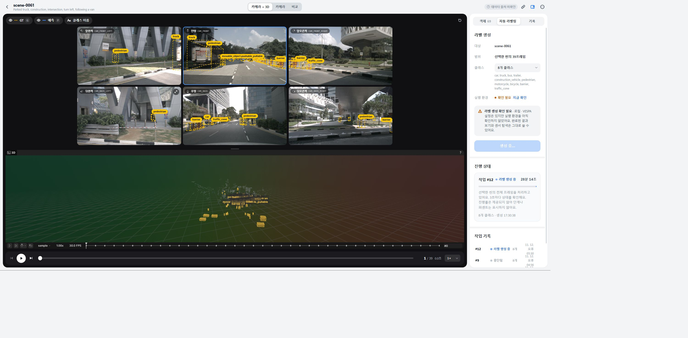
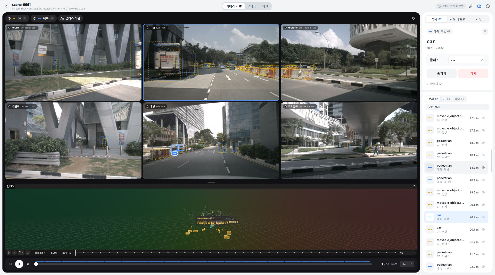
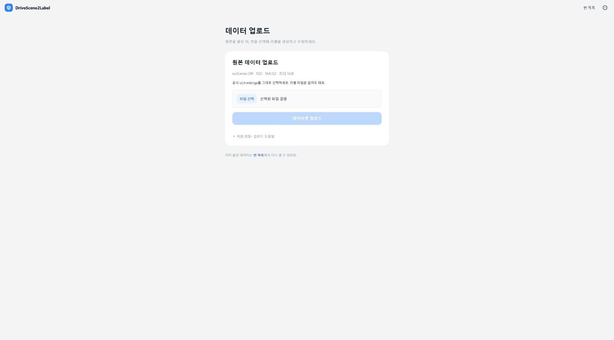
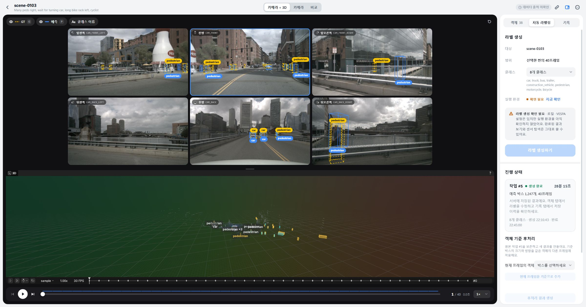
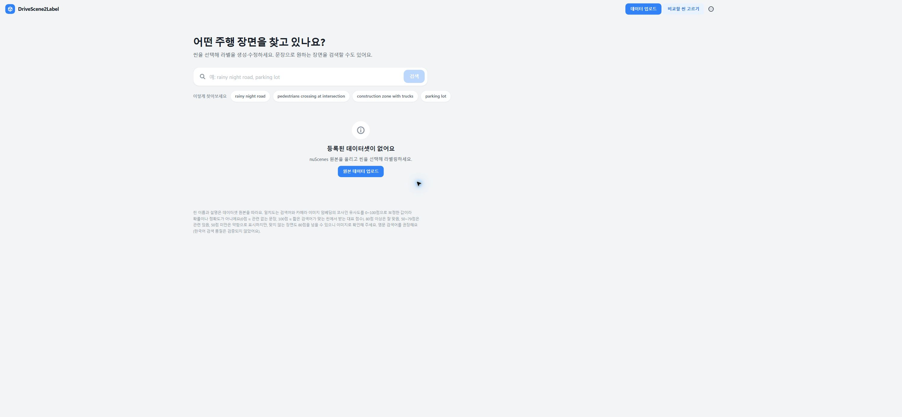
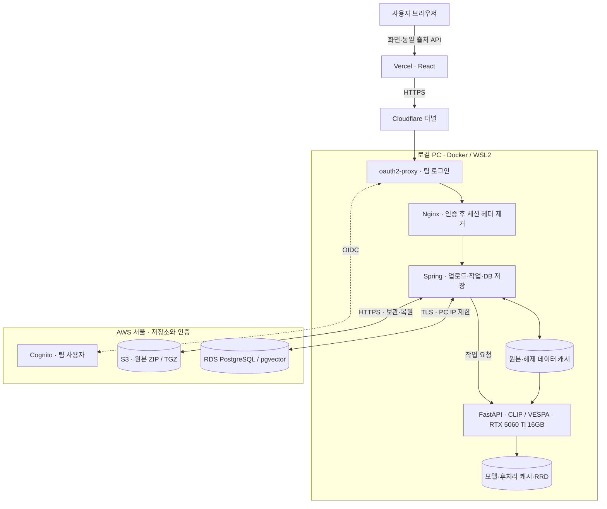

# DriveScene2Label

nuScenes 원본을 올리고, 주행 씬을 찾아 **선택한 씬의 3D 라벨을 생성·확인·수정하는 웹 애플리케이션**입니다. CLIP 자연어 검색, 6개 카메라와 LiDAR 3D 작업대, VESPA 자동 라벨링, 객체 기준 후처리와 편집 이력을 제공합니다.

**[서비스 열기](https://drivescene2label.vercel.app) · [API 명세](README_API.md) · [구조·병목 분석·면접 학습 문서](docs/architecture-and-measurement-2026-11-12.md)**

> **운영 일시중지 · 2026-11-12 저녁 사용자 요청.** 로컬 서버·GPU·터널을 종료하고 Vercel을 pause했습니다. RDS도 종료용 스냅샷과 함께 정지 절차를 진행했습니다. 원본·라벨·백업은 유지합니다. Git 자동 배포도 `git.deploymentEnabled=false`로 중지했으며, 아래 화면과 배포 성공 기록은 중지 전 검증 이력입니다. [최종 중지 상태·다시 켜는 순서](docs/shutdown-2026-11-12.md).

기준: **2026-11-12 · `release-version`**. 현재 프론트는 Vercel, 백엔드와 GPU는 로컬 PC, 원본은 AWS S3, 메타데이터·라벨은 RDS에 둡니다. **EC2·ECS·EKS는 이번 MVP에 사용하지 않습니다.** 과거 전체 AWS 운영 명령과 검증 기록은 [별도 이력 문서](docs/aws-deployment-history-2026-11-09.md)로 옮겼습니다.

## 사용 흐름

1. **원본 업로드:** `/uploads`에서 nuScenes ZIP·TGZ·TAR.GZ를 선택합니다. 공식 `v1.0-mini.tgz`는 재압축 없이 사용하며 라벨 JSON은 필요하지 않습니다. 최대 5GB, 압축 해제 후 8GiB입니다. 일반 JPG·MP4만으로는 3D 라벨링할 수 없습니다.
2. **씬 등록·검색 준비:** 파일은 4,000,000바이트 조각으로 전송하고 서버가 압축 검증 → S3 원본 보관 → RDS 등록을 처리합니다. 등록 후 CLIP 이미지 임베딩을 자동 생성합니다. **임베딩 완료 전에도 등록된 씬은 열 수 있으며, 새 라벨 생성은 완료 후 가능합니다.** 공유 GPU에서 검색 준비가 먼저 끝나도록 UI와 API 모두에서 검사합니다.
3. **씬 선택·수동 라벨 생성:** 임베딩이 끝난 뒤 사용자가 **라벨 생성하기**를 눌러야 작업을 만듭니다. 업로드·씬 열기·상태 조회·임베딩 완료만으로 추론을 시작하지 않습니다. `scene-0103`을 선택하면 그 씬의 **40개 키프레임**을 대상으로 실행합니다. `scene-0061`은 39개입니다. 10개 씬을 한꺼번에 실행하지 않으며 현재 프레임 한 장만 처리하는 것도 아닙니다.
4. **결과 확인·편집:** 같은 작업대에서 GT·예측, 카메라·LiDAR, 작업 기록을 확인합니다. 완료 결과를 서버에서 다시 조회하므로 새로고침 때문에 재추론할 필요가 없습니다. 객체의 클래스 변경·삭제·되돌리기와 편집 이력을 지원합니다.
5. **객체 기준 후처리:** 객체와 기준 프레임을 지정해 저장된 중간 상태에서 새 결과를 만듭니다. 기존 작업을 보존하고 이미지 검출·분할은 반복하지 않습니다. 캐시가 없는 과거 작업은 새 기본 결과가 필요합니다.

팀에서 공유한 **T1/0프레임, T3/18프레임**은 특정 작업의 예시입니다. 모든 씬에 고정 적용하지 않으며, 해당 예시를 동일하게 재현한 성능·품질 시험은 아직 하지 않았습니다. 객체 번호는 작업 내부에서만 유효합니다.

**팀원은 Windows·macOS·Linux의 브라우저로 같은 서비스 주소와 팀 계정을 사용합니다.** 팀원 PC에 Docker·AWS CLI·Vercel CLI·GPU 설치가 필요하지 않습니다. PowerShell 시작 명령은 현재 서버 역할을 맡은 Windows PC의 운영용입니다. Mac 자체에서 VESPA/CUDA 추론을 실행하는 지원과는 다르며, 실제 Safari/Mac 화면 검증은 아직 하지 않았습니다.

서비스의 Cognito 로그인은 데이터·GPU 실행 권한을 보호합니다. Vercel 로그인은 배포 관리 권한입니다. GitHub 자동 배포가 연결되면 허용된 브랜치에 push해 프론트를 배포하며, 팀원이 매번 Vercel CLI로 로그인할 필요는 없습니다. 로컬 백엔드·GPU 이미지는 Git push만으로 갱신되지 않습니다.

## 현재 화면과 확인 상태

**11월 12일 17:58 KST 공개 서비스 확인:** Cognito 로그인 후 씬 10개, 검색 임베딩 **2,424/2,424장**, `scene-0061` 카메라 6개·GT·LiDAR 3D, 사용자 실행 작업 **#12의 진행 상태 조회**를 확인했습니다. 이때 #12는 실행 중이며 아래 화면은 예측 생성 완료 증거가 아닙니다. HTTP 400 조회 오류를 복구하는 동안 backend·AI 컨테이너와 작업 시작 시각을 유지했습니다.

**후속 결과:** #12는 18:00 완료 상태로 저장됐고 API에서 **39프레임·1,308개 박스**를 다시 조회했습니다. UI/DB 시각 차이는 약 30분 9초이며, worker의 AI 요청+결과 저장 구간은 약 30분 20초입니다. 이미지 검출·분할이 실행기 시간의 약 **84.3%**였습니다. [계측 범위와 시간 차이 설명](docs/upload-measurement-2026-11-12.md#완료된-단일-씬-작업-12).



<details>
<summary>업로드 화면·단일 씬 결과·초기화 후 화면</summary>

11월 11일 완료 작업 #3의 예측을 표시한 이전 작업대입니다.






</details>

11월 12일 새 코드 배포 → 팀 로그인 → 기존 10개 씬 조회를 확인했습니다. 이후 사용자 요청에 따라 **앱 데이터만 초기화**했습니다. DB 덤프를 별도 DB에 실제 복원해 **33개 테이블의 행 수 일치**를 확인했고, **S3 10개 객체의 key·size·ETag와 로컬 캐시·계정은 보존**했습니다. 새 원본 업로드·씬 추론은 사용자가 직접 수행하며 이전 실행의 결과와 구분해 계측합니다.

## 현재 구조



|구성|역할과 운영 조건|
|---|---|
|Vercel|React 정적 화면과 `/api`, `/oauth2` 전달. GPU 연산은 실행하지 않음|
|Cloudflare Quick Tunnel|Vercel에서 로컬 4180 Cognito 로그인 게이트웨이로 연결. 임시 주소이며 재시작 때 Vercel 연결 갱신 필요|
|Cognito + oauth2-proxy|기존 `team` 그룹 로그인과 브라우저 세션 쿠키 확인|
|내부 Nginx|인증을 마친 요청에서 Spring이 사용하지 않는 Cookie·Authorization 제거. 업로드 스트리밍·Range·멱등 키 보존. 호스트 포트 공개 없음|
|Spring Boot|입력 검증, 압축·원본 저장, catalog·작업 관리, 결과·편집 저장. DB 소유 서비스|
|FastAPI + 로컬 eGPU|CLIP 검색 임베딩, VESPA 추론, 후처리, Rerun export. 브라우저에 직접 공개하지 않음|
|S3|원본 압축 파일 보관. 캐시가 없을 때 원본 전체를 복원할 수 있음|
|RDS + pgvector|씬·GT·이미지 벡터·작업·예측·편집 이력. PC IP /32 제한과 TLS 인증서·호스트 검증|
|로컬 Docker 볼륨|압축 해제본·모델·중간 결과·RRD 재사용. 원격 저장소를 써도 로컬 공간은 필요|

AWS는 원본·업무 DB 외에 기존 **Cognito, IAM/STS 인증도 사용**합니다. 따라서 “AWS는 S3/RDS 외에는 전혀 사용하지 않는다”는 설명은 정확하지 않습니다. 노트북이 꺼지면 Vercel 화면 파일은 제공되어도 API·GPU 작업은 동작하지 않습니다. RRD와 후처리 파일은 아직 S3에 자동 백업하지 않습니다.

## 배포를 나눈 이유

**보유 eGPU를 활용하고 팀이 접속할 주소와 원격 원본·DB를 유지하기 위한 시연용 선택**입니다. 전체 AWS보다 단순하거나 항상 빠르기 때문에 고른 구조는 아닙니다. 월 절감액과 전체 성능 우위도 아직 비교 측정하지 않았습니다.

|선택|장점|단점·적합한 상황|
|---|---|---|
|현재 Vercel + 로컬 연산 + S3/RDS|보유 GPU 활용, 공유 HTTPS UI, PC 수명과 분리된 원본·DB|PC·집 회선·터널에 의존, RDS 왕복과 S3 전송, 여러 서비스 운영. 시연 시간에 사용하는 MVP|
|전체 AWS|API·DB·GPU를 같은 리전에 배치, PC와 무관한 운영|GPU/API/DB·네트워크 비용과 클라우드 운영 필요. 상시 공개·동시 사용이 중요할 때 유리|
|전체 로컬|DB 왕복이 짧고 개발 구성이 단순|디스크·백업·장애 복구·외부 공유를 직접 책임. 단독 개발·실험에 적합|

**이전 AWS 구성 요소를 이번에 쓰지 않는 이유:**

|이전 요소|당시 목적|현재 판단|
|---|---|---|
|ECS Fargate 웹/API|EC2 호스트 관리 없이 컨테이너 실행|Spring을 보유 PC에서 실행. 대신 PC 종료 시 API 중단을 감수|
|EKS + CPU EC2|동일 이미지의 Kubernetes 배포 비교 검증|단일 GPU MVP에 두 웹/API 배포 경로를 유지할 필요가 작음. 클러스터 운영·비용 제외|
|GPU EC2 `g6.2xlarge` / L4 24GB|원격 VESPA·CLIP 연산|보유 RTX 5060 Ti 16GB 사용. 더 빠르다고 가정하지 않으며 GPU 내부 병목은 별도 개선|
|ECR·CloudFormation·GitHub OIDC|AWS 이미지 발행·인프라 재생성·단기 배포 권한|과거 자동화와 이력 보존. 현재 시작 명령이 AWS compute 배포를 실행하지 않음|
|RDS·S3|영속 DB·원본 보관|유지. RDS 실행·스토리지, S3 저장·요청·전송 비용은 남음|

전체 AWS로 돌아갈 때도 ECS와 EKS를 모두 쓸 필요는 없습니다. 상시 운영·동시 사용·PC 장애와 무관한 API가 필요해지면 **API/worker의 클라우드 이전부터** 다시 검토합니다. 현재 구조를 고가용성이나 마이크로서비스 확장성의 성과로 포장하지 않습니다.

Redis·Kafka·SQS·Elasticsearch는 도입하지 않았습니다. 작업 상태·선점은 PostgreSQL, 벡터 검색은 pgvector가 처리합니다. 별도 큐·캐시·검색 엔진은 실제 병목과 복구 요구를 확인한 뒤 검토합니다. Nginx를 추가하는 것만으로 모델 연산이나 대용량 전송이 빨라지지는 않습니다.

## 실제 병목과 개선 내용

**11월 12일 사용자 직접 업로드 실측:** 4.168GB TGZ의 공개 경로 전송 **11분 54초**, 서버 처리 관찰 대기 **3분 35초**, 합계 **15분 29초**였다. 서버 내부 S3 보관은 **141.5초**, RDS 등록은 **9.9초**였다. 이번 업로드의 우선 분석 대상은 전송 경로와 조각 사이 대기다. [측정 조건·조각별 시간·임베딩 완료 기록](docs/upload-measurement-2026-11-12.md).

CLIP은 CUDA로 2,424장 저장을 완료했다. 중간 라벨 작업 때문에 2,208장에서 대기하는 실행 순서 문제가 드러났다. 사용자 흐름은 **임베딩 완료 → 사용자 버튼 클릭 → 선택한 씬 라벨링**으로 명확히 하며, 이 순서 검사의 변경·배포 상태는 별도 기록한다. 임베딩 완료가 라벨링 자동 실행을 뜻하지 않는다.

다음은 **11월 11일 실행의 관측값**입니다. 서로 다른 실행을 같은 조건의 벤치마크처럼 비교하지 않습니다.

|관측 구간|측정|해석|
|---|---:|---|
|TGZ 압축 해제·검증|약 47.8초|브라우저 전송 이후 서버 작업|
|S3 원본 보관|약 358.1초|해당 업로드의 긴 단계. DB/ORM만 바꾸어 해결할 문제 아님|
|DB 메타데이터 등록|약 13.0초|importer는 이미 JDBC 500행 batch 사용|
|scene-0103 작업 #5|40프레임·1,247박스·약 28분 16초|선택한 한 씬의 처리 시간|
|위 작업의 이미지 검출·분할|약 21분 7초|해당 추론의 가장 긴 단계. S3/RDS 통신이 주원인이라는 근거는 없음|

|문제|적용·검증한 조치|남은 일|
|---|---|---|
|어느 단계에서 기다리는지 불명확|HTTP request ID, 업로드·S3·DB import·CLIP·VESPA 내부·3D 단계 시간, JSONL/Markdown 보고서|새 사용자 시험에서 전체 시간과 단계별 기여도 비교|
|반복 전송·긴 공개 경로|분할 전송·같은 파일 재선택 재개, 같은 PC의 loopback 업로드 경로|S3 직접 multipart, 조각 병렬 전송은 미구현|
|검출·분할 비용|SAM `inference_mode` 적용, 1이미지·3박스 비교에서 동일 마스크 확인|Grounding DINO 이미지 특징 재사용·모델 상주·배치 처리 실험|
|결과를 다시 찾기 어려움|씬별 완료 작업 조회·재열기, 결과와 편집 이력 저장|원본 파일명·업로드 날짜 중심 정렬, 편집 override의 RRD 반영|
|재부팅 뒤 실행 준비 실패|Docker 준비 검사·쓰기 재개·GPU 실제 CUDA 확인·연결 동기화|호스트 GPU lost 원인과 반복 실행 안정성, 중단된 RUNNING 작업 자동 복구|
|Cloudflare 터널 발급 timeout/429|Microsoft 비공개 터널로 임시 복구 후 11월 12일 재발급 성공. Cloudflare 복귀 시 Microsoft 토큰 전달 제거|고정 도메인·named tunnel은 미구성. 제공자 교체가 GPU 추론을 빠르게 한다는 근거는 없음|
|로그인 후 씬·작업 조회 HTTP 400|Tomcat `Request header is too large` 확인. 인증 뒤 내부 Nginx에서 불필요한 세션 헤더 제거 후 실제 로그인 화면 조회 복구|익명 401 유지, 합성 12KB 쿠키·4.2MB 업로드·206 Range 회귀 검사. [원인과 검증](docs/http-400-header-troubleshooting-2026-11-12.md)|
|Docker 로그 조회 누락|최근 tail과 시간 조회 대조, 불일치 보고, 유휴 컨테이너 재생성 후 수집 확인|무손실 로그 플랫폼을 구현한 것은 아님|

SAM 부분 시험의 최대 CUDA 할당량은 **8,042 → 2,796MiB**, 시간 중앙값은 **0.793 → 0.697초**였습니다. **전체 씬 속도·VRAM 개선율이 아닙니다.** 스레드를 무작정 늘리지 않았으며, BLAS/OMP 기본 1은 작은 CPU 연산의 과도한 스레드 생성을 피하려는 기존 설정입니다. [측정 조건·실행 로그·후속 개선](docs/troubleshooting-2026-11-11.md).

## 백엔드 구현을 설명할 때

- **JWT·세션·쿠키:** Cognito OIDC와 oauth2-proxy를 연결했습니다. JWT는 토큰 형식, 쿠키는 브라우저 전송 수단이며 대체 관계가 아닙니다. 자체 Spring JWT 인증 필터·Redis 세션을 구현한 것으로 설명하지 않습니다.
- **프록시 경계:** 로그인 쿠키는 oauth2-proxy에서 확인한 뒤 내부 Nginx가 제거합니다. Spring의 헤더 제한을 넘던 요청을 줄이는 조치이며 GPU 추론 속도 개선과는 별개입니다. Nginx 로그에는 method·path·status·요청/상위 서버 시간·request ID만 남기고 Cookie·Authorization·쿼리·본문은 기록하지 않습니다.
- **JPA·JDBC:** 일반 catalog·라벨 문서는 JPA를 사용하고 대량 import는 JDBC batch를 사용합니다. 작업 선점·예측·검색·객체 편집은 명시 SQL을 사용합니다. 특정 SQL과 왕복을 측정한 뒤 병목을 판단합니다.
- **작업·정합성:** dataset/scene 범위를 검증하고 idempotency key로 재시도 중복 생성을 막습니다. 완료 작업 조회는 새 추론을 시작하지 않습니다. 중단된 RUNNING 작업 자동 복구는 아직 검증되지 않았습니다.
- **관측:** 공통 ID와 경계별 시간을 추가했습니다. OpenTelemetry 분산 트레이싱이나 GPU 커널 프로파일러를 도입한 상태는 아닙니다.

코드 경로·인증 경계·트랜잭션·면접 답변과 학습 순서는 [상세 문서](docs/architecture-and-measurement-2026-11-12.md)에 정리했습니다.

## 실행과 직접 시험

이미 설정한 Windows PC에서 저장소 루트를 기준으로 실행합니다. 처음 준비하는 환경은 [혼합 배포 설정](docs/hybrid-setup.md)을 먼저 따릅니다. 비밀 설정은 Git·OneDrive 밖 `%LOCALAPPDATA%\DriveScene2Label\hybrid`에 보관합니다.

```powershell
# 기존 RDS 준비 + 로컬 서버/GPU + S3 세션 + 인증 터널 + Vercel 연결
powershell -ExecutionPolicy Bypass -File scripts/hybrid.ps1 -Action start

powershell -ExecutionPolicy Bypass -File scripts/hybrid.ps1 -Action status
# 로컬 서비스만 정지. DB·원본·캐시 볼륨은 보존
powershell -ExecutionPolicy Bypass -File scripts/hybrid.ps1 -Action stop
```

AWS/Vercel 로그인이 만료되면 각각 공식 CLI 로그인을 갱신합니다. `start`는 실행 중인 컨테이너를 재생성하지 않고 이미 검증된 Vercel production 소스로 터널 주소를 갱신합니다. **작업 트리의 새 코드를 배포하는 명령은 아닙니다.** 현재 보호된 `tunnel.json`의 provider는 `cloudflare`입니다. Quick Tunnel은 주소·가용성이 고정되지 않으며, 발급 실패 시 기존 공개 연결을 성공으로 표시하지 않습니다. Microsoft fallback은 별도의 요청 헤더 설정 복원과 검증 후 사용할 수 있습니다.

이 PC의 전송 경로를 줄이려면 [로컬 업로드](http://127.0.0.1:8080/uploads), 공개 서비스 경로를 측정하려면 [Vercel 업로드](https://drivescene2label.vercel.app/uploads)를 사용합니다. 두 경로는 같은 S3/RDS를 사용합니다. 업로드 도중 주소를 바꾸면 브라우저 재개 정보가 공유되지 않으므로 원래 탭에서 마칩니다. 로컬 업로드도 압축 해제·S3 보관·RDS 등록 시간은 필요합니다.

S3에는 시작할 인스턴스가 없습니다. 로컬 `stop`은 RDS를 중지하지 않으며 비용도 남습니다. RDS의 일시 중지는 최대 7일 후 자동 해제되고 저장공간 등의 비용은 계속됩니다. [AWS RDS 중지 설명](https://docs.aws.amazon.com/AmazonRDS/latest/UserGuide/USER_StopInstance.html).

### 로그와 결과 보관

```powershell
# 수집기가 이미 실행 중이면 중복 실행하지 않습니다.
python scripts/hybrid/measurement.py begin
python scripts/hybrid/measurement.py watch

# 수집기를 마친 뒤 보고서를 갱신
python scripts/hybrid/measurement.py stop
python scripts/hybrid/measurement.py collect
```

`watch`는 최대 48시간 동안 30초 간격으로 수집합니다. PC 종료 후에는 다시 실행해야 합니다. `.local/hybrid/measurements/<UTC 시작 시각>/`에 다음을 보관하며 Git에 올리지 않습니다.

|파일|내용|
|---|---|
|`manifest.json`|시작 시각·Git revision·작업 트리 변경 여부. 시험 경로와 cold/warm 조건은 별도 기록|
|`events.jsonl`|허용한 request/upload/dataset/job/run ID와 단계·소요 시간|
|`report.json`, `report.md`|작업·단계별 횟수, p50/p95/최대, 실패·누락·수집 오류|

중첩된 시간을 합산하지 않습니다. 브라우저 측정은 프록시·재시도·polling을 포함한 자기 보고이며 순수 네트워크 시간이 아닙니다. CPU 시간도 CUDA 커널 시간이 아닙니다. 비밀번호·쿠키·검색 문장·센서 본문은 이 수집기에 저장하지 않습니다. 실제 라벨은 RDS, RRD·중간 산출물은 로컬 결과 볼륨에 별도로 저장합니다.

내부 Nginx의 요청 시간은 `docker logs --since 10m drivescene-hybrid-auth-upstream-1`로 별도 확인합니다. 이 로그는 현재 위 계측 수집기의 집계 대상은 아니며, Docker에서 10MB × 3개로 순환 보관합니다.

## 검증 범위와 배포

|검증|11월 12일 결과|
|---|---|
|백엔드 핵심 통합 / HTTP 필터|45개 / 1개 통과|
|프론트 단위 / fixture 브라우저 흐름|최신 비교 화면 병합 후 108개, 기존 4개 + 수동 실행·중단 표시 2개 통과|
|AI 계약·패치·계측|33개 통과, 고정 checkout에 패치 적용 포함|
|시작·터널·로그 수집·내부 프록시|30개 통과. 합성 12KB 쿠키 제거·4.5MB 업로드 무결성·Range 포함|
|제품 빌드|프론트·Spring 이미지·GPU 이미지 성공. PyArrow 중복 pin 수정|
|실제 환경|재부팅 후 CUDA 연산, Vercel 팀 로그인·씬 조회·초기화 후 빈 화면, 쓰기 재개 확인|
|백업·초기화|별도 DB 복원·33테이블 행 수 일치, S3 10객체 보존|
|새 대용량 업로드·검색·씬 추론|사용자 TGZ 업로드 dataset 6·10씬, CLIP 2,424장 완료. 사용자 실행 #12 scene-0061 완료, 39프레임·1,308박스 API 재조회|

GitHub 저장소를 기존 Vercel 프로젝트에 연결하고 **Production Branch를 `release-version`, Root Directory를 `frontend`**로 설정했습니다. 해당 브랜치 push는 GitHub CI와 Vercel 프론트 빌드를 시작합니다. 두 시스템은 별도로 실행되므로 CI 성공이 Vercel 승격을 자동으로 차단하는 구성은 아닙니다. Preview 브랜치는 운영 주소를 바꾸지 않습니다. 기존 ECS/EKS 배포 workflow는 수동이며 **push가 AWS compute를 켜지 않습니다.** [실행 증거·재개 기록](docs/work-checkpoint-2026-11-12.md), [CI](https://github.com/DriveScene2Label-Team/DriveScene2Label/actions/workflows/ci.yml).

## 문서 안내

|문서|내용|
|---|---|
|[구조 선택·인증·DB·병목 분석](docs/architecture-and-measurement-2026-11-12.md)|장단점, 코드 근거, 측정 해석, 면접·학습|
|[Claude 전달 프롬프트](docs/claude-hybrid-architecture-prompt.md)|현재 인프라 구조도·시퀀스·설계 이유·실측 분석을 요청할 본문|
|[교수님 발표 10장 프롬프트](docs/presentation-prompt-2026-11-12.md)|이전 L4/AWS 구성, 현재 배포, 비용 판단, 통신·백엔드·실측 병목|
|[11월 12일 직접 업로드 실측](docs/upload-measurement-2026-11-12.md)|공개 전송·S3·RDS·CLIP 시간과 실행 순서 문제|
|[현재 실행 설정](docs/hybrid-setup.md)|보호된 설정·GPU·로그인·터널·재부팅|
|[트러블슈팅](docs/troubleshooting-2026-11-11.md)|업로드 오류, 저장·3D·모델·실측 사례|
|[로그인 후 HTTP 400](docs/http-400-header-troubleshooting-2026-11-12.md)|Tomcat 헤더 제한 진단, 인증 후 쿠키 제거, 작업 보존·회귀 검사|
|[API 명세](README_API.md) / [작업 API](docs/auto-label-jobs-api.md)|프론트·백엔드 계약|
|[라벨 편집](docs/label-editing.md) / [Rerun](docs/rerun-recording.md)|결과·수정 이력·3D 계약과 한계|
|[전체 로컬 개발](docs/local-development.md) / [VESPA](ai-server/VESPA.md)|모델 pin·환경변수·Docker·개발 테스트|
|[과거 전체 AWS 검증](docs/aws-deployment-history-2026-11-09.md)|종료한 ECS/EKS/GPU 환경과 당시 CI/CD 기록|
|[구현 체크리스트](docs/frontend-implementation-checklist.md)|구현 완료와 미검증 범위|

모델·nuScenes 원본·DB 덤프·추론 산출물·비밀 설정은 Git에 넣지 않습니다. 모델·데이터 라이선스는 원본 배포처를 따릅니다. VESPA upstream 변경은 고정 commit과 `ai-server/vespa-patches`로 관리합니다.
