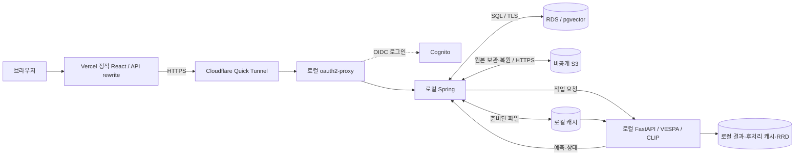

# 배포 선택과 병목 분석: 백엔드·클라우드 면접용 기록

기준: 2026-11-12, `release-version`의 `7ba61ee`와 이 문서에 연결된 계측 변경. 4학년 캡스톤/MVP에서 직접 설명할 수 있는 범위를 대상으로 한다. 과거 실측, 현재 구현, 다음 개선안을 구분한다. 전체 AWS보다 빠르거나 저렴하다는 정량 비교는 아직 없다.

## 1. 결정과 전제

**프론트는 Vercel, Spring·FastAPI·GPU는 보유 PC, 원본은 S3, 업무 데이터는 RDS PostgreSQL/pgvector**에 둔다. EC2·ECS·EKS는 이번 배포에 사용하지 않는다. 팀 시연 중심이고 PC가 켜진 시간에 사용하는 조건이다. 24시간 서비스와 다중 GPU 확장은 현재 목표가 아니다.

정확하게는 현재 AWS 사용이 S3/RDS 두 서비스뿐인 것은 아니다. **기존 팀 로그인은 Cognito를 계속 사용**하고, S3 권한은 IAM/STS 단기 세션으로 받는다. 인증을 없애거나 새로 자체 구현한 상태라고 설명하면 안 된다. React만 Vercel에 배포하며 Vercel이 로컬 GPU를 호스팅하지 않는다. [Vercel GPU 역할 설명](https://vercel.com/i/what-is-serverless-gpu), [외부 API rewrite](https://vercel.com/docs/routing/rewrites).

선택 이유는 이미 보유한 5060 Ti 16GB를 활용해 클라우드 GPU 가동 비용을 피하고, PC의 제한된 디스크와 별개로 원본·DB를 유지하기 위해서다. **그 대가로 네트워크 경계와 운영 지점이 늘어난다.** 이 구조를 확장성·고가용성·단순성을 위한 마이크로서비스 설계라고 포장하지 않는다.

## 2. 전체 AWS가 더 깔끔하지 않은가

운영 장소와 네트워크를 통일한다는 관점에서는 맞다. API와 DB를 같은 리전/VPC에 두고 집 회선·PC 절전·임시 터널을 서비스 경로에서 뺄 수 있다. 다만 전체 AWS가 반드시 ECS와 EKS를 모두 요구하는 것은 아니다. 작은 MVP는 컨테이너를 실행하는 EC2와 S3/RDS, 정적 웹 호스팅으로도 설계할 수 있다. 과거의 복잡한 ECS+EKS 구성을 그대로 비교 기준으로 강제하면 현재 구조의 장점이 과장된다.

|관점|전체 AWS|현재 혼합 구성|전체 로컬|
|---|---|---|---|
|목적에 맞는 상황|PC와 무관한 상시 공개, 팀 사용량 증가|보유 GPU 활용, 제한된 예산, 시연 시간 운영|혼자 개발·알고리즘 실험, 외부 공유 필요 적음|
|가용성|상시 운영에 유리하나 단일 VM만으로 HA가 되지는 않음|PC·인터넷·Docker·GPU·터널 중 하나가 멈추면 API 중단|PC가 멈추면 앱과 DB 접근 중단|
|DB/파일 거리|같은 리전에 배치해 외부 왕복을 줄임|RDS는 인터넷 왕복, S3는 캐시 복원/원본 보관 때 전송|로컬 DB·디스크 접근|
|비용|GPU 가동, CPU/API, DB, 스토리지, 선택한 LB/전송 비용|GPU 서버 청구는 피하지만 전기·회선·운영 시간과 RDS/S3 비용은 남음|로컬 디스크·백업·전기·장비 비용|
|운영|클라우드 계정·권한·배포·비용·복구 관리|Vercel+Cloudflare 터널+AWS+PC를 함께 관리|로컬 환경·백업·외부 접속을 직접 관리|
|저장 지속성|스토리지·백업 정책에 따름|S3/RDS는 PC와 분리, RRD·중간 산출물은 로컬|디스크 장애 때 백업 유무가 중요|
|확장|API/GPU worker를 별도로 늘리기 쉬움|단일 eGPU·메모리·집 업로드 속도에 제한|보유 장비에 제한|

RDS는 필수 선택은 아니다. 소규모 단독 데모라면 로컬 PostgreSQL과 검증된 백업이 더 단순할 수 있다. 여기서는 기존 SQL 스키마·pgvector·트랜잭션을 유지하고 PC 재설치와 독립된 DB를 확보하려고 RDS를 남긴다. **DB가 원격에 남아 있는 것과 PC가 꺼져도 API를 사용할 수 있는 것은 다르다.**

## 3. 실제 요청·데이터 경로



|보관물|현재 위치|유실/복구 설명|
|---|---|---|
|업로드 ZIP/TGZ 원본|S3 + 로컬 압축 파일|S3 원본에서 재준비 가능. S3 객체 삭제/권한도 별도 관리 필요|
|씬·GT·벡터·예측·수정 이력|RDS|DB 백업을 보존하고 복원 절차를 검증해야 함|
|해제한 센서 파일·모델|로컬 Docker 볼륨|반복 GPU 연산은 이 경로를 사용. S3가 있어도 로컬 공간은 필요|
|후처리 NPZ·실행 로그·RRD|로컬 결과 볼륨|현재 모두 S3에 자동 백업되지 않음. DB 백업만으로 이 파일까지 복구되지 않음|

원본 업로드는 `브라우저 → Spring 분할 수신 → 압축 검증 → S3 보관 → DB 등록`이다. 현재 브라우저→S3 직접 업로드는 구현하지 않았다. 같은 PC의 `http://127.0.0.1:8080/uploads`는 첫 구간의 Vercel/터널 왕복만 생략한다. 이후 S3 보관과 RDS 등록은 동일하다.

한 씬을 선택하면 그 씬의 sample만 추론한다. 다만 캐시가 비었으면 **한 씬을 위해 압축 원본 전체를 내려받을 수 있다.** 준비 범위와 추론 범위를 구분해야 한다. 검색은 CLIP 질의 벡터를 생성한 뒤 RDS pgvector에서 거리·씬 집계를 수행한다. 모든 벡터를 PC로 받는 방식은 아니다.

## 4. JWT·세션·쿠키: 지금 구현한 것은 무엇인가

JWT는 토큰 형식, 쿠키는 브라우저의 저장/전송 수단, 세션은 로그인 상태를 유지하는 방식이다. 서로 하나만 고르는 세 가지 대안이 아니다.

1. 로그인은 Cognito의 OIDC와 로컬 oauth2-proxy가 처리한다. 게이트웨이는 `cognito:groups`의 `team` 그룹을 제한한다.
2. 브라우저는 `__Host-ds2l` 쿠키를 사용한다. 설정은 Secure, HttpOnly, SameSite=Lax, 만료 8시간·갱신 간격 30분이다. HttpOnly는 JS의 쿠키 읽기를 막으며 XSS나 CSRF 전체를 없애는 기능은 아니다.
3. Compose는 Redis 세션 저장소를 지정하지 않았다. oauth2-proxy의 기본은 쿠키 저장 방식이므로 이를 **Spring HttpSession 또는 Redis에 세션을 저장했다고 설명하면 안 된다.** 실제 보호 환경파일의 override 여부도 운영 확인 대상이다. [oauth2-proxy 세션 저장 설명](https://oauth2-proxy.github.io/oauth2-proxy/configuration/session_storage/).
4. `PASS_ACCESS_TOKEN=false`, `PASS_BASIC_AUTH=false`이다. Spring 코드에서 JWT 서명 검증 필터를 직접 구현한 구조가 아니다. Spring은 공개 인증 게이트웨이 뒤의 내부 서비스다. loopback 직접 접근은 이 PC를 신뢰하는 운영 경로이며 원격 게이트웨이 인증을 거치지 않는다.
5. Cognito의 토큰과 AWS CLI 로그인/STS 자격 증명은 용도가 다르다. 전자는 팀 사용자 로그인, 후자는 운영자의 AWS API·S3 접근이다. 사용자에게 AWS 키를 주는 구조가 아니다.

근거: [인증 Compose](../compose.hybrid-auth.yml), [Vercel 경로](../frontend/vercel.json), [운영 설정](hybrid-setup.md). OAuth 로그인 CSRF 방어와 업무 API의 CSRF 검증을 같은 것으로 설명하지 않는다. 사용자별 데이터 소유권/RBAC, 업무 요청 CSRF/Origin 정책, 즉시 세션 폐기 요구는 현재 팀 공유 MVP와 별도의 설계·검증 범위다.

면접 답변: “직접 JWT 인증을 구현한 것은 아닙니다. Cognito OIDC를 oauth2-proxy에 연결해 팀 로그인을 보호했고 브라우저 세션 쿠키를 사용했습니다. API 서버는 게이트웨이 뒤에 두었습니다. JWT와 쿠키는 대체 관계가 아니며, 자체 사용자별 권한을 구현했다는 주장과는 구분합니다.”

## 5. JPA·JDBC·쿼리·트랜잭션

|코드 경로|현재 구현|분석할 지점|
|---|---|---|
|일반 catalog repository, 별도 JSON 라벨 문서·버전|Spring Data JPA|조회 projection, 불필요한 payload 로딩, SQL 횟수, 버전 충돌|
|nuScenes 메타데이터 import|NamedParameterJdbcTemplate, 주요 테이블 500행 batch|파싱/검증, advisory lock 대기, 테이블별 batch 호출 시간, commit|
|작업 큐·예측 저장·벡터 검색·새 객체 편집|JdbcClient/명시 SQL|행 잠금, 왕복 수, 실행 계획, transaction 범위|
|씬 검색|DB에서 pgvector 거리와 집계|AI 질의 벡터 시간과 DB 시간 분리, 인덱스/필터 적합성|

JPA도 결국 JDBC/SQL을 사용한다. JDBC로 바꾼다고 네트워크 왕복이 자동으로 줄어드는 것은 아니다. 원인은 ORM 이름 대신 **어떤 SQL이 몇 번 실행되는가**로 확인한다. 현재 `AutoLabelService.complete`의 예측 저장은 박스별 INSERT이고, importer는 이미 batch다. `reWriteBatchedInserts=true`는 JDBC batch에 대한 옵션이지 별도 `update()` 호출을 자동 묶는 옵션이 아니다. [pgJDBC 설정](https://jdbc.postgresql.org/documentation/use/).

`한 트랜잭션 = 쿼리 한 번`도 아니다. GPU 호출을 28분 기다리는 동안 DB transaction을 열어두지 않고 작업 claim, 외부 AI 요청, 결과 저장을 분리한다. 결과 박스와 COMPLETED 전이는 같은 저장 transaction으로 처리하고 실패 시 rollback한다. Idempotency-Key는 HTTP 재시도의 중복 job 생성을 막고, execution token은 오래된 worker 결과가 새 상태를 덮는 것을 방지한다. [AutoLabelService](../src/main/java/com/example/demo/nuscenes/service/AutoLabelService.java), [회귀 테스트](../src/test/java/com/example/demo/AutoLabelTests.java).

예를 들어 직렬 DB 호출 1,000회에 왕복 지연 20ms가 있다면 단순 모델에서 왕복만 약 20초다. **설명용 가정이며 실제 측정값은 아니다.** Hikari pool을 무작정 늘리는 것은 이 왕복을 없애지 않는다. N+1도 실제 SQL 횟수·접근 패턴을 확인하기 전에는 원인으로 단정하지 않는다. [Spring transaction 설명](https://docs.spring.io/spring-data/jpa/reference/jpa/transactions.html).

## 6. 실측 근거와 소프트웨어 개선

2026-11-11 기록이며 새 P1/P2 패치 배포의 성능으로 재사용하지 않는다.

|관찰|실측/범위|판단과 다음 조치|
|---|---|---|
|4.17GB TGZ 서버 처리|해제/검증 47.8초, S3 보관 358.1초, DB import 13.0초|업로드 대기는 S3 보관이 큼. 브라우저 전송은 별도|
|scene-0103만 실행|40키프레임·1,247박스, 약 28분16초|전체 10씬이어서 느린 것이 아님|
|검출·분할|약 21분7초, 전체 약 75%|Grounding DINO 이미지 반복 계산·SAM 구간부터 검증|
|추론 중 표본|170초/18개, AI 네트워크 증가 수십 KB|이 표본에서 원본 S3 전송이 주요 병목인 근거 없음|
|SAM 부분 비교|1이미지·3박스, 동일 마스크, 0.793→0.697초, 최대 할당 8,042→2,796MiB|inference_mode 적용. 전체 씬 속도 개선률은 미측정|

|단점|소프트웨어로 가능한 개선|검증 기준/한계|
|---|---|---|
|같은 PC 파일도 공개 경로 우회|loopback 업로드(구현), 이후 S3 multipart/직접 전송 검토|동일 파일·회선·캐시 조건, 해시·재개·원본 보관 실패 처리|
|RDS 왕복과 많은 INSERT|batch 저장, 필요한 열만 조회, 적절한 캐시|SQL 횟수·elapsed·rollback/idempotency 유지. 미구현 후보와 구분|
|한 번 느리면 재실행|완료 작업 복원·3D 기존 라벨 사용(구현), 중간 캐시 재사용|dataset/model/config 버전 경계 보존|
|GPU 병목|inference_mode(구현), 이미지 특징 재사용·모델 상주 실험|출력 동등성·VRAM·전체 시간. 스레드 증가만으로 해결하지 않음|
|장애 때 중복 작업/결과 유실|상태 전이, idempotency, execution token(구현), 결과 저장 재시도 개선|작업 재생성 없이 복구되는지, DB/파일 일관성|
|임시 터널 주소 변경|시작 명령의 주소 갱신(구현), 고정 도메인 tunnel 검토|로그인 callback·쿠키·공개 API 동작. Quick Tunnel은 개발/시험용|
|PC 전원·회선 장애|health·복구 스크립트·큐·백업|이를 통해 PC 없이 서비스를 운영할 수는 없음. 상시 운영이면 compute 이전|

Cloudflare는 Quick Tunnel을 개발/시험용으로 설명한다. 현재 시연 경로를 상시 운영 SLA로 설명하지 않는다. [공식 설명](https://developers.cloudflare.com/tunnel/concepts/).

## 7. 측정 설계: 어느 시간을 재는가

|경계|로그/키|측정값|
|---|---|---|
|브라우저 업로드 시도|UPLOAD_CLIENT / upload UUID|전송 단계·등록 관찰 대기·총 시간, 재개 바이트, 이번 시도에서 확인한 바이트|
|Spring HTTP 진입→응답|HTTP / 서버 생성 request UUID|HTTP method·route template·status·wall_ms. query/body/cookie 미기록|
|업로드 조각|UPLOAD_TRANSFER / request+upload|입력 읽기, DB 행 잠금 조회, 파일 기록/fsync, DB 갱신, transaction, 최종 상태 조회|
|압축/원본/등록|Dataset upload / upload→dataset|COPYING·EXTRACTING·STORING_ORIGINAL·IMPORTING_METADATA·TOTAL|
|DB import 내부|DB_IMPORT / dataset+table|행 수·batch 호출 수·JDBC 호출 시간·테이블 전체 시간·advisory lock|
|CLIP·검색|CLIP / dataset+image, SEARCH / request|AI와 DB 저장/검색을 분리|
|자동 라벨|VESPA_STAGE / job+run+scene|데이터 준비·AI 호출·결과 검증·저장|
|모델 내부|DS2L_STAGE / run+stage+call|DINO/SAM·CPU 전처리·특징·후처리별 wall/CPU 시간|
|3D|RERUN_STAGE / recording|요청 구성·export·결과 저장|

주의할 해석:

- 브라우저 시간에는 프록시·전송·재시도·polling이 포함된다. Spring 시간과의 차이가 순수 네트워크 시간이라는 뜻은 아니다. 서로 다른 머신의 시계를 빼지 않고 각 경계의 monotonic duration을 사용한다.
- 조각의 transaction_ms에는 lock/file/update/commit이 포함된다. 서로 포함되는 시간을 합쳐 전체 시간으로 만들지 않는다.
- JDBC 호출 시간에는 연결/왕복/DB 실행 대기가 섞인다. 느린 SQL을 특정한 뒤 `EXPLAIN (ANALYZE, BUFFERS)`와 서버 통계를 별도 확인해야 한다. 운영 write SQL에 EXPLAIN ANALYZE를 무심코 실행하지 않는다.
- CPU 시간은 CUDA 커널 시간이 아니다. GPU utilization 표본, CUDA 동기화 기반 부분 시험, 전체 경과 시간을 구분한다.
- browser metrics는 사용자 측 자기 보고이며 데이터 정합성·권한·과금 판단에 쓰지 않는다. 전달 실패가 파일 업로드를 실패시키지 않는다.
- 모델/데이터 캐시의 cold/warm, 네트워크 경로, 패치 버전, 클래스 설정, 데이터 checksum을 결과와 함께 적는다. 1회 성공을 p95/SLA로 일반화하지 않는다.

## 8. 비용·보안·배포의 판단 기준

현재 비용은 `RDS 실행+스토리지/백업 + S3 저장/요청/전송 + Vercel/터널 플랜 + 로컬 전기·장비·운영 시간`으로 본다. 전체 AWS는 여기에 선택한 GPU/CPU 가동과 네트워크 구성 비용을 비교한다. GPU 월 가동시간과 실제 청구가 없으므로 절감액을 임의로 쓰지 않는다. S3→로컬 원본 복원은 인터넷 전송 항목이 생길 수 있고, RDS는 PC 종료와 관계없이 계속 실행될 수 있다. DB 중지 중에도 스토리지/백업 비용은 남는다. [S3 요금](https://aws.amazon.com/s3/pricing/), [RDS PostgreSQL 요금](https://aws.amazon.com/rds/postgresql/pricing/).

S3는 비공개·최소 권한·TLS·저장 암호화를 유지하고, RDS는 현재 PC IP /32 제한과 인증서/호스트 검증 TLS를 사용한다. 원격 DB 주소만 숨기는 것은 접근 통제가 아니다. 사용자 토큰·DB 비밀번호·센서 본문·질의문 전체를 진단 로그에 넣지 않는다. [S3 지침](https://docs.aws.amazon.com/AmazonS3/latest/userguide/security-best-practices.html), [RDS 보안 그룹](https://docs.aws.amazon.com/AmazonRDS/latest/UserGuide/Overview.RDSSecurityGroups.html).

상시 공개, 팀 동시 사용, PC 장애와 무관한 API, 큰 원본 반복 전송이 요구되면 선택을 다시 평가한다. 첫 후보는 API/worker를 클라우드로 옮기는 것이며, 프론트까지 옮기는 것은 별도 선택이다. AWS로 통일하기 위해 불필요한 클러스터를 추가하지 않는다.

## 9. 면접에서 말할 수 있는 범위

“클라우드 GPU 비용과 보유 장비 조건 때문에 연산을 로컬로 옮겼고 원본·DB는 AWS에 유지했습니다. 대신 집 회선과 RDS 왕복이 추가돼서 업로드와 추론을 단계별로 계측했습니다. 실제 업로드에서는 S3 보관이 약 358초, DB 등록은 13초였고, 추론은 28분 중 검출·분할이 21분이었습니다. 그래서 JPA를 무작정 교체하거나 스레드를 늘리지 않고 전송 경로·batch·모델 반복 연산을 따로 분석했습니다. 현재는 시연용이며 PC 장애를 견디는 상시 서비스가 필요하면 연산 배치를 다시 결정하겠습니다.”

직접 공부할 순서: HTTP 요청/응답·타임아웃 → 쿠키/세션/OIDC·JWT 차이 → SQL/인덱스/실행 계획 → transaction/locking/idempotency → JDBC batch/JPA 조회 → S3 전송·캐시 → worker·GPU 단계 → 장애 복구·비용. “분산 트레이싱을 도입했다”보다는 **공통 ID와 경계별 소요 시간을 추가해 원인을 좁혔다**고 설명하는 것이 현재 구현에 정확하다.

## 10. 이번 변경 검증·사용자 재시험

최신 pull 직후 실제 GPU 이미지 빌드에서 PyArrow 23.0.1과 18.1.0의 중복 고정을 발견했다. 기존 NumPy 1 환경에서 실행한 23.0.1 하나로 정리하고 중복 pin 회귀 검사를 추가했다. GitHub의 일반 CI 성공만으로 GPU 이미지 빌드까지 성공했다고 판단할 수 없었던 사례다.

2026-11-12 재부팅 뒤 GPU CUDA 연산과 공개 Vercel 로그인·실데이터 조회를 확인했다. 이후 앱 데이터를 초기화했으며 S3 원본과 DB 백업을 보존했다. [최종 운영 증거](work-checkpoint-2026-11-12.md)에서 새 사용자 시험과 기존 검증을 구분한다.

|검증|실제 결과|범위|
|---|---|---|
|백엔드 핵심 통합|45개 통과|별도 로컬 PostgreSQL에서 업로드·작업·편집·검색·recording 검증|
|HTTP 계측|1개 통과|예외 응답·request ID·MDC 복원·민감 문자열 미기록|
|프론트 단위|100개 통과|계측 포함 기존 컴포넌트/계약|
|브라우저 흐름|4개 통과|fixture API 기반 업로드·편집·다운로드·모듈 복구; 공개 로그인 E2E와 다름|
|AI 계약·패치·계측|33개 통과|새 GPU 이미지에서 고정 checkout 패치 적용까지 검사|
|운영/수집 스크립트|28개 통과|환경 동기화·계측 집계·오류/중복·터널 인증·로그 조회 누락·제공자 혼용 방지 검증|
|빌드|프론트·백엔드·GPU 이미지 성공|PyArrow 중복 pin 제거 후 실제 이미지 빌드|
|CUDA 부분 확인|5060 Ti, NumPy 1.26.4, PyArrow 23.0.1, CUDA tensor 합 16.0|재부팅 후 GPU 접근 복구 확인. 전체 VESPA 씬 재추론과는 구분|

배포 과정에서는 Cloudflare Quick Tunnel 발급이 두 차례 timeout됐고, 실패 로그의 `api.trycloudflare.com`을 공개 터널 주소로 오인하는 파서를 발견해 수정·회귀 검증했다. 이어 호스트 `nvidia-smi` 자체가 `GPU is lost. Reboot the system to recover this GPU`를 반환했다. Docker에 GPU device request는 설정되어 있었다. 이 시점의 실패를 VESPA 미설치나 VRAM 부족으로 확정할 수 없다. 컨테이너 HTTP health=200과 GPU 추론 가능 여부는 다르다.

재기동 후 DB에 작업 #6(scene-0553)이 RUNNING으로 남아 있지만 AI 컨테이너에는 uvicorn만 있고 실행 subprocess는 없었다. 자동 재시작/복구를 검증했다고 주장하지 않는다. 이 상태도 초기화 전 백업에 보존했다. 공개 로그인·씬 조회 확인 후 쓰기를 중지하고 worker를 정지했다. 18,818,252바이트 DB 덤프를 별도 DB에 복원해 33개 테이블 행 수 일치를 확인한 뒤 앱 테이블을 비웠다. S3 10개 객체의 key·size·ETag가 전후 동일하고 계정·코드·캐시 볼륨도 보존했다.

Cloudflare 발급이 HTTP 429로 실패해 Microsoft 비공개 Dev Tunnel로 임시 복구했다. 당시 서버 전용 connect 토큰과 사용자 로그인은 별개였으며, 터널 앞단의 빈 HTTP 401을 앱의 JSON 401로 오인하지 않도록 검증했다. 17시 이후 Cloudflare 재발급·서울 연결·로그인 게이트웨이 401을 확인해 복귀를 준비했고, Microsoft 토큰 요청 헤더를 제거했다. 두 제공자의 설정을 혼용하면 빌드/동기화를 중단한다. 실제 업로드 시간은 전환 전 Microsoft 경로의 관측이다. [Microsoft 보안 모델](https://learn.microsoft.com/en-us/azure/developer/dev-tunnels/security), [Vercel 요청 헤더 설정](https://vercel.com/docs/project-configuration/vercel-ts).

실제 로그 수집 시험에서 Docker 재시작 후 `logs --since`가 최근 이벤트를 빠뜨리고 작은 `--tail`은 반환하는 현상을 발견했다. 새 컨테이너로 재생성하고 양쪽 조회를 대조한다. 불일치 시 `LogCursorMismatch`를 보고서에 남겨 부분 수집을 성공으로 오인하지 않는다. 50행 tail은 누락 검출 보조이며 완전한 로그 복구 방식이 아니다.

새 ZIP 전송은 사용자가 직접 수행한다. 아직 수행하지 않은 새 대용량 업로드와 전체 GPU 추론 시간을 테스트 통과로 기재하지 않는다.

### 사용자 시험과 결과 보관

1. 배포된 `/uploads`에서 원본 하나를 올린다. 비교할 때 파일 크기·SHA256·ZIP/TGZ·공개/loopback 경로와 캐시 상태를 기록한다. 임베딩 완료 전에도 등록된 씬은 탐색할 수 있으며 자연어 검색 준비와 VESPA 추론은 별도 단계다.
2. 씬 목록에서 **scene-0103**을 열고 자동 라벨 생성을 한 번 실행한다. 대상은 그 씬의 40키프레임이다. 10개 씬 전체 실행이나 한 프레임만의 실행으로 해석하지 않는다.
3. 작업 번호와 업로드 시각을 남긴다. 완료 후 예측·3D·새로고침 복원·편집 저장을 확인한다. 결과를 보려고 생성 버튼을 다시 누르면 새 추론을 시작할 수 있다.
4. 수집 보고서에서 원본 보관·DB import·CLIP·AI 요청·VESPA 세부 단계·결과 저장을 비교한다. 실제 느린 경계를 정한 뒤 동일 조건으로 개선 전후를 비교한다.

```powershell
# 저장소 루트에서 실행. begin은 새 관측 구간을 만들며 앱 데이터를 변경하지 않는다.
python scripts/hybrid/measurement.py begin
python scripts/hybrid/measurement.py watch
# 다른 터미널에서 현재까지 보고서를 갱신하려면 watch를 먼저 stop하고 끝난 뒤 collect한다.
python scripts/hybrid/measurement.py stop
python scripts/hybrid/measurement.py collect
```

`watch`는 최대 48시간, 30초 간격으로 로컬 Docker 로그와 실행별 stage-events를 수집한다. PC 종료 뒤에는 다시 실행해야 한다. Docker 로그 회전 전에 수집해야 하므로 완전한 무손실 로그 저장 시스템은 아니다. 같은 디렉터리에 수집기를 둘 이상 실행하지 않는다. 파일은 Git에서 제외한 `.local/hybrid/measurements/<UTC 시작 시각>/`에 둔다:

- `manifest.json`: Git revision·dirty 여부·측정 시작 시각. 캐시/시험 조건은 별도 기록한다.
- `events.jsonl`: 허용한 단계·ID·소요 시간만 남긴 이벤트. 비밀번호·쿠키·검색 문장·센서 본문은 이 수집기에 저장하지 않는다.
- `report.json`, `report.md`: 구간/작업별 횟수·합계·p50·p95·최대값과 수집 오류. 한 씬 안의 함수 호출 분포는 사용자 요청 SLA가 아니다. 단계 합계를 전체 처리 시간으로 더하지 않는다.

실제 예측은 기존 RDS의 job/annotation에, RRD와 VESPA 중간 결과는 기존 로컬 결과 볼륨에 저장된다. 계측 보고서는 그 결과를 대체하지 않는다. 브라우저 계측 전송에 실패하면 `localStorage`의 `ds2l.lastUploadMeasurement` 한 건이 보조 증거다.
