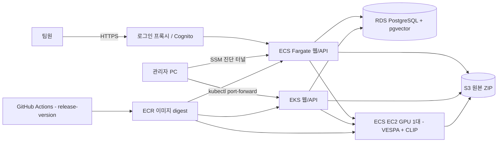

# 전체 AWS 배포 검증 이력 — 2026-11-09

**과거 환경의 기록입니다. 현재 시작 명령이 아닙니다.** 당시 ECS/EKS에 같은 이미지를 배포하는 비교 검증을 진행했으며 이후 실행 자원을 종료했습니다. 현재 MVP는 Vercel + 로컬 Spring/FastAPI/eGPU + S3/RDS이고, EC2·ECS·EKS를 사용하지 않습니다. 전환 이유·대가·다시 클라우드로 옮길 조건은 [현재 README](../README.md#배포를-나눈-이유)를 확인하세요.

## 16. AWS 배포와 구성 이유

프로젝트 계정 `189750306426`의 **서울 `ap-northeast-2`**를 사용합니다. ECS와 EKS에 같은 웹/API 이미지를 배포하고 데이터와 GPU는 공유합니다. 두 배포 경로를 함께 검증하기 위한 구성이며, ECS와 EKS 모두 실행 중에는 각각 실행 비용이 발생합니다.

|구성|사용 목적·선택 이유|전체 stop 이후|
|---|---|---|
|ECS Fargate|웹/API 실행. EC2 호스트를 직접 관리하지 않고 Docker 이미지로 배포. 자동 라벨 worker의 단일 실행 위치|태스크·서비스 제거|
|EKS + CPU EC2 1대|동일 이미지의 Kubernetes 배포 검증, ClusterIP 서비스, Pod Identity. CPU 노드는 SSM 접속 경유지로도 사용|노드와 클러스터 제거|
|ECS EC2 `g6.2xlarge` 1대|VESPA와 CLIP이 NVIDIA GPU를 공유해 GPU 중복 할당 방지. 초기 크기는 L4 24 GiB / 8 vCPU이며 성능은 실측 필요|인스턴스와 캐시 디스크 제거|
|RDS PostgreSQL 16 + pgvector|catalog·작업·원본 라벨·수정 이력·벡터를 같은 DB에서 관리. `db.t4g.small`, 사설·암호화·TLS 인증서 검증|검증된 수동 스냅샷과 복구 정보 보존 후 인스턴스 제거|
|S3|원본 ZIP을 서버 수명과 분리하고 서버별 캐시를 복원. 버전 관리·외부 공개 차단·HTTPS 강제|파일과 이전 버전 유지|
|ECR|검증된 앱/AI Docker 이미지를 immutable tag와 digest로 관리. ECS/EKS가 동일 버전을 참조|이미지 유지|
|Secrets Manager|DB 자격 증명과 내부 운영 토큰 관리. 저장소·workflow 변수에 실제 비밀번호를 넣지 않음|유지|
|GitHub OIDC|장기 AWS access key 없이 이 저장소의 production environment에서 단기 인증|IAM/OIDC 설정 유지|
|CloudFormation|영구 리소스와 실행 리소스를 분리하고 같은 설정으로 재생성|foundation 스택 유지|

**Redis·Kafka·SQS·Elasticsearch는 추가하지 않았습니다.** 현재 작업 상태·선점은 PostgreSQL이 처리하고 벡터 검색은 pgvector가 처리합니다. 작은 단일 GPU worker 구성에서 같은 역할의 운영 서비스를 추가하지 않기 위한 선택입니다. EKS에서는 자동 라벨 worker를 끄고, GPU를 끄면 ECS worker도 비활성화해 대기 작업을 DB에 남깁니다.

앱·DB·GPU의 직접 접속 포트는 인터넷에 공개하지 않습니다. 팀 접속을 위한 `web-start`는 AWS HTTPS 주소와 ALB, Cognito 로그인 프록시를 추가합니다. 관리자가 생성한 `team` 그룹 계정만 이용할 수 있습니다. 실제 주소는 환경 `status`의 `recovery.public_url`에서 확인합니다. SSM 터널 또는 Kubernetes port-forward는 관리자 진단에 사용합니다. NAT Gateway는 생성하지 않습니다. AWS의 recording worker는 공유 `.rrd` 저장 구성이 없으므로 비활성화했습니다. [팀 계정 생성과 외부 접속](aws-ecs-cicd.md#팀-로그인과-외부-https-주소).

### CI/CD 실행

1. 프로젝트 계정의 서울 CloudShell에서 [bootstrap 절차](aws-ecs-cicd.md#최초-준비)로 foundation을 준비합니다.
2. GitHub `production` environment의 배포 허용 브랜치를 `release-version`으로 설정합니다. Repository Variable `AWS_ROLE_ARN`에 bootstrap의 GitHub 역할 ARN, `AWS_DEPLOY_ENABLED=true`를 지정합니다. 단기 인증은 OIDC를 사용합니다.
3. PR 검사는 `release-version` 대상이며, 해당 브랜치 push는 백엔드·프런트엔드·브라우저 흐름·인프라 안전장치 테스트 및 Docker 빌드를 실행합니다.
4. 통과한 이미지를 ECR에 발행합니다. 실행 중인 환경은 쓰기와 작업을 잠시 멈추고 같은 digest를 ECS/EKS에 배포한 뒤 확인합니다. **환경이 꺼져 있으면 이미지만 준비하며 push가 서버를 켜지 않습니다.**
5. GPU 모델 이미지는 `Release images and deploy ECS + EKS` → Run workflow → `component=ai`로 수동 빌드합니다. 이미지 빌드와 실행 환경 변경을 별도 job으로 나눠 긴 모델 빌드가 환경 stop을 막지 않게 했습니다.

수동 운영은 GitHub Actions → **AWS environment** → Run workflow → `release-version`에서 실행합니다.

|action|동작|
|---|---|
|status|실행 리소스·스택·복구 스냅샷·GPU 한도 확인|
|start|DB 생성/복원 → EKS·GPU·ECS 구성 → 앱 준비 확인. GPU 승인 전에는 `gpu=false`로 CPU 환경만 검증|
|stop|쓰기 차단 → 작업 종료 대기 → 스냅샷·S3 복구 기록 검증 → 실행 리소스 제거|
|gpu-start / gpu-stop|공유 GPU와 ECS worker만 켜거나 끄기|
|verify|두 환경에서 브라우저 라벨 업로드·버튼 편집·저장·다운로드와 ZIP 업로드/API 다운로드 검사. stop/start 후 `restore_check=true`로 이전 문서·이력·ZIP SHA-256 일치 확인|

원본 파일·수정 라벨·스냅샷·이미지를 **최소 한 달 보관하고, 한 달 이후에도 자동 삭제하지 않습니다.** 서버를 꺼도 S3·ECR·스냅샷·Secrets Manager·DNS 등의 보관 비용은 남습니다. CloudWatch 진단 로그만 30일 보관합니다. RDS는 단순 정지 시 7일 후 자동 시작되므로 장기 미사용에는 스냅샷 보존 후 인스턴스를 제거합니다. EKS도 제어 영역 요금을 줄이기 위해 클러스터 자체를 제거합니다. 다시 켜려면 재생성·복원·모델 로딩 시간이 필요합니다. [운영 명령·접속 방법·장애 복구](aws-ecs-cicd.md).

### 검증 상태 (2026-11-09)

이번 계정에서는 서울 리전이 계정 수준에서 이미 활성화돼 있었지만 콘솔의 표시 리전에서 숨겨져 있었습니다. 콘솔 표시와 기본 리전을 서울로 맞췄고, 사용자가 조직 정책의 서울 허용을 반영한 뒤 프로젝트 계정 CloudShell/API 접근을 확인했습니다. 조직의 보안 정책을 전체 해제하지 않았습니다.

GitHub 기본 브랜치와 `production` 배포 허용 브랜치를 `release-version`으로 설정하고 OIDC 인증을 실제 실행에서 확인했습니다. 첫 EKS 노드 생성에서 필요한 프로젝트 역할·AWS 서비스 연결 역할 조회 권한을 보완했습니다. AI 이미지는 VESPA의 NumPy 1 환경에 맞는 PyArrow를 별도로 고정해 빌드 import 검사와 ECR 발행을 통과했습니다. GPU 한도 상향은 별도 AWS 승인 절차이므로 이미지 준비 완료와 GPU 실행 완료를 구분합니다.

|검사|결과|
|---|---|
|실제 PostgreSQL 백엔드 테스트|45개 통과|
|프런트엔드 단위 테스트·프로덕션 빌드|61개 및 빌드 통과|
|UI fixture / 실제 Spring 라벨 저장·다운로드|2개 / 1개 통과|
|AI 업로드 계약 / 배포 안전장치|11개 / 15개 통과|
|팀 로그인·GPU DNS 인프라 조건|배포 안전장치 총 19개 통과. cfn-lint 및 cfn-guard의 적용 가능한 저장소·DB·계정 규칙 통과|
|실제 nuScenes 센서 데이터|scene-0061 ZIP 업로드, dataset 3 / scene 3, 39개 프레임·6개 카메라 이미지·GT 박스 표시 확인. 기존 합성 테스트 fixture와 구분|
|Docker 전체 빌드·CloudFormation 템플릿 검사|통과|
|GitHub 원격 CI·OIDC·ECR 발행|[성공 실행](https://github.com/DriveScene2Label-Team/DriveScene2Label/actions/runs/42579817011)|
|AI Docker 빌드·VESPA import·ECR 발행|[성공 실행](https://github.com/DriveScene2Label-Team/DriveScene2Label/actions/runs/42586236337)|
|서울 S3/ECR/배포 권한·암호화 비공개 RDS|생성 확인|
|서울 ECS/EKS 앱 배포·동일 이미지 확인|[start 성공](https://github.com/DriveScene2Label-Team/DriveScene2Label/actions/runs/42595122060)|
|ECS/EKS 실제 UI 저장·다운로드·ZIP 교차 조회|양쪽 브라우저 검사 통과, 원본 라벨·revision·ZIP SHA-256 일치. [검증 실행](https://github.com/DriveScene2Label-Team/DriveScene2Label/actions/runs/42595393497)|
|전체 stop/start 후 DB 스냅샷 복원·무잔여 검사|아직 실환경 검증하지 않음. 종료 안전장치 단위 테스트와 구분|
|서울 GPU 추론·임베딩|G/VT On-Demand 한도 8 vCPU 승인 확인. GPU DNS 등록을 Cloud Map 방식으로 수정했으며 실제 추론 성공은 별도 검증 필요|

이 절은 **이전 전체 AWS 배포의 실행 기록**입니다. 당시 ECS 앱·EKS 클러스터·CPU 노드·RDS·공개 로그인 게이트웨이를 사용했고, 이후 종료 과정에서 ECS/EKS/GPU 실행 자원을 제거했습니다. 현재 MVP는 문서 상단의 Vercel·로컬 연산·S3/RDS 구성을 사용합니다. 이 절의 과거 start workflow는 현재 하이브리드 재개 명령이 아닙니다.

`/health` 성공은 CLIP 로딩을 의미하며 VESPA 전체 추론 성공을 대신하지 않습니다. 기존 로컬 GPU 검증과 이번 AWS 배포 검증은 구분합니다. 새로 확인되는 결과와 제한은 이 표와 [AWS 운영 문서](aws-ecs-cicd.md)에 기록합니다.
