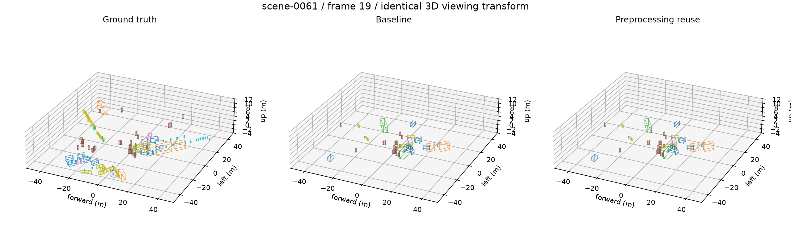

# 최적화 검토용 증거 — 2026-11-18

341개 선택 파일, 약 13.2MB. [manifest.json](manifest.json)은 원본 경로·SHA256과 내보낸 파일의 SHA256·크기를 제공한다. JSON 포맷·절대 저장소 경로·텍스트 LF 줄바꿈을 정규화했으며 로컬 원본은 보존했다.

| 폴더 | 읽을 파일 | 판단 |
|---|---|---|
| [G1](G1/report.md) | report / events / 조건 | 소량 전처리 반복 비교 |
| [G2](G2/report.md) | quality-with-gt / baseline·reuse final-result / 단계 이벤트 | 전체 39프레임·234검출·3D·track·GT 보존 |
| [C1](C1/report.md) | comparison / 6회 계측 / query-evidence | 3쌍 중앙값·벡터·검색 비교 |
| [A1 업로드](A1-upload/report.md) | cycle-summary / client-events | 전체 원본·S3·RDS·CLIP |
| [A1 라벨](A1-label/report.md) | roundtrip-quality / recording-download | 1,308박스 RDS·RRD 왕복 |
| [S1](S1/report.md) | storage-cycle | 세 캐시 조건의 복원 시간·무결성 |
| [T3](T3/report.md) / [T4](T4/report.md) | comparison / scene-quality-with-gt | 소량 통과 → 전체 3D 변화로 후보 기각 |
| [A2/P](A2-P/report.md) | variant-comparison / 각 case events | attention 미지원·정밀도 시간/출력 차이 |
| [R1/R2](R1-R2/20261117T181902Z/report.md) | ONNX/ORT/TRT 결과·user-interruption | parse 성공과 품질/중단을 구분. 이전 3개 폴더는 실패 이력 |
| [최종 테스트](operations/test-summary.json) | tests / operations | local pass/skip·이전 Java 결과·최종 종료 확인 |

S2/Q2의 새 AWS 실험은 실행하지 않아 결과 폴더가 없다. 실제 그래프·가중치·원본 데이터·전체 벡터 덤프·credential을 Git에 넣지 않았다. 자세한 stdout/stderr 및 원본은 로컬 measurement/experiment 폴더와 private 원본 로그 ZIP에 보존한다.

그림은 선택한 프레임 19의 예시이며 전체 프레임 수치 비교를 대신하지 않는다. GT와 예측은 다르지만 기준과 전처리 재사용 결과는 같다. 기존 그림의 우측 z축 글자가 가장자리에서 일부 잘린 한계가 있으며 GPU 중지 요청 이후 재생성하지 않았다.
