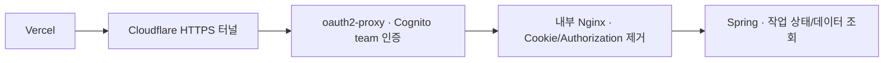
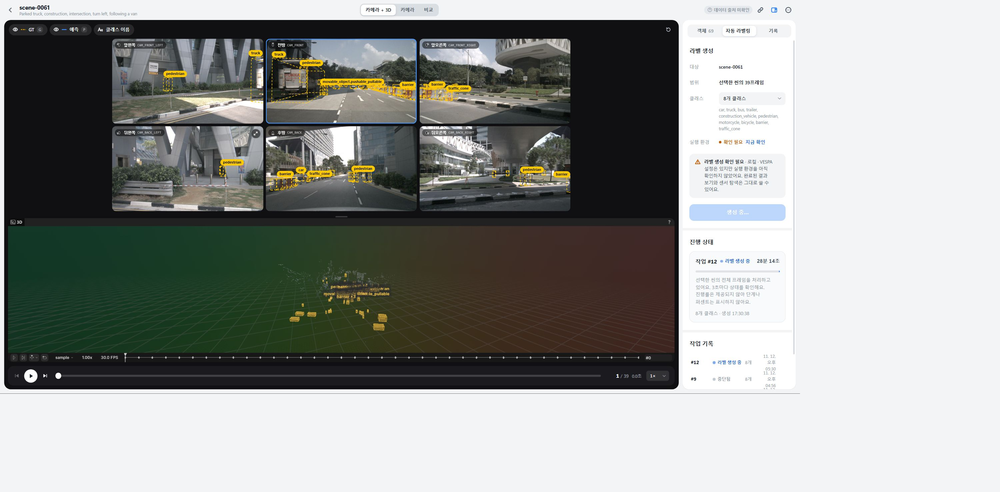

# 로그인 후 HTTP 400 조회 오류

기준: 2026-11-12 17:58 KST. 데이터셋 6 / scene-0061 / 사용자 실행 작업 #12.

## 증상과 원인 분리

Cloudflare로 연결한 Vercel 프론트가 READY였고 익명 API는 정상적으로 401을 반환했지만, 로그인한 브라우저에서 씬 목록과 작업 상태 조회가 HTTP 400으로 실패했다. **배포 READY·익명 401만으로 로그인 후 API까지 정상이라고 판단할 수 없었다.**

1. 로컬 Spring `/api/auto-label/jobs/12`는 `RUNNING`을 반환했다.
2. 공개 API와 터널의 익명 요청은 Cognito 로그인 게이트웨이에서 `401 {}`로 차단됐다.
3. 로그인된 Chrome에서는 데이터 조회가 400으로 실패했다.
4. 같은 시각 Spring/Tomcat 로그에 `java.lang.IllegalArgumentException: Request header is too large`가 기록됐다. Controller·JPA·GPU에 도달하기 전 HTTP 파싱 단계의 실패였다.

인증 후 전달되는 헤더가 Tomcat 허용량을 넘는 것이 직접 원인이다. 실제 사용자의 쿠키나 토큰을 로그에 남기지 않았으므로, 개별 실제 쿠키의 정확한 크기나 각 프록시가 추가한 바이트 비율은 측정값으로 주장하지 않는다. 앱 상태 조회 실패를 작업 실패로 바꾸거나 새 GPU 추론을 시작해서는 안 된다.

## 수정



- `compose.hybrid-auth.yml`에 외부 포트를 열지 않는 `auth-upstream`을 추가했다. 순서는 **인증 → 헤더 정리 → Spring**이다. 비로그인 요청이 Nginx나 Spring으로 우회하는 공개 경로는 만들지 않았다.
- Spring은 Cognito 세션 쿠키·Bearer 토큰을 인증에 사용하지 않으므로 이 두 헤더를 인증 **후** 제거한다. 브라우저의 세션 쿠키와 OAuth callback은 oauth2-proxy가 그대로 처리한다.
- Nginx의 입력 헤더 공간은 `4 × 16k`로 제한한다. `Idempotency-Key`, `Range`, `If-Range`, Content-Type·본문·쿼리 경로는 보존한다. 업로드 요청/응답 버퍼링을 끄고 재시도에 의한 POST 중복 전송도 비활성화한다.
- Docker DNS를 주기적으로 확인하므로 이후 Spring 컨테이너 IP가 바뀌어도 이전 IP를 계속 사용하지 않는다.
- upstream 건강 상태 확인 후 oauth2-proxy만 재생성했다. backend/AI의 컨테이너 ID·시작 시각 및 #12의 `startedAt=2026-11-12T08:30:38.896382Z`를 유지했다.
- `infra/local/auth-upstream.conf`의 구조화 access log는 method/path/status/duration/upstream duration/request ID만 기록한다. 기존 측정 보고서와 별도 Docker 로그이며, 이 변경으로 OpenTelemetry를 도입한 것은 아니다.

Nginx를 추가한 목적은 인증 이후 헤더 크기와 전달 규칙을 통제하는 것이다. 이번 400은 복구했지만 VESPA 이미지 검출·분할 계산을 빠르게 하지는 않는다. 추가 컨테이너의 설정·상태를 운영해야 하는 비용도 있다.

## 확인 결과

|검사|결과|
|---|---|
|Compose 검증 / `nginx -t`|성공|
|격리된 Docker 테스트|합성 12KB Cookie와 Authorization이 upstream에서 제거됨|
|4,500,000바이트 합성 업로드|본문 길이·SHA-256 일치, Idempotency-Key·Content-Type·Range·If-Range·쿼리 보존|
|부분 다운로드|206·Content-Range·ETag·본문 보존|
|운영/계측 검사|30개 통과, 운영 DB·S3·GPU 작업 생성 없음|
|공개 익명 API|401 `{}` 유지|
|로그인한 Windows Chrome|씬 10개, 임베딩 2,424/2,424, 6개 카메라·GT·LiDAR 3D, #12 진행 상태 조회 성공|
|작업 보존|backend·AI 재시작 없음. #12는 당시 계속 RUNNING이며 완료 시간·성능으로 기록하지 않음|



`실행 환경 확인 필요`는 별도의 준비 상태 확인 표시다. 위 화면에서 #12 진행 상태를 정상적으로 읽고 있는 것과 모순되지 않으며 새 추론을 재실행할 이유가 아니다. Mac/Safari 실제 화면 시험은 아직 하지 않았다.

후속 확인: #12는 18:00 완료 상태로 저장됐고 결과 API에서 39개 sample·1,308개 박스를 재조회했다. [이번 실행 단계별 계측](upload-measurement-2026-11-12.md#완료된-단일-씬-작업-12).

## 재현 검사와 운영

```powershell
$env:RUN_GATEWAY_INTEGRATION='1'
python -m unittest discover -s scripts/hybrid/tests -v
docker logs --since 10m drivescene-hybrid-auth-upstream-1
```

통합 테스트는 자체 Docker 네트워크·가짜 Python upstream·loopback 임시 포트를 만들고 종료 시 자기 컨테이너만 제거한다. 같은 검사를 GitHub CI에도 연결했다. 기존 운영 환경에 설정을 적용할 때 전체 Compose를 재생성하지 않는다:

```powershell
$runtimeEnv = Join-Path $env:LOCALAPPDATA 'DriveScene2Label/hybrid/compose.env'
$compose = @('compose', '--env-file', $runtimeEnv, '-f', 'compose.hybrid.yml', '-f', 'compose.gpu.yml', '-f', 'compose.hybrid-auth.yml')
docker @compose config --quiet
# 오류가 있으면 중단. 내부 upstream이 healthy인 것을 확인한 뒤 인증 게이트웨이만 변경.
docker @compose up -d --no-deps --wait auth-upstream
docker @compose up -d --no-deps auth-gateway
```

증거는 `.local/hybrid/verification-20261112/`와 `tests-header-fix.log`에 보관했다. [Nginx 헤더 제거](https://nginx.org/en/docs/http/ngx_http_proxy_module.html#proxy_set_header), [입력 헤더 제한](https://nginx.org/en/docs/http/ngx_http_core_module.html#large_client_header_buffers), [요청 버퍼링](https://nginx.org/en/docs/http/ngx_http_proxy_module.html#proxy_request_buffering)의 공식 동작을 기준으로 설정했다.
