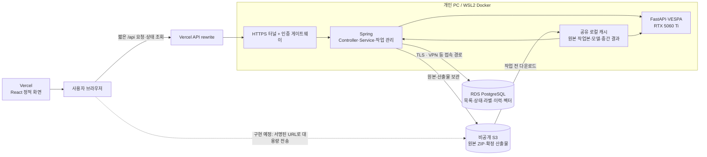

# DriveScene2Label 혼합 배포 계획과 통신 병목 분석

작성일: 2026-11-11 KST

코드 기준: `release-version`, `a0227072e237bbbe3c504f4a552074372960b349`

상태: 설계 기준 문서. 이 계획서 작성 단계에서는 AWS 자원 조회·생성·복원·시작, Vercel 배포, Docker 기동, GPU 추론을 수행하지 않았다. 이후 사용자가 요청한 로컬 환경 설정과 검증 결과는 [혼합 실행 준비](hybrid-setup.md)에 별도로 기록한다.

## 1. 결정과 비교 범위

목표 구성은 **프론트엔드 Vercel, Spring 백엔드와 FastAPI·GPU는 개인 PC, 원본 파일은 S3, 운영 데이터는 RDS PostgreSQL**이다. 기존 React·Spring·FastAPI·PostgreSQL 구조를 유지한다. 클라우드 GPU 비용을 피하면서 원본과 수정 이력을 PC 수명에서 분리하는 것이 목적이다. 추론 속도가 빨라진다고 가정하지 않는다.

주 비교 대상은 아래 두 가지다. 프론트엔드를 동일한 Vercel 주소에서 제공하고 같은 PC·eGPU·코드·데이터를 사용해 저장 위치의 영향을 분리한다. 별도의 localhost 접속 측정으로 공개 접속 경로의 비용도 분리한다.

| 항목 | A 전체 로컬 | B 선택한 혼합 구성 |
|---|---|---|
| 프론트엔드 | Vercel | Vercel |
| 백엔드·AI | 로컬 Docker, RTX 5060 Ti 16GB | 동일 |
| 원본 파일 | 로컬 디스크 | S3 원본 + 필요한 데이터의 로컬 캐시 |
| 운영 DB | 로컬 PostgreSQL + pgvector | RDS PostgreSQL + pgvector |
| 장점 | DB·파일 접근이 빠르고 구성이 단순, 클라우드 저장·DB 운영비 없음 | 원본·수정 이력 중앙 보관, PC 교체와 팀 데이터 공유에 유리, 관리형 DB 백업 활용 |
| 비용·부담 | 디스크 확보, 직접 백업, PC 장애 복구 | S3 저장·요청·전송, RDS 인스턴스·스토리지·백업, DB 접속 경로 비용 |
| 통신 영향 | 외부 사용자의 로컬 API 접속은 필요 | 외부 API 접속에 더해 S3 전송과 RDS 왕복이 발생 |
| 로컬 공간 | 전체 데이터·모델·결과·DB | 모델·컨테이너·작업 데이터·중간 결과는 여전히 필요 |
| PC 종료 | 백엔드와 작업 중단 | 백엔드와 작업 중단. 원본·DB가 남아도 웹 기능이 자동으로 계속되지는 않음 |

전체 AWS 배포는 기술적으로 이미 가능한 경로가 존재한다. 과거 배포에는 ECS와 EKS가 함께 있었고, GPU는 별도 EC2였다. 기존 `g6.2xlarge/L4` 기록은 참고 기준이며 A/B 비교군에 섞지 않는다. GPU·CPU·회선이 달라 저장 위치만의 효과를 비교할 수 없기 때문이다. 24시간 운영과 다중 작업 처리가 필요해지면 백엔드·GPU worker를 클라우드로 이동하는 후속 경로로 남긴다.

## 2. 목표 구조와 데이터 소유권

점선은 새로 구현할 경로다. Vercel이 로컬 GPU를 실행하거나 로컬 DB에 직접 연결하는 구조가 아니다. 브라우저의 업무 API는 Spring을 통하고, S3 파일 전송만 서버가 발급한 제한된 URL로 직접 수행하도록 계약을 확장한다.

| 데이터 | 최종 보관 위치 | 현재 코드와 차이 |
|---|---|---|
| 원본 nuScenes ZIP | S3 | 선택적 업로드·복원 구현 있음 |
| 씬·sample·센서 경로·GT | RDS | 기존 PostgreSQL 스키마 유지 |
| 예측 박스·작업 상태·라벨 문서·수정 이력 | RDS | 기존 transaction·version 충돌 검증 유지 |
| CLIP embedding과 검색 | RDS pgvector | 벡터 거리·정렬은 DB에서 계산, 결과만 Spring에 반환 |
| 확정 결과 JSON·후처리 산출물·공유할 recording | S3 + RDS의 버전·위치·checksum 참조 | **S3 보관 기능 추가 필요**. 현재 S3 연동은 주로 원본 ZIP |
| 실행 중 NPZ·로그·미완료 결과 | 로컬 작업 디렉터리 | 업로드 확인 전 삭제 금지, 보관 범위 결정 |
| 모델 가중치·선택 데이터 작업본 | 로컬 캐시 | 모델과 데이터 캐시를 별도로 관리 |

라벨의 수정 원본은 RDS에 두고 S3 JSON은 특정 revision의 내보내기 결과로 취급한다. DB와 S3에 있는 같은 라벨을 독립적으로 수정하는 이중 원본 구조를 만들지 않는다.

## 3. 현재 코드에서 확인한 실행 경로

### 업로드

현재는 `브라우저 → Spring multipart → 로컬 ZIP 저장 → 압축 해제 → S3 PUT → 메타데이터 DB 등록 → 응답`이다. 브라우저가 S3로 직접 보내는 기능은 없다. 따라서 혼합 구성에서 이 경로를 그대로 공개하면 사용자에서 PC로 전송한 파일을 PC에서 다시 S3로 올리고, 한 HTTP 요청이 검증·DB 등록까지 기다린다.

근거: [DatasetUpload.tsx](../frontend/src/features/labeling/DatasetUpload.tsx) 9~34행, [DatasetUploadService.java](../src/main/java/com/example/demo/nuscenes/service/DatasetUploadService.java) 27~42행, [UploadArchiveStore.java](../src/main/java/com/example/demo/nuscenes/storage/UploadArchiveStore.java) 30~40행.

### 캐시가 없는 첫 화면과 첫 작업

센서 파일 API는 DB에서 경로를 조회한 뒤 로컬 파일을 연다. 업로드 데이터의 디렉터리가 없으면 `DatasetStorage`가 S3 ZIP 전체를 내려받아 압축을 푼다. **카메라 한 장 요청도 전체 ZIP 복원을 유발할 수 있다.** 캐시가 있으면 같은 요청에서 ZIP을 다시 받지는 않는다.

AI도 업로드 디렉터리가 없으면 ZIP을 내려받아 푼다. Python 다운로드는 `use_threads=False`이며 캐시 준비에 lock을 사용한다. Java 복원 메서드도 인스턴스 전체 `synchronized`이므로 여러 데이터셋 복원이 직렬 대기할 가능성이 있다. 이것을 현재 실측 병목으로 단정하지 않고 동시 요청 시험 대상으로 둔다.

근거: [FileController.java](../src/main/java/com/example/demo/nuscenes/api/FileController.java) 22~33행, [DatasetStorage.java](../src/main/java/com/example/demo/nuscenes/storage/DatasetStorage.java) 24~50행, [uploaded_dataset.py](../ai-server/services/uploaded_dataset.py) 25~55행.

### 추론과 결과 저장

`Spring이 RDS에 작업 등록 → worker가 작업 claim → 로컬 FastAPI 호출 → 로컬 파일과 GPU로 VESPA 실행 → Spring이 결과 검증 → RDS에 결과 저장` 흐름이다. GPU 연산마다 S3나 RDS에 접근하는 설계는 아니다. 모델이 캐시에 없으면 별도 가중치 다운로드가 있을 수 있고, 매 작업 subprocess 시작 비용도 존재한다.

브라우저에는 작업 번호를 반환하고 상태를 조회하는 구조가 이미 있다. Spring과 AI 사이의 긴 요청은 로컬 내부 통신으로 남길 수 있다. GPU 실행 동안 하나의 DB transaction을 계속 유지하도록 변경하지 않는다.

예측 결과 저장은 `AutoLabelService.complete()`에서 박스마다 `repo.box()`를 호출하고, 각 호출이 개별 SQL INSERT를 실행한다. 하나의 transaction이라고 해서 DB 왕복이 한 번인 것은 아니다. 반면 **메타데이터 importer의 주요 테이블은 이미 500개 단위 batchUpdate**를 사용한다. 둘을 구분해야 한다.

근거: [AutoLabelService.java](../src/main/java/com/example/demo/nuscenes/service/AutoLabelService.java) 25~70행, [AutoLabelRepository.java](../src/main/java/com/example/demo/nuscenes/repository/AutoLabelRepository.java) 26~60행, [NuscenesImporter.java](../src/main/java/com/example/demo/nuscenes/importer/NuscenesImporter.java) 74~105행, [vespa_service.py](../ai-server/services/vespa_service.py) 122~180행.

### 화면 탐색과 검색

한 프레임에서 sample 상세·GT·카메라별 pose·calibration·이미지를 여러 요청으로 읽는다. 카메라가 6대라면 캐시가 없는 첫 프레임에 관련 요청이 많아지고, 이미지 요청도 서버의 DB 경로 조회를 거친다. 프론트에 캐시·prefetch·병렬 요청은 이미 있으므로 전부 직렬이라고 계산하면 안 된다.

검색은 CLIP 벡터를 만든 뒤 SQL에서 거리·씬별 집계를 수행한다. 전체 embedding을 인터넷으로 PC에 내려받아 검색하는 구조는 아니다. 데이터가 커지면 검색 쿼리 자체의 실행 시간도 별도로 확인한다.

근거: [useFrameBundle.ts](../frontend/src/features/frames/useFrameBundle.ts) 34~46행, [queries.ts](../frontend/src/api/queries.ts) 28~83행, [SceneSearchRepository.java](../src/main/java/com/example/demo/nuscenes/repository/SceneSearchRepository.java) 18~56행.

## 4. 병목 가능성과 크기 추정

### 기존 22분 43초 기록의 해석

사용자가 제공한 11월 9일 실행 기록은 L4에서 `scene-0061`, 39개 키프레임·8class·983개 박스, 전체 약 1,363초다. 이미지 검출·분할 약 1,063초, 지면 제거 약 142초, DINOv2 약 115초로 기록됐다. 이번에 재측정한 값이 아니며, 로컬 5060 Ti의 예상 시간으로 사용할 수 없다.

당시 이미지 검출·분할 비중은 약 78%다. 이 기록만으로 VPC·ECS·EKS·RDS 통신이 22분의 주원인이었다고 볼 수 없다. 다만 **새 혼합 구성은 인터넷 전송·DB 왕복을 추가하므로 새로운 병목이 생길 수 있다.** 과거 GPU 사용률 98%라는 한 시점의 관찰만으로 전체 실행의 효율도 확정하지 않는다.

### S3 전송은 파일 크기와 실효 속도로 계산

`전송 시간 ≈ 파일 바이트 × 8 ÷ 실제 전송 비트/초`

과거 원본 크기 4,337,726,268바이트를 한 번 다운로드하는 예시다. 아래 속도는 가정이며 집 회선을 측정한 값이 아니다. 표에는 압축 해제·TLS·요청 지연·재전송·디스크 기록 비용이 포함되지 않는다.

| 가정한 실효 다운로드 속도 | 순수 전송 시간 |
|---|---:|
| 20Mbps | 약 28분 55초 |
| 50Mbps | 약 11분 34초 |
| 100Mbps | 약 5분 47초 |
| 500Mbps | 약 1분 9초 |

따라서 매 작업마다 전체 ZIP을 다시 받으면, 회선에 따라 준비 시간이 추론만큼 길어질 수 있다. 같은 데이터셋의 10개 씬을 처리할 때 **ZIP 한 번 다운로드 후 캐시 재사용**하는 경우와 **씬마다 다시 다운로드**하는 경우는 구분해서 측정한다. 집 인터넷의 업로드 속도는 다운로드 속도와 다를 수 있어 PC→S3·PC→외부 사용자 전송도 따로 재야 한다.

### RDS는 작은 데이터라도 왕복 횟수가 중요

박스 983개를 동기 INSERT 983회로 저장하고, 각 실행이 대략 한 번의 네트워크 왕복을 필요로 한다고 단순화하면 추가 지연의 규모는 다음과 같다. SQL 실행·commit·결과 크기 비용을 제외한 설명용 모델이다.

| 가정한 DB 왕복 지연 | 983회 직렬 실행의 왕복 시간 |
|---|---:|
| 10ms | 약 9.8초 |
| 30ms | 약 29.5초 |
| 50ms | 약 49.2초 |

실제 프로토콜·드라이버·서버 처리에 따라 값이 달라진다. `batchUpdate`와 지원되는 INSERT 재작성 옵션을 비교하고, 실제 statement 수·batch 수·elapsed time을 기록한다. `reWriteBatchedInserts=true`만 추가해 현재 개별 `update()` 호출이 자동으로 묶인다고 가정하지 않는다. [pgJDBC 연결 옵션](https://jdbc.postgresql.org/documentation/use/)

### 우선순위

| 우선순위 | 후보 병목 | 영향 | 대응과 검증 |
|---|---|---|---|
| P0 | 전체 ZIP을 공개 API로 전송 | 프록시 용량·대기 제한, PC에서 S3로 재전송 | S3 직접 분할 업로드, 비동기 검증·등록 |
| P0 | 첫 이미지 요청 안에서 ZIP 전체 복원 | 첫 화면이 수분 대기·timeout | 사전 데이터 준비 작업과 준비 상태 API |
| P0 | RDS 박스별 INSERT | GPU 종료 뒤 저장 지연 | 배치 저장, transaction·실행 token·중복 방지 보존 |
| P1 | 여러 프레임 API와 파일별 DB 조회 | RTT 누적, 동시 요청 시 pool 대기 | immutable metadata 캐시, 프레임 묶음 조회, 제한된 prefetch |
| P1 | 이미지·RRD를 PC가 외부로 전송 | 집 업로드 회선과 터널 병목 | 미디어·확정 recording을 S3 객체로 저장하고 서명 URL 제공 |
| P1 | idle worker가 기본 1초마다 DB polling | 쓸모없는 쿼리·재연결 부하 | 빈 큐/장애 시 backoff, 접수 지연과 비교 |
| P1 | GPU 완료 후 RDS 연결 단절 | 결과 유실 또는 불필요한 재추론 | 로컬 완료 manifest 보존과 저장만 재시도하는 경로 |
| 별도 | 이미지 backbone 반복·모델 준비 | 추론 자체가 오래 걸림 | 동일 입력 특징 재사용과 모델 준비 계측. 배포 구조 변경과 분리 |

## 5. 구현 설계

### 5.1 로컬 실행 구성

- 기존 `compose.yml`은 전체 로컬 비교군으로 유지하고, 혼합 전용 구성은 별도 파일로 작성한다.
- 현재 Compose는 `DB_URL`을 `db:5432`로 고정하고 `depends_on: db`를 갖는다. 혼합 구성에서는 외부 RDS 주소·사용자·비밀번호를 주입하고 로컬 DB 의존성을 제거해야 한다. 단순히 `.env`에 DB_URL을 추가하는 것만으로는 부족하다.
- GPU override, AI 주소, timeout, 모델 캐시를 유지한다. 서울을 사용할 때 지역 기본값 `us-east-1`을 그대로 두지 않고 `ap-northeast-2`를 명시한다.
- backend가 다운로드·압축 해제를 담당하는 **하나의 캐시 작성자**가 되고 AI는 준비된 캐시를 읽는다. 현재 AI `/uploads`는 읽기 전용이므로, 캐시가 없는데 AI가 직접 복원하도록 방치하지 않는다.
- 캐시는 backend·AI가 동일 경로·동일 버전을 보도록 공유한다. 컨테이너 데이터와 대용량 작업 캐시는 가능한 한 WSL Linux 파일시스템 또는 별도 SSD에 둔다. OneDrive 소스 폴더에 데이터·모델 캐시를 함께 쌓지 않는다.
- 캐시 삭제와 모델·데이터 다운로드는 실제 용량을 확인한 뒤 구현 단계에서 수행한다. 현재 단계에서 실행하지 않는다.

### 5.2 S3 업로드와 데이터 준비

목표 경로는 `업로드 세션 생성 → 브라우저가 S3에 part 전송 → 완료 요청 → 서버 무결성 확인 → 데이터 준비·검증 작업 → RDS 등록 → READY`다. 객체 업로드 완료와 데이터셋 사용 가능 상태를 구분한다.

직접 업로드가 전체 전송 시간을 자동으로 줄이는 것은 아니다. 현재 검증·압축 해제·추론은 로컬에서 수행하므로, 로컬 캐시가 없으면 S3 업로드 이후 PC로 내려받는 단계도 필요하다. 특히 같은 PC에서 파일을 올렸다면 원래 갖고 있던 파일을 다시 받는 셈이므로, 검증된 원본 checksum으로 기존 로컬 파일을 캐시에 연결하는 경로를 함께 검토한다. 직접 업로드의 우선 목적은 대용량 파일이 API 프록시를 통과하지 않게 하고 중단 후 재시도를 지원하는 것이다.

- 브라우저에 AWS 장기 키를 주지 않는다. 서버가 허용된 key·upload ID·part에 대해서만 짧은 수명의 서명 URL을 발급한다.
- 허용 origin CORS, 서버 측 크기·checksum 검증, 저장 암호화, HTTPS, 최소 권한을 적용한다. multipart ETag를 전체 파일 SHA-256으로 간주하지 않는다.
- 실패한 part만 재전송하고, 완료되지 않은 multipart upload 정리 정책을 둔다. S3 업로드와 RDS 등록은 하나의 DB transaction이 아니므로 상태를 기록하고 고아 객체를 정리한다. [S3 multipart 동작](https://docs.aws.amazon.com/AmazonS3/latest/userguide/mpuoverview.html), [서명 URL](https://docs.aws.amazon.com/AmazonS3/latest/userguide/using-presigned-url.html)
- 1차는 검증된 데이터셋 단위 캐시 재사용으로 시작한다. 디스크가 이를 수용하지 못하면 씬 단위 패키징이 배포 전 필수 작업으로 바뀐다.
- 2차는 원본 ZIP을 보존하면서 씬별 파일 목록·패키지 또는 개별 센서 객체를 만든다. sample/sweep·pose·calibration·메타데이터 참조를 함께 유지한다. 파일 몇 개만 임의로 잘라 기존 importer에 넣는 방식은 사용하지 않는다.
- 현재 importer checksum은 메타데이터 중심이므로 원본 전체 무결성과 동일시하지 않는다. 실제 archive checksum·object version·데이터 형식 버전을 캐시 manifest에 기록한다.
- 캐시 총량 제한, 사용 중 데이터 고정, 마지막 사용 기준 정리, 완료된 다운로드의 원자적 게시를 설계한다. 원격 보관이 검증되지 않은 결과는 정리 대상에서 제외한다.

저장 공간은 `모델 + 컨테이너/빌드 캐시 + 활성 ZIP + 압축 해제 데이터 + 중간 결과 + 여유 공간`으로 산정한다. 과거 4.34GB ZIP과 압축 해제 상한 8GiB만 합해도 약 12.04GiB가 될 수 있으며, 이는 실제 필요 공간을 모두 포함한 수치가 아니다. multipart 임시 파일과 모델 등이 더해질 수 있다.

### 5.3 RDS 연결과 저장

기존 인프라 코드는 `PubliclyAccessible=False`와 사설 subnet을 사용하고, DB 보안 그룹은 앱·노드 보안 그룹에서 오는 연결만 허용한다. 따라서 **예전 DB를 복원하고 주소만 로컬에 넣어도 바로 연결되는 상태는 아니다.**

기본 설계는 사설 RDS를 유지하고 VPN 경로를 마련하는 것이다. AWS Client VPN 등 별도 접속 자원은 비용·운영 부담이 있으므로 S3/RDS 외에 추가 비용으로 비교한다. 추가 EC2를 두지 않으려면 기존 EKS 노드를 이용하던 SSM 터널을 그대로 재사용할 수 없다.

개발·시연 예산상 VPN이 맞지 않으면, 공개 접근 RDS에 신뢰한 출발지 IP `/32`만 허용하고 TLS 인증서·호스트를 검증하는 대안도 비교한다. 이 경우 공인 IP 변경 대응과 공개 subnet/route 구성이 필요하며, `0.0.0.0/0`로 DB를 열지 않는다. 공개 접근 변경은 지금 실행하지 않고, 실제 구축 전에 접속 방식과 비용을 결정한다. [RDS 공개·사설 연결](https://docs.aws.amazon.com/AmazonRDS/latest/gettingstartedguide/security-public-private.html)

- 보존 스냅샷으로 새 RDS 인스턴스를 복원하는 작업이 필요하다. 복원 후 기존 라벨·dataset·Flyway 버전·pgvector를 확인한다. 스냅샷은 실행 중 DB가 아니다. [복원 동작](https://docs.aws.amazon.com/AmazonRDS/latest/UserGuide/USER_RestoreFromSnapshot.html)
- 런타임 최소 권한 DB 사용자, CA 인증서와 `sslmode=verify-full`, 연결 pool·연결 timeout을 설정한다. 과거 AWS 배포의 TLS 검증 수준을 유지한다. [RDS TLS](https://docs.aws.amazon.com/AmazonRDS/latest/UserGuide/PostgreSQL.Concepts.General.Security.html)
- 박스·작업 대상 저장을 배치화한다. 메타데이터 importer의 기존 batch와 pgJDBC 설정은 별도로 검증한다. 관계·완료 상태의 원자성, optimistic version 충돌, execution token 검증을 유지한다.
- 이미지 경로·calibration 등 변경되지 않는 metadata를 dataset version으로 캐시한다. 수정 라벨·작업 상태를 영구 캐시하지 않는다.
- GPU가 결과를 만들었는데 DB 저장만 실패하면, 로컬 결과와 manifest를 보존한 뒤 저장 단계만 다시 수행하도록 추가한다. 재시도 성공 시 중복 박스가 없고, 완료된 job을 덮어쓰지 않도록 설계한다.
- 현재 전체 구성 시작 스크립트를 호출하면 EKS/ECS/GPU도 생성할 수 있다. 향후 복원은 혼합 구성 전용 절차로 분리하고 기존 전체 `start`를 그대로 실행하지 않는다.

### 5.4 Vercel과 외부 접속

- `frontend/`를 Vite 프로젝트로 배포하고 SPA 경로 새로고침, Rerun WASM, 실제 `/api` 호출을 검증한다. 기존 상대 `/api` 계약을 유지하도록 external rewrite를 사용한다. [Vercel rewrites](https://vercel.com/docs/routing/rewrites)
- rewrite 대상은 로컬 `localhost`가 아니라 HTTPS 터널의 주소다. 로컬 인증 게이트웨이가 인증 후 Spring에 전달한다. 기존 AWS OAuth2 프록시/Cognito 경로는 로컬로 자동 이전되지 않는다.
- 업무 API와 터널 직접 주소 모두 인증을 거치게 한다. DB·FastAPI를 브라우저에 노출하지 않고, DB 비밀번호·AWS 키·고정 서비스 비밀을 프론트에 넣지 않는다. 사용자별 데이터에 공개 CDN 캐시를 적용하지 않는다.
- 기존 API에는 일반 사용자용 Spring Security 구성이 확인되지 않으므로, 터널을 연결하는 것만으로 이전 로그인 보호가 유지된다고 가정하지 않는다.
- 4.34GB ZIP은 Vercel·터널의 API 프록시를 통과시키지 않는 것을 목표로 한다. 프록시별 요청 크기·대기 제한은 배포 계획에서 확인하고, GPU 장기 실행은 기존 작업 접수·polling 방식을 유지한다. Vercel Functions의 제한을 external rewrite 제한과 혼동하지 않는다.
- 큰 recording·센서 파일을 S3에서 직접 전달하려면 현재 ZIP 안에만 있는 파일을 개별 객체로 만들고 경로를 매핑해야 한다. S3 URL만 바꾸는 설정으로 끝나지 않는다. Range, CORS, content type, checksum과 Viewer 동작을 함께 확인한다.

### 5.5 이번 후처리 기능의 위치

새 tracklet 후처리는 별도 실행 파일에 추가됐고 기본 웹 runner에 연결되지 않았다. 혼합 배포와 후처리 통합은 별도 변경으로 관리한다. 먼저 기존 파이프라인으로 A/B 측정하고, 그 뒤 후처리 버전·기준 프레임·track 정보·산출물 형식을 연결한다. 이를 네트워크 개선이나 추론 속도 개선으로 보고하지 않는다.

## 6. 비교 실험 계획

### 통제 조건

코드 commit, Docker 이미지·모델 버전, dataset checksum, scene-0061, classMode, eGPU 연결 방식, CPU/RAM, 전원 상태를 고정한다. 이전 L4와 이번 5060 Ti 시간을 섞어 저장소 성능으로 해석하지 않는다. 모델 캐시 유무와 데이터 캐시 유무를 서로 다른 조건으로 기록한다.

| 실험 | DB | 파일 보관·캐시 | 확인 목적 |
|---|---|---|---|
| A0 | 로컬 | 로컬, 준비 완료 | 저장 통신이 없는 기준 |
| B1 | 로컬 | S3, 데이터 캐시 없음 | 다운로드·압축 해제 비용 분리 |
| B2 | 로컬 | S3, 데이터 캐시 있음 | 캐시 재사용 시 S3 전송 제거 확인 |
| B3 | RDS | 로컬, 준비 완료 | DB RTT·SQL·pool 대기 영향 분리 |
| B4 | RDS | S3, 캐시 없음 | 혼합 구성 첫 사용 |
| B5 | RDS | S3, 캐시 있음 | 혼합 구성 반복 사용 |

A0도 공개 Vercel 경로와 localhost 경로를 나눠 측정한다. B1~B5의 실제 AWS 측정은 사용자에게서 AWS 재개 지시를 받은 이후다. 그 전에는 가짜 S3·로컬 PostgreSQL·제어된 지연 주입으로 계약과 실패 처리를 검증할 수 있지만 AWS 실측으로 표기하지 않는다.

### 측정 항목

- 요청마다 request ID, job ID, dataset/version, cache hit 여부를 남긴다. 키·서명 URL·사용자 데이터 본문은 로그에 남기지 않는다.
- 업로드: 브라우저→S3 바이트·시간, 완료 검증 시간, 압축 해제 시간, metadata 검증·DB import 시간.
- 준비: S3 GET 횟수·바이트·시간, 디스크 기록·압축 해제, 모델 다운로드·로딩, 캐시 사용량.
- 추론: 지면 제거, 검출·분할, DINOv2, 후처리, 전체 worker 시간. CUDA 비동기 실행을 고려한 타이밍 또는 profiler를 사용한다.
- DB: 연결 획득 대기, 실제 쿼리 시간, statement/batch 수, commit 시간, 결과 바이트. `SELECT 1` 시간과 서버 실행 시간을 구분한다.
- 화면: 첫 프레임 완성 시간, 프레임 전환 지연, 카메라 다운로드 바이트·요청 수, RRD 최초 표시 시간, 동시 사용자 1명·소수 팀원 조건.
- 안정성: PC 절전·터널 단절·DB 단절·S3 재시도·디스크 부족 후 기존 결과 재사용, 중복 작업·중복 저장 여부.

모델 캐시를 준비한 동일 조건의 전체 실행은 최소 3회로 시작해 중앙값과 범위를 남긴다. 짧은 API는 충분한 반복 표본을 모아 p50/p95를 보고한다. 3개 표본만으로 p95를 대표값처럼 제시하지 않는다. 비싼 추론을 반복하기 전에 고정된 결과를 재생해 DB 저장·화면 성능을 독립 측정한다.

### 초기 합격 기준 제안

아래는 실측 결과가 아닌 구현·수용 기준 초안이다. 실제 회선과 데이터 크기를 확인해 확정한다.

- 준비된 동일 데이터셋을 반복 실행할 때 원본 ZIP의 추가 다운로드 바이트가 0이다.
- 기존 완료 결과를 다시 열 때 새 GPU job이 생성되지 않는다.
- 동일 입력의 박스·좌표·라벨 버전이 저장 위치에 따라 달라지지 않는다.
- RDS 저장 중 연결이 끊겨도 불완전한 결과를 COMPLETED로 노출하지 않고, 저장 재시도로 복구한다.
- 데이터·모델 캐시가 준비된 B5에서 GPU 단계 시간은 A0의 반복 변동 범위와 비교한다. 차이가 크면 CPU·디스크·eGPU 자원 경합을 조사한다.
- 고정 결과 983개 저장은 초기 목표 5초 이내, 작은 metadata API는 목표 p95 1초 이내로 두되 측정 후 현실성을 재평가한다. 달성 전 면접 성과로 사용하지 않는다.
- 캐시가 없는 대용량 준비는 상태·오류·재시도가 보여야 하며 단일 이미지 요청을 수분 동안 대기시키지 않는다.

## 7. 작업 순서와 완료 조건

| 단계 | 작업 | 완료 조건 | AWS 실행 |
|---|---|---|---|
| 0 분석 | 현재 경로·변경 파일·병목 후보·계측 항목 정리 | 본 문서, 코드 근거 확인 | 없음, 이번 수행 범위 |
| 1 로컬 기준과 계측 | 전체 로컬 구성·단계별 로그·고정 결과 재생·별도 cache manifest 설계 구현 | A0 측정과 쿼리/전송 수 확인 | 없음, 후속 구현 |
| 2 DB·캐시 개선 | 박스 batch 저장, 준비 상태, 캐시 소유권·용량 제한, 저장 재시도 | 로컬/fake 계약·장애 시험 통과 | 없음 |
| 3 외부 업로드 준비 | 직접 multipart 업로드·완료 검증·비동기 등록, S3 산출물 보관, 인증·Vercel 설정 | fake S3·프론트·API 계약 검증, 실제 한계 체크리스트 | 실제 배포 전까지 없음 |
| 4 AWS 최소 구성 | 기존 보존 자원 확인, RDS 복원과 접속 경로, S3 권한·정책, 인증 연동 | 기존 데이터 확인·백업/복원 검증·TLS 접속 | **AWS 재개 지시 이후** |
| 5 혼합 실측 | B1~B5, 공개 브라우저 업로드·검수·저장·재열기 | 표에 실측값·실패율·비용 기록 | 재개 이후 |
| 6 후처리 통합 | 새 tracklet 모듈을 별도 버전으로 API·결과 저장에 연결 | 원본/보정본 비교, GT 정량 평가 | 필요 환경에 한해 |

기획 단계에서는 애플리케이션 코드나 배포 설정을 변경하지 않았다. 후속 환경 설정의 진행 상태는 [혼합 실행 준비](hybrid-setup.md)에 기록한다. 기존 배포 workflow는 release-version push를 감지하므로, 후속 작업의 push 전에 AWS 배포 gate와 Vercel 배포 범위를 확인한다. 기획 문서를 쓰는 것만으로 원격 push나 배포를 수행하지 않는다.

주요 변경 예정 파일은 `compose.hybrid.yml`(신규), `frontend/vercel.json`(신규), S3 업로드 세션 API·프론트 upload 모듈, `DatasetStorage`·`UploadedDatasetCache`, `AutoLabelService/Repository`, 완료 결과 재사용 API/화면, 캐시·작업 계측 모듈이다. 명칭은 구현 전 확정하며 기존 전체 로컬 실행을 유지한다.

## 8. 면접에서 설명할 선택 이유

> 이미 보유한 GPU를 활용해 반복적인 모델 실험의 클라우드 연산비를 줄이고, 원본 데이터와 라벨 수정 이력은 S3·RDS에 중앙 보관하는 구성을 선택했습니다. 프론트는 Vercel에 배포하고 백엔드·추론은 로컬에 두도록 설계했습니다. 이 구조에서는 인터넷 지연이 생길 수 있어, 대용량 파일은 미리 캐시하고 DB 쓰기는 배치 처리하며, 캐시 유무와 DB 위치를 나눠 전체 로컬 구성과 비교할 계획입니다. PC 가동 시간에 의존하므로 현재 목표는 팀 개발·시연이고, 상시 운영이 필요하면 백엔드와 worker를 클라우드로 옮길 수 있도록 구성 요소 간 API를 유지할 계획입니다.

구현·측정 전에는 위처럼 **선택·설계·계획**으로 설명한다. 완료 후에는 실제 계측 결과와 검증 범위를 넣어 과거형으로 바꾼다.

| 질문 | 설명할 근거와 한계 |
|---|---|
| 왜 전부 로컬로 하지 않았나? | 원본·라벨 이력을 PC 장애·교체에서 분리하고 팀이 같은 데이터 버전을 쓰게 하려는 선택. 네트워크·RDS 비용은 추가됨 |
| 왜 전부 AWS로 하지 않았나? | 보유 GPU 활용과 개발 비용 제약. 전체 AWS가 기술적으로 불가능해서가 아님 |
| 왜 S3와 RDS를 나눴나? | 대용량 파일은 객체 저장, 관계·작업 상태·동시 수정·검색은 PostgreSQL transaction과 pgvector로 처리 |
| 왜 Vercel인가? | 프론트 배포·정적 파일 전달을 GPU 서버 운영과 분리. 로컬 API나 GPU의 가용성을 보장하지는 않음 |
| 통신 때문에 더 느리지 않나? | 캐시가 없으면 그럴 수 있음. 원본 byte 전송과 DB 왕복 횟수를 각각 줄이고 조건별 실측으로 판단 |
| RDS를 쓰면 모델 계산이 빨라지나? | 아니며, RDS 선택 이유는 데이터 관리·일관성·백업. 실제 GPU 속도 문제는 별도 |
| 서버를 꺼도 서비스되나? | 화면 파일은 제공될 수 있으나 로컬 API·GPU 기능은 중단. 상시 운영 서비스라고 주장하지 않음 |
| 이번 후처리로 빨라졌나? | 박스 품질 보정 기능 추가이며 속도 개선을 입증하지 않았음 |

## 9. 구축 전에 확인할 입력과 비용

결정에 필요한 값은 로컬 캐시에 할당할 실제 공간, 외장 SSD 사용 가능 여부, 집 회선 업·다운로드 실효 속도, PC 연속 가동 가능 시간, 동시 사용자 수, 월 비용 한도다. 이 값 없이 특정 GPU 처리 시간이나 월 요금을 확정하지 않는다.

비용 비교에는 S3 저장·GET/PUT·multipart·인터넷 전송, RDS 인스턴스·스토리지·백업, VPN 또는 접속 자원, Vercel 전송/요금제, 도메인·터널, 로컬 전력·SSD를 포함한다. 기존 보존 스냅샷·ECR 등 유지 자원도 별도로 합산한다. S3 원본을 반복 다운로드하면 시간과 전송 비용이 함께 늘어난다. [S3 요금](https://aws.amazon.com/s3/pricing/)

현재는 AWS가 종료된 과거 기록을 전제로 계획했으며 계정의 현 상태를 다시 조회하지 않았다. 클라우드 실측 결과, 로컬 GPU 속도, 캐시 여유 공간, 월 비용은 미측정이다. 검증된 개선 효과가 생기면 코드 버전·데이터·측정 조건과 함께 이 문서의 비교표를 갱신한다.
