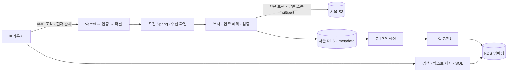

# 최적화 의사결정: 문제·해결·장단점·비용

기준: **2026-11-18 KST**, 로컬 RTX 5060 Ti GPU·Spring + 서울 RDS/S3 + Vercel. 이 문서는 채택 여부와 근거를 한곳에서 읽기 위한 문서다. 상세 원본은 [모델·CLIP](optimization-results-2026-11-18.md), [쿼리·서빙](optimization-resume-2026-11-18.md), [Java S3](s3-java-optimization-2026-11-18.md), [코드 위치](optimization-code-map-2026-11-18.md)에 있다.

**Pros = 장점, Cons = 단점. Trade-off = 한쪽의 이득을 위해 감수하는 비용·제약**이다. 사용 기술 이름보다 무엇이 반복됐고 어떤 비용을 줄였는지 먼저 설명한다. 빠른 응답, 정확도 유지, 인프라 청구액 감소는 각각 별도로 검증한다.

## 요청이 지나가는 경로부터 나누기

브라우저→로컬 전송과 로컬→S3 전송은 다른 구간이다. S3 multipart를 켜도 브라우저 수신이나 TGZ 해제까지 병렬이 되지는 않는다. 업로드·임베딩은 worker로 처리하지만, 비동기는 HTTP 응답 대기를 분리하는 방식이다. GPU 연산량이 자동으로 줄거나 모든 작업이 동시에 실행된다는 뜻은 아니다.

11월 18일 저녁 사용자 업로드는 초기화 후 새 브라우저 시험이다. 인증 프록시→backend 요청 ID 1,043개가 일치했다. 정확한 브라우저 주소·화면은 별도로 수집하지 않았으며 앞선 API/격리 실험과 구분한다. 초반 228개 조각의 서버 처리 중앙값은 **125.5ms**, 수신 82ms, DB 잠금 조회 7ms·갱신 7ms, 파일 쓰기 11ms였다. 이는 초반 표본이며 전체 업로드 결과가 아니다. DB 잠금 조회 타이머에는 네트워크·쿼리 시간이 포함되므로 순수 lock wait로 해석하지 않는다. inclusive 타이머를 서로 더하지 않는다.

### 같은 사용자 업로드의 완료 관측

4,168,148,189바이트 업로드가 dataset 22·10씬으로 완료됐고, 19:28:46 KST API에서 CLIP **2,424/2,424 완료**를 확인했다. 브라우저 보고 전송 411.392초·서버 처리 대기 385.006초·합계 796.398초다. 서버 자체 구간은 복사 31.486초, 해제 110.297초, S3 단일 PUT 228.923초, metadata import 13.605초, 전체 384.323초다. 브라우저 보고와 서버 타이머는 경계가 달라 합치지 않는다.

**이 업로드는 single PUT 기준선이다.** 완료 후 유휴 상태에서 19:29 KST backend만 재생성해 multipart를 opt-in으로 켰다. 다음 1GiB 초과 파일에 16MiB·최대 동시 4파트가 적용된다. AI 시작 시각은 유지했고 앱 데이터도 다시 초기화하지 않았다. 브라우저 조각은 여전히 순차다.

**계측 누락도 보존한다.** 인덱싱 완료 상태를 API로 확인한 뒤 backend를 교체하면서 30초 수집 주기 사이의 마지막 CLIP_INDEX 완료 타이머가 누락됐다. 전체 인덱싱 시간을 추정하지 않는다. 별도 `pre-activation-backend-events.jsonl`은 이름과 달리 재생성 후 수집돼 이전 tail을 복구하지 못했다. 앞으로 컨테이너 교체 직전 `snapshot_stage_logs.py`로 독립 스냅샷을 먼저 남긴다. [기준선·운영 전환·가격 계산 증거](evidence/optimization-decisions-2026-11-18/README.md).

## VESPA 안의 모델과 우리가 바꾼 부분

실행 컨테이너 `/opt/vespa/configs/vlm/p_final.yaml`과 upstream 처리 코드를 읽어 모델명을 확인했다. **Grounding DINO와 DINOv2는 서로 다른 역할**이고, 이 배포에는 DINOv3·SAM2를 넣지 않았다. VESPA는 여러 모델과 기하 처리를 묶은 3D 라벨링 파이프라인이다.

| 단계 | 실제 모델/코드 | 하는 일 | 이번 최적화 범위 |
|---|---|---|---|
| 객체 찾기 | `IDEA-Research/grounding-dino-base` | 카메라 이미지에서 클래스 문장에 맞는 2D 박스 검출 | 클래스별로 반복하던 이미지 resize/normalize만 재사용. backbone 특징이나 결과 박스를 캐시한 것이 아니며 forward 횟수 유지 |
| 영역 자르기 | `facebook/sam-vit-base` | 검출 박스를 받아 픽셀 단위 객체 마스크 생성 | runner에서 `torch.inference_mode()` 적용, 모델 singleton 유지. CPU 스레드 후보는 별도 시험. inference mode의 독립 개선율은 주장하지 않음 |
| LiDAR/기하 처리 | ground removal·reprojection·cluster denoising | 지면 제거 후 2D 마스크와 LiDAR 점을 연결하고 객체 점군 정리 | 구간별 계측. 이번 G2에서 알고리즘 교체 없음 |
| 외형 특징 | `dinov2_vitb14_reg` | 마스크 기반 객체 외형 임베딩을 생성해 여러 카메라·프레임의 객체 대응에 사용 | 계측만. DINOv3 교체나 이 단계의 새 엔진 가속을 검증한 것은 아님 |
| 3D 결과·추적 | multicamera merge·appearance tracking·yaw/size 보정·rigid tracklet | 중복 객체 병합, 속도/방향·3D 박스, 프레임 간 track 및 기준 프레임 후처리 | 결과·track·좌표·GT 회귀. 기준 프레임 변경 재실행은 저장한 중간 상태를 재사용 |
| 검색 경로 | 별도 CLIP `ViT-L-14-quickgelu/openai` | 자연어 검색과 이미지 임베딩 | C1/Q2/Q3 대상. VESPA의 DINOv2를 CLIP으로 교체한 것이 아님 |

G1에서는 이미지 전처리 360→36회, forward는 360→360회였다. G2에서는 Grounding 구간 1,213.790→1,122.069초, 전체 씬 2,242.293→2,173.204초였다. SAM·DINOv2 시간의 자연 변동을 별도 최적화 성과로 더하지 않는다. [VESPA upstream](https://github.com/TUMFTM/VESPA), [Grounding DINO](https://github.com/IDEA-Research/GroundingDINO), [DINOv2](https://github.com/facebookresearch/dinov2).

## FlashAttention·비트수·엔진: 실제로 무엇이 실패했나

| 실험 | 실제 실행·결과 | 보류 이유와 다음 검증 |
|---|---|---|
| FlashAttention 2 / SDPA | Transformers 4.49 GroundingDinoForObjectDetection에 실제 attention 옵션을 전달했으나 모델 미지원 ValueError로 초기화 실패 | 현재 모델/버전의 최상위 지원 문제. 일반 attention·BERT 하위 attention·multi-scale deformable attention을 같은 것으로 취급하지 않음. 패키지 설치만으로 해결됐다고 주장하지 않음 |
| 전체 `.half()` / BF16 변환 | Float/Half, Float/BFloat16 linear 입력 dtype 불일치로 실행 실패 | 전체 입력/가중치·지원 연산 dtype 정합성부터 해결해야 함. 해당 비트수가 모든 모델에서 불가능하다는 뜻은 아님 |
| autocast FP16 | 6카메라·60forward·3회, 중앙값 30.198→22.428초. 45검출 수 유지, 최소 IoU 0.994792·최대 score 차이 0.008755 | 실행·속도는 확인했지만 출력 동일성 기준 미달. 전체 씬 3D·GT 허용 오차를 정한 뒤 평가할 후보. 정확도 하락을 확정한 결과는 아님 |
| autocast BF16 | 22.481초, 기준 45검출 중 1개 누락 | 단순 수치 오차를 넘어 검출 수 변화. 클래스·거리·threshold별 누락과 downstream 3D 영향 검증 필요 |
| matmul TF32 | 24.575초, 45검출 수 유지, 최소 IoU 0.999371·최대 score 차이 0.003904 | 실행 성공과 exact 결과 보존을 구분. 별도 전체 씬 검증 전 기본값 유지 |
| ONNX Runtime CUDA | ONNX export/checker와 실제 CUDA 실행 성공. exporter 데이터 분기/연산 오류도 기록. raw logits/box 비교 실패 | query 슬롯 재배치와 실제 검출 차이를 구분해야 함. raw 차이를 바로 mAP 하락으로 부르지 않음 |
| TensorRT | 최초 빌드 중 사용자가 중지한 뒤 후속 시험에서 빌드 완료: 143.666초. 단일 forward 중앙값 0.2122초. 6카메라 car 검출 비교 수행 | 박스·점수 차이, 전체 클래스·씬·3D 회귀 미검증. 설치/빌드 성공만으로 운영 교체하지 않음 |
| INT8 / INT4 양자화 | **미실행**, calibration·정확도 평가 없음 | FP16/BF16 실험을 INT8/INT4 양자화 검증으로 표시하지 않음 |
| deformable custom CUDA kernel | 당시 `custom_deformable_kernel_loaded=false`, ninja/nvcc 부재 관측 | 개발 도구·CUDA 호환성·출력·성능을 따로 검증할 후보. FlashAttention 대체와 구분 |

AMP FP16의 allocated VRAM은 2,207.2→2,595.8MiB로 오히려 증가했다. FP32 가중치와 cast/cache가 남는 실험이라 비트수를 낮췄다고 전체 메모리가 절반이라고 설명하지 않는다. 원본과 실패 로그: [A2/P 실험](optimization-results-2026-11-18.md), [ORT/TRT 후속](optimization-resume-2026-11-18.md).

**서빙 서버와 추론 엔진도 다르다.** 현재 FastAPI·worker·GPU 작업 순서 제어는 요청 수용/대기/장애 격리 영역이다. PyTorch·ORT·TensorRT는 모델 실행 경로다. Triton은 모델 서버 후보지만 이번에 배포하거나 dynamic batching 효과를 측정하지 않았다. Grounding의 텍스트/이미지 shape·단일 GPU의 메모리·큐 대기·모델 상주·품질을 먼저 검증해야 한다. [실험 설계와 공식 엔진 문서](optimization-expansion-2026-11-18.md).

## GPU 메모리와 모델 상주는 별도 문제

RTX 5060 Ti는 GDDR7 VRAM을 사용하며 공식 대역폭은 **448GB/s**다. 이 PC의 모델은 16GB다. VRAM 용량, 외부 메모리 대역폭, 칩 내부 SRAM은 서로 다르다. FlashAttention은 attention의 중간 행렬을 외부 메모리에 왕복하는 양을 줄이는 알고리즘이며, CPU 지면 제거·파일 읽기·모델 최초 로딩 전체를 대신하지 않는다. 16GB를 전부 채워야 GPU가 정상 동작하는 것도 아니다. [NVIDIA 사양](https://www.nvidia.com/en-us/geforce/graphics-cards/50-series/), [FlashAttention 논문](https://arxiv.org/abs/2205.14135).

현재 `main.py` lifespan에서 **CLIP만 startup load**한다. VESPA는 `VespaService._run_local()`이 작업마다 새 Python 프로세스를 만들고, Grounding DINO·SAM·DINOv2 singleton은 **그 자식 프로세스 안에서만** 재사용한다. 작업이 끝나 프로세스가 종료되면 다음 작업은 다시 모델을 얻는다. 모델 파일이 디스크에 캐시된 상태와 모델 가중치가 GPU에 상주한 상태를 구분해야 한다. `/health`의 VESPA configured 또는 capability 준비 검사는 세 모델이 VRAM에 상주한다는 뜻이 아니다.

### 사용자 job 14: GPU 사용이 낮았던 구간

scene-0061·run `da39e1de-71e0-4ae3-aa7f-20c102fe7a36`의 **19:43 KST 중간 스냅샷**이다. 작업 완료/최종 3D 품질 결과는 아직 아니다.

| 구간 | 실제 시간 | 해석 |
|---|---:|---|
| Python/runtime import | 17.424757초 | 작업 자식 프로세스 초기 준비 |
| 데이터 로딩 | 22.641450초 | 해당 씬 준비. GPU 모델 로딩과 구분 |
| CPU 지면 제거 | 349.952860초 | GPU 모델 단계 이전. 사진의 낮은 GPU 사용률과 부합 |
| Grounding DINO 첫 getter | 15.593834초 | 생성·파일 읽기·device 이동 등이 포함된 첫 접근; 순수 전송 시간은 아님 |
| SAM 첫 getter | 5.745660초 | 동일 경계 |
| 두 번째 getter | detector 0.000106초 / SAM 0.000013초 | 같은 작업의 singleton 재사용 |
| DINOv2 최초 로딩 | 미측정 | 기존 runner에는 개별 getter 타이머 없음. 이번 코드에 추가하되 진행 중 컨테이너에는 적용하지 않음 |

이전 완료 A1의 첫 detector/SAM getter는 약 8.973/5.515초였다. 서로 다른 실행의 cache·부하 조건을 통제하지 않았으므로 이번 시간 증가를 GPU 자체 성능 하락으로 단정하지 않는다. 현재 계측기 표의 합계는 **ms**로 정규화되어 있고, 새 `model_load_report.py` 보고서는 **초**를 명시한다. 첫 접근과 이후 접근을 섞어 평균내거나 getter를 enclosing detection 시간에 다시 더하지 않는다.

사용자 화면의 Windows RAM은 30.6/31.5GB(97%)였다. 후속 Linux 관측에서는 MemAvailable 약 19GB와 상당한 파일 캐시가 있었으므로 호스트 사용률만으로 컨테이너 OOM이나 swap thrashing을 확정할 수 없다. 호스트 commit 여유·WSL 캐시·major fault/swap의 **시간당 변화**를 다음 비교에 포함한다. 현재 동작 중인 작업을 위해 WSL 재시작이나 메모리 설정 변경은 하지 않았다.

### 상주 서빙 후보와 검증 순서

| 케이스 | 동작 | 이득 / 대가 | 현재 상태 |
|---|---|---|---|
| L0 현재 | 매 작업 자식 프로세스, 모델은 필요 시 로드 | 장애/메모리 격리 단순. 매번 import·모델 로딩 반복 | 현재 실행 기준선 |
| L1 작업 시작 시 미리 로드 | 같은 자식에서 로딩 시점만 앞당김 | 부하를 겹치지 않으면 총 작업량은 같음. 상주화 효과로 표시하면 안 됨 | 미구현·미측정 |
| L2 단일 상주 GPU worker | 서버 시작에 모델 load·대표 입력 warmup, 순차 작업에서 가중치 재사용 | 반복 작업 초기 지연 감소 후보. idle VRAM/RAM 유지·누수·장애 복구·CLIP 공존 필요 | 설계 후보, 아직 배포하지 않음 |

L2는 상주 프로세스 **1개**와 제한된 큐로 시작한다. 모델 캐시는 유지하되 씬 이미지·점군·출력·타이머·설정은 작업마다 정리해야 한다. 서로 다른 dataset/scene 두 작업, 강제 실패 다음 작업 복구, timeout·취소 후 worker 재생성, CLIP 동시 접근, 3D 결과·peak/idle RAM·VRAM을 검증한다. process 유지로 바뀌는 random state도 통제한다. 준비 상태는 loading/ready/failed와 warmup 완료로 구분한다. 현재 라벨링이 진행 중이므로 새 상주 프로세스를 띄우거나 컨테이너를 교체하지 않는다.

다음 우선순위는 **L2 반복 모델 로딩 감소**와 **CPU 지면 제거 350초의 호출/점군 범위 분석**을 분리하는 것이다. 상주화만으로 위 CPU 시간이 없어지거나 TensorRT가 전체 씬을 같은 비율로 줄인다고 설명하지 않는다.

## 케이스별 결정

| 케이스 / 문제 | 해결·도구 선택 이유 | 검증 결과 | Pros / 유리한 조건 | Cons / 불리한 조건·비용 | 결정·원복 |
|---|---|---|---|---|---|
| **G2** 같은 이미지 전처리를 클래스마다 반복 | 기존 PyTorch/Transformers 유지, resize·normalize tensor만 재사용. 모델 교체보다 출력 계약을 보존하기 쉬움 | 전체 씬 2,242.293→2,173.204초, 234검출·39프레임·1,308박스 일치. 1쌍 | 같은 이미지에 여러 클래스, 전처리 중복이 클 때 유리. 추가 클라우드 서비스 없음 | 모델 forward·SAM·LiDAR 연산은 남음. 전체 데이터셋 정확도·p95 검증은 아님 | 채택. `VESPA_GROUNDING_PREPROCESS=baseline` |
| **C1** pending 조회 후 이미지마다 source/exists 재조회 | pending Source를 전달해 중복 SELECT 제거. 캐시 서버 없이 현재 요청에서 이미 읽은 값 사용 | 474장×3쌍, 49.192→42.948초; 1,422벡터·54검색 일치 | 원격 RDS 왕복이 누적될 때 유리. 코드상 이미지별 2SELECT 제거 | 중복 방지·재시도 계약은 계속 필요. 모델 추론·INSERT 비용은 남음 | 채택. `EMBEDDING_INDEX_PREFETCH_ENABLED=false` |
| **Q2** 검색의 거리 계산·실행 계획이 비효율적 | PostgreSQL MATERIALIZED 거리 CTE, 검색 트랜잭션에만 custom plan. exact 결과 유지 | SQL 216쌍·API 54쌍 일치. dataset SQL 789.562→55.290ms | 현재 exact 씬 집계와 parameter별 최적 계획에 적합. 검색 DB 추가 불필요 | 계획 비용·SET LOCAL 왕복·임시 I/O가 추가될 수 있음. 작은 데이터/다른 query 분포는 다시 측정 | 채택. `SEARCH_EXACT_OPTIMIZATION_ENABLED=false` |
| **Q3** 같은 검색 문장의 CLIP 텍스트 추론 반복 | 프로세스 LRU 256개 + 동일 진행 요청 single-flight. 모델 수명과 캐시 수명이 같아 무효화 범위가 명확 | 1,152응답 일치; 같은 문장 32요청 추론 32→1회 | 반복 검색·동시 동일 요청. RAM 안에서 처리해 Redis 운영비 없음 | 모두 다른 문장에는 추론 절감 없음. 소량 동시 unique 시험 29% 악화도 보존. 프로세스 간 캐시 공유 없음 | 채택. `CLIP_TEXT_CACHE_SIZE=0` |
| **S1** 같은 원본을 S3에서 계속 복원 | UUID별 로컬 압축·해제 캐시 보존. 이미 필요한 로컬 GPU 데이터 재사용 | 13파일 GET 합: warm 0.359 / archive 71.078 / S3 cold 431.500초. 해시·catalog 일치 | 같은 씬을 반복 열 때 가장 큰 효과. GET·S3 인터넷 송신·압축 해제 절감 | 로컬 디스크 소비. 소유/버전 분리와 공간 관리 필요. 캐시 없음 상태도 정상 복원돼야 함 | 보존. 임의 삭제 대신 별도 공간·보존 정책 필요 |
| **S3-J/J.1** 큰 파일 단일 전송·부분 실패·취소 경합 | SDK 스트리밍 16MiB 파트, 동시성 최대 4, 한 archive만 입장. 검증된 SDK 재시도와 제한된 Java executor 선택 | 4.17GB 업로드 3쌍 감소율 -1.54% / 12.50% / 4.21%. 전체 SHA·복원 31,225파일, 장애 5종. 취소 수정 후 회귀 65개·실제 7케이스 | 큰 파일·여유 회선에서 병렬 연결, 실패한 파트만 재전송. 힙에 전체 파일 적재 안 함 | 생성/완료·파트 요청 증가, 회선 공유/서버 제한 시 느려질 수 있음. 프로세스 강제 종료 후 resume는 미구현 | 코드 기본 OFF. 19:29 KST 운영 opt-in ON, 1GiB 초과·16MiB·동시 4파트. 이 설정의 다음 실제 사용자 업로드는 아직 미측정. 원복은 `UPLOAD_S3_MULTIPART_ENABLED=false` 후 유휴 재시작 |
| **T4 / AMP / TF32** CPU/GPU 연산을 더 빠르게 | 스레드 1·2·4, 낮은 정밀도 각각 비교. 큰 숫자로 무작정 올리지 않음 | 스레드 2는 전체 씬 한 박스 9필드 변화, AMP도 검출 차이 | 허용 오차와 정확도 기준이 합의되면 후보 | thread oversubscription·메모리/수치 변화 가능. 소량 단계 성공이 최종 3D 성공은 아님 | 기본 스레드 1·기존 FP32 유지 |
| **Flash / ORT / TensorRT** 추론 엔진 교체 | 실제 attention 지원 확인, graph export·runtime·검출을 단계별 비교 | 현재 attention 설정 미지원. TRT 빌드 143.666초, 추론 중앙값 0.2122초지만 출력 차이·전체 3D 미검증 | 지원 연산과 품질을 통과하면 kernel/메모리 개선 가능 | graph 변환·custom op·엔진 버전·shape 관리·빌드 비용. 한 모델의 짧은 추론 시간을 전체 pipeline과 비교하면 안 됨 | 배포 보류. 기존 PyTorch 유지 |

**빠르다고 모두 적용하지 않았다.** 출력이 달라지는 후보, 반복마다 편차가 큰 후보, 전체 3D 회귀가 없는 엔진을 구분했다. 현재 체감 속도만으로 특정 변경의 효과를 확정하지 않는다.

## 서울 RDS·S3 비용: 사양과 공개 단가

**19:17 KST 스냅샷**. AWS Price List API에서 regionCode `ap-northeast-2`, PostgreSQL·Single-AZ·실제 사용 SKU를 선택했다. unused reservation이나 Annotation request SKU를 합산하지 않았다. 계산은 [capture_cost_inputs.py](../scripts/hybrid/capture_cost_inputs.py), [summarize_cost_inputs.py](../scripts/hybrid/summarize_cost_inputs.py)의 Decimal 산술로 재현한다. 수치는 USD, 월 730시간·세전 공개 단가이며 **실제 청구서가 아니다**.

| 항목 | 확인한 값 / 계산 | 의미 |
|---|---|---|
| RDS instance | `db.t4g.small`, PostgreSQL 16.15, Single-AZ, **$0.051/시간** | 730시간 **$37.23**, 100시간 $5.10의 compute 사용 가정 |
| RDS 스토리지 | gp3 20GiB × **$0.131/GB-month** = **$2.62/월** | 행을 지워도 할당 스토리지 요금은 바로 줄지 않음 |
| RDS 소계 | compute + gp3 = **$39.85/월** | burst CPU credit·추가 backup·송신·IPv4 등 제외 |
| S3 저장 | **$0.025/GB-month**, 첫 50TiB 구간 | 현재 객체 26개, 전체 버전 122개 합 약 21.274GiB → **$0.532/월**. 당시 처리 중인 새 업로드 추가분 제외 |
| RDS + 위 S3 저장 소계 | **약 $40.38/월** | 전체 운영비가 아닌 두 항목 소계 |
| S3 요청 | PUT 계열 **$0.0045/1,000건**, GET 계열 **$0.00035/1,000건** | 실제 SDK retry·HEAD·LIST 등도 유형별 추가 |
| S3→로컬 인터넷 송신 | 무료 구간을 넘는 첫 유료 구간 **$0.126/GiB** | 무료 100GB는 AWS 서비스·리전 전체 합산. 이 앱 전용 잔여량으로 가정하면 안 됨 |
| Vercel | 공개 가격 Hobby $0, Pro 기본 $20/월 + 조건별 사용량/좌석 | 연결 도구가 현재 팀 billing plan을 반환하지 않아 **현재 요금제는 미확인**. Pro 가입·변경은 하지 않음 |
| 로컬 GPU·PC | 전기·장비·디스크·인터넷 비용 | 기존 장비라 새 EC2 GPU instance 요금은 없지만 운영비 0이라는 뜻은 아님. 전력 실측 없음 |

[RDS 공식 요금](https://aws.amazon.com/rds/postgresql/pricing/), [S3 공식 요금](https://aws.amazon.com/s3/pricing/), [Vercel 공식 요금](https://vercel.com/pricing). 세금·환율·크레딧·약정 할인·Cognito·Vercel 사용량·다른 AWS 자원은 위 소계에 넣지 않았다. RDS T4g Unlimited의 CPU credit 추가 과금도 사용 패턴에 따라 생길 수 있다.

이번 달 11/1–17 Cost Explorer도 조회했다. 결과는 **계정 전체·크레딧/환불 제외·추정치**이며 이 앱 전용 비용으로 분리되지 않아 공개 README에 계정 전체 금액을 싣지 않는다. 비공개 로컬 `cost-inputs/billing-private.json`, `billing-summary-private.json`에 원본과 산출 결과를 보존했다. Cost Explorer 사용비와 할인 후 최종 청구액을 같은 값으로 부르지 않는다.

## 병렬 업로드는 비용을 얼마나 늘리는가

시험 원본 **4,168,148,189 bytes = 약 3.882GiB**를 16MiB로 나누면 **249파트**다. 성공 1회·재시도 없음 기준으로 Create 1 + UploadPart 249 + Complete 1 = **251 PUT 계열 요청**이다. 단일 PUT은 1요청이다.

- 단일 업로드 요청 비용 약 **$0.0000045/회**.
- multipart 요청 비용 약 **$0.0011295/회**; 추가분 **$0.001125/회**, 같은 파일 100회라면 **$0.1125 추가**.
- 병렬도를 1→4로 올리는 것 자체가 동일 파트 수를 4배로 만들지는 않는다. 파트 크기·재시도 횟수가 요청 수를 결정한다.
- 전송한 전체 바이트가 같으면 완료 객체의 저장 용량이 4배가 되지 않는다. 중단된 미완료 파트는 정리 전까지 저장 요금이 생긴다.

요청 비용은 이 사례에서 작지만 **항상 빨라진다는 보장은 없다**. 전체 업로드는 브라우저 수신·복사·압축 해제·S3·DB·CLIP으로 이어져 S3만 줄여도 체감 개선은 해당 구간 비중만큼 제한된다. [S3 multipart 절차·요금·정리 규칙](https://docs.aws.amazon.com/AmazonS3/latest/userguide/mpuoverview.html).

## 캐시의 비용 효과와 직접 S3 업로드의 trade-off

위 원본 1개를 한 달 더 저장하는 비용은 약 **$0.097**이다. 반면 무료 송신 구간을 이미 썼다면 S3→로컬에서 같은 원본을 한 번 더 받는 비용은 GET 1회 포함 약 **$0.489**다. 같은 원본을 100회 cold download하는 단순 시나리오는 무료 100GiB가 전부 남아 있으면 **$36.31**, 전혀 안 남아 있으면 **$48.91**이다. 실제 무료 잔여량·누적 유료 tier·재시도는 따로 확인해야 한다.

따라서 반복 조회에서는 작은 GET 요청 비용보다 **대용량 인터넷 송신과 재압축 해제 방지**가 더 중요할 수 있다. 이 프로젝트는 로컬 GPU가 데이터를 필요로 해서 로컬 캐시가 자연스럽다. 다만 디스크 여유가 부족하면 공간 제한·최근 사용·재다운로드 비용을 함께 보는 cache eviction 정책이 필요하다.

브라우저가 presigned multipart로 S3에 직접 올리면 로컬 서버 수신 부하와 프록시 경유를 줄일 수 있다. 하지만 현재 구조에서는 GPU가 쓰려고 **S3→로컬 원본 다운로드를 새로 해야 하므로** 송신 비용·처리 지연이 늘 수 있다. CORS·짧은 만료·upload ownership·checksum·완료 검증·중단 정리도 필요하다. 직접 업로드를 모든 구조에서 더 싸고 빠른 답으로 단정하지 않는다.

## 빨라짐과 청구액 감소가 다른 이유

- RDS를 같은 크기로 24시간 켜두면 SELECT가 빨라져도 기본 instance 시간 요금은 같다. 여유 처리량·응답 시간·burst 위험을 줄인 효과가 먼저이고, 실제 비용 감소는 사양/운영 시간 변경을 검증해야 한다.
- 로컬 GPU 추론 시간 단축은 대기·전력·처리량에 영향을 줄 수 있지만, 전력계나 실제 작업량 없이 절감액을 계산하지 않는다. 전기 요금은 평균 측정 W ÷ 1,000 × 사용시간 × 실제 요금체계로 따로 산정한다.
- RDS 중지는 compute 시간 요금을 줄이지만 스토리지·백업·해당되는 public IPv4 요금은 남으며 7일 뒤 자동 재시작된다. 사용자가 수동 시험 중이라 **이번에는 RDS를 중지하지 않는다**. [RDS 중지 동작](https://docs.aws.amazon.com/AmazonRDS/latest/UserGuide/USER_StopInstance.html).

## 다음 후보와 채택 조건

| 후보 | 해결하려는 문제 | 왜 아직 추가하지 않았나 / 검증할 것 |
|---|---|---|
| 브라우저 2–4조각 동시 전송 | 공용 주소 경유 RTT·순차 요청 대기 | 현재 `receivedBytes` 연속 offset 계약은 out-of-order를 거부. 파트별 checksum·중복 처리·완료 bitmap·재개·빠진 조각·디스크 동기화·동시 세션 시험 필요. 4MB 조각의 경로 제한도 함께 검토 |
| S3 Range GET 병렬 복원 | 대용량 cold restore | version/ETag 고정, 범위 누락/중첩 방지, 전체 SHA·실패 시 부분 파일 정리. 회선이 이미 포화면 효과가 작음 |
| Q4 metadata batch / Q5 JDBC batch | 카메라 metadata·라벨 저장의 반복 DB 왕복 | 좌표 mapping·순서·중복·트랜잭션 원복 검증. 현재 N+1 C1 개선과 구분 |
| HNSW·OpenSearch | 데이터가 커져 exact 검색이 지배적일 때 | 현재 씬 집계/순위 의미 보존과 recall@k 품질 기준이 먼저. 별도 검색 서버·인덱스 복제·운영 비용이 생김 |
| Kafka·Spark·Hadoop | 대규모 이벤트 처리·분산 배치 분석 | 현재 단일 파일 업로드/모델 forward를 직접 가속하는 교체품이 아님. broker·cluster·partition·재처리·모니터링 비용을 설명할 실제 부하가 먼저 |
| AWS GPU/백엔드 이전 | 상시 운영·로컬 소음/가용성·RDS/S3와 거리 | 같은 리전 네트워크 이점과 GPU instance 시간·idle·EBS·IPv4 비용을 함께 비교. 현재 사용자가 선택한 hybrid를 유지 |

새 실험은 한 번에 한 변수만 바꾸고 같은 입력·순서 교차·cold/warm·동시 작업·전체 SHA/검색순위/3D 품질을 기록한다. 빠른 소량 사례만 골라 전체 성과로 표시하지 않는다. 운영 스위치 변경은 진행 중인 업로드·임베딩·라벨 작업이 없는 구간에서 적용한다.
