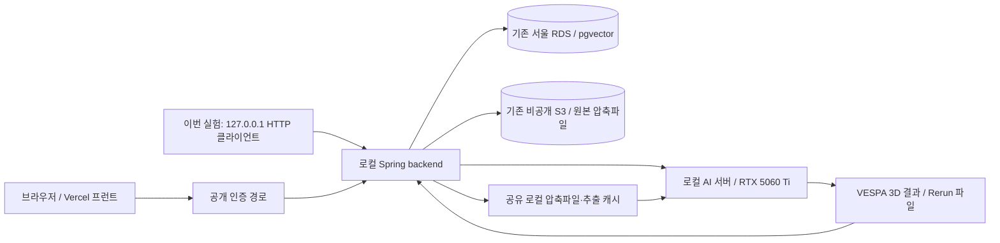

# 전체 씬·CLIP DB·AWS 파일 왕복 검증

> 이 문서는 사전 계획이다. 실행 결과·실패·채택·후속 CPU 시험은 [통합 보고서](optimization-results-2026-11-18.md)에 기록한다. 아래 환경 상태는 계획 작성 당시 기준이다.

2026-11-17 실행 계획. 이 문서의 가설과 목표는 측정 결과가 아니다. 완료 결과와 채택 판단은 `optimization-experiment-log.md` 및 각 실행의 원본 JSON/JSONL을 기준으로 한다.

## 현재 구조와 범위

RDS는 이미 실행 상태이며 기존 RDS/S3를 유지한다. 이번 실험은 로컬 컴퓨트와 실제 AWS 데이터 서비스를 연결한 하이브리드 경로다. 새 EC2 GPU 인스턴스, Vercel 브라우저 전송, 공개 인증 경로, 클라우드 컴퓨트 이전에 따른 RTT 차이는 이 실험으로 검증했다고 주장하지 않는다.

## 케이스와 사전 판정 기준

| 케이스 | 문제 정의·가설 | 한 번에 바꾸는 것 | 성능 경계 | 품질·채택 조건 |
|---|---|---|---|---|
| G2 | 클래스마다 같은 이미지 전처리가 반복된다 | Grounding 이미지 전처리만 호출 내 재사용 | 전체 씬 벽시계, 단계별 시간 | scene-0061 39키프레임·234카메라, 검출/최종 3D/track 비교, 공식 devkit GT 지표 회귀, 전체 시간 감소 |
| C1 | 인덱싱할 목록을 얻은 뒤 이미지마다 동일 메타데이터/존재 여부를 다시 조회한다 | pending 조회에 Source 포함, 이미 선택한 missing 조건 재사용 | CLIP_INDEX 시작→종료, source/exists/cache/AI/save/batch JDBC | 두 씬 3쌍 교차 순서, 벡터 키·768차원·정규화·cosine/Linf, 18개 검색의 순위·최상위 이미지 보존 |
| S1 | 로컬 캐시가 사라지면 어느 단계가 느린지 분리되지 않는다 | 추출 파일 유무 / 로컬 압축파일 유무 | 첫 정상 파일 GET, archive_prepare / S3 GET / 압축 해제 | 파일 SHA256·원본 압축파일 SHA256·전체 파일 수/크기·메타데이터 해시·RDS catalog 동일 |
| A1 | 추론 단독 성공은 서비스 전체 성공을 보장하지 않는다 | 채택 후보를 정상 서비스 경로로 실행 | 업로드→S3→등록→CLIP→검색→파일 복구→자동 라벨→RDS 조회→3D recording | 전체 mini 업로드, 2,424 이미지 인덱스, 39프레임 라벨, 모든 box/track RDS 왕복, recording 전체/Range 다운로드 |

G2는 mini 데이터의 **scene-0061 한 씬 전체**다. 전체 10개 씬에 대한 라벨 생성 품질 평가나 전체 nuScenes split/리더보드 성능 평가가 아니다. C1의 작은 반복용 아카이브는 두 씬 keyframe 센서 파일만 포함하므로 VESPA 라벨 실험 입력으로 쓰지 않는다. A1은 원본 전체 mini 아카이브를 사용한다.

## 도구 선택 이유

- 현재 운영 VESPA runner와 모델을 그대로 호출한다. 별도 추론 코드로 바꾸면 속도 차이에 구현 차이까지 섞이기 때문이다. 모델 정밀도·threshold·forward 횟수는 바꾸지 않는다.
- Grounding/SAM 이후 최종 3D JSON의 전체 필드를 비교한다. box 개수만 비교하면 클래스·위치·track 변경을 놓친다. 실수 좌표 허용 오차는 1e-6, 클래스/ID/순서/커버리지는 정확 일치다.
- 설치된 nuScenes devkit의 filtering/matching/metric 계산을 사용한다. mini 버전의 `train` 표기를 `mini_train`으로 맞춘 뒤 같은 39개 sample의 GT와 prediction만 평가한다. 단일 씬 지표이며 confidence는 기존 VESPA 상수 1.0이다. [공식 평가 설명](https://github.com/nutonomy/nuscenes-devkit/blob/master/python-sdk/nuscenes/eval/detection/README.md).
- CLIP은 실제 업로드 API와 실제 RDS의 별도 새 dataset을 사용한다. 같은 데이터의 기존 임베딩을 지우지 않고 양쪽을 독립 인덱싱해 저장·검색 결과까지 검증한다. 이미 로드된 AI를 공유하고 각 조건마다 backend를 재시작한다.
- `pg_stat_statements`는 있으면 읽기만 한다. 공유 통계를 reset하거나 extension을 새로 설치하지 않는다. 없으면 SQL 호출 감소는 코드 구조상 예상으로만 표시하고 실제 wall/JDBC/AI 시간으로 판단한다.
- CPU/GPU 자원은 30초 간격으로 수집한다. JSONL에는 허용한 필드만 저장하고 환경변수 전체·인증정보·쿠키·요청 본문은 저장하지 않는다. 단계 시간은 중첩될 수 있어 단순 합산하지 않는다.
- S3 복원은 캐시 파일을 삭제하지 않고 고유 백업 디렉터리로 rename해 조건을 만든다. 정상 HTTP GET이 실제 S3 다운로드와 복원을 유발해야 한다. 원본 해시 확인은 GET 시간 측정 밖에서 수행한다.
- RDS 왕복은 원본 모델 artifact의 정규화 SHA256 및 모든 3D 필드를 API 응답과 비교한다. Rerun은 READY 여부 외에 모든 sample/예측 ID 연결과 파일 전체/부분 다운로드를 확인한다. API 검증은 브라우저의 시각적 렌더링 확인과 구분한다.

## 비교 시 피해야 할 해석

1. G1의 검출 12장 약 11.8% 개선을 전체 VESPA 개선율로 쓰지 않는다. G2의 전체 파이프라인 시간이 필요하다.
2. 작은 반복 입력에서 얻은 C1 개선율과 과거 전체 업로드 C0를 직접 나누지 않는다. A1 전체 업로드는 규모 확장 동작 확인이며 동일 조건의 전후 인과 비교가 아니다.
3. 캐시가 있는 읽기가 S3 cold보다 빠르면 조건에 맞는 정상 차이다. S3를 제거해야 한다는 결론이 아니다. S3는 영속 원본과 캐시 유실 복구 역할을 맡는다.
4. AWS는 병렬 byte-range 다운로드 같은 기법을 설명하지만, 먼저 현재 구현의 전체 객체 다운로드·압축 해제 비용을 측정한다. 이번에는 다운로드 구현을 동시에 변경하지 않는다. [AWS S3 성능 가이드](https://docs.aws.amazon.com/AmazonS3/latest/userguide/optimizing-performance-guidelines.html).
5. 운영 적용은 품질 검증과 성능 관측 후에만 한다. 실패·중단·도구 오류도 원본 증거에 남기고 재실행은 새 디렉터리에서 수행한다.
