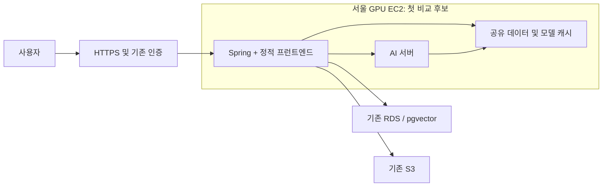

# 최적화 조사: 우선 검증할 두 케이스

> 후속 G2·C1·S1 및 정상 전체 API 검증은 [2026-11-18 통합 보고서](optimization-results-2026-11-18.md)에서 확인한다. 아래는 최적화 실행 전 조사와 가설 이력이다.

> 계측 후 갱신: C0 통합 기준선과 G0/G1 비교를 완료했다. 현재 판정·실행 상태는 [실험 기록](optimization-experiment-log.md)을 따른다. 아래의 미실측 가설·목표는 조사 시점의 제안이며 완료 성과로 읽지 않는다.

조사일: 2026-11-17 KST. 대상 코드: `878297b`. 공식 문서, 실제 AI 이미지에 설치된 Transformers 4.49.0 소스, 프로젝트 코드, 기존 측정 파일을 대조했다. 이번 조사는 새로운 추론·통합 업로드·배포를 실행하지 않았다.

**권고: ① VESPA 검출의 반복 처리, ② CLIP 검색 준비 전체 경로를 먼저 검증한다.** 다만 Grounding DINO는 전처리 재사용과 프롬프트 통합을 분리하고, CLIP은 최신 스케줄러 수정 이후 기준선을 먼저 확보한다. SAM에는 결과를 보존할 가능성이 높은 후처리 후보가 새로 확인됐다.

## 1. 증거에 따라 분류한 케이스

| 케이스 | 확인된 사실 | 아직 확인하지 못한 것 | 판단 |
|---|---|---|---|
| VESPA Grounding DINO | 과거 한 씬의 executor 1,808.547초 중 1,035.422초. 설치된 pipeline은 후보별 이미지 전처리·모델 입력 생성 | 실제 forward 횟수, 전처리/forward/후처리 비율, 변경 후 품질 | 선정 1 |
| CLIP 인덱싱 경로 | 신규 이미지당 source·exists·upsert. AI API는 이미지당 한 번. 최신 scheduler는 claim을 유지 | 최신 코드의 전체 인덱싱 시간, 각 SQL 시간과 대기 원인 | 선정 2 |
| CLIP 내부 | 최신 2,424장 단독 API 실행 185.016초. 전처리 누적 52.969초, 모델 실행·전송 누적 98.825초 | 여러 이미지 batch의 실제 처리량·메모리·검색 회귀 | 선정 2의 후속 실험 |
| SAM | 과거 같은 씬에서 433.334초. CPU에서 두 번 resize 후 이진화. 이후 float 평균과 재이진화 | resize/reduction/forward별 시간 | 대체 후보, 세부 계측에 포함 |
| 검색 SQL | 씬별 집계 후 LIMIT. 과거 검색 표본은 3회 | 데이터 규모별 실행 계획·p95·실제 인덱스 | 후순위 |
| AWS 배치·하드웨어 | 로컬 compute와 서울 RDS·S3, 공유 로컬 캐시. GPU 서버 이전 가능 | 네트워크와 CPU/GPU 각각의 효과, 요금·서울 가용성·할당량 | 코드 변경과 분리해 비교 |

출처: [과거 VESPA 완료 요약](../.local/hybrid/verification-20261112/job12-completed-summary.json), [최신 CLIP 단독 보고서](../.local/hybrid/measurements/20261117T122714Z/report.md). 서로 다른 실행의 시간을 나누어 개선율을 만들지 않는다.

## 2. 선정 1 — Grounding DINO 반복 처리

### 이번 조사로 구체화한 점

실제 설치 소스의 `preprocess()`는 라벨별로 tokenizer와 image processor를 호출하고, `_forward()`는 그 입력으로 모델을 호출한다. 프로젝트는 후보 10개를 전달하며 batch size를 별도로 지정하지 않는다. 코드에서 예상하는 호출은 이미지당 10회지만 런타임 forward 계수로 확인해야 한다.

공식 문서는 복수 클래스를 마침표로 구분하는 입력과 grounded 후처리를 지원한다. 그러나 현재 pipeline은 결과에 요청한 candidate label을 붙이는 반면, 직접 API는 토큰 점수로 문구를 추출한다. 실제 설치 소스에서는 `text_labels` 인자가 분류 라벨을 강제로 지정하는 데 사용되지 않는다. 따라서 인자를 넘기는 것만으로 프로젝트의 10개 클래스에 정확히 매핑된다고 가정하면 안 된다. [Grounding DINO 문서](https://huggingface.co/docs/transformers/v4.49.0/en/model_doc/grounding-dino#usage-tips), [버전 고정 소스](https://github.com/huggingface/transformers/blob/v4.49.0/src/transformers/models/grounding_dino/processing_grounding_dino.py)

프로젝트는 검출 라벨을 정리한 뒤 허용 클래스에 없으면 제거한다. 직접 API로 바꿀 때 문구 매핑이 달라지면 검출 결과가 조용히 사라질 수 있다. threshold, 라벨 매핑, 박스 정수 변환·정렬까지 비교해야 한다.

### 비교할 변형

| 변형 | 바꾸는 것 | 유지하는 것 | 확인할 위험 |
|---|---|---|---|
| D0 기준 | 없음 | 현재 10개 후보의 개별 처리 | 실제 호출 수를 먼저 기록 |
| D1 | 이미지 전처리 결과를 재사용하는 직접 경로 | 후보 문장·클래스별 forward·후처리 의미 | 기존 경로와 입력/박스/점수 일치 |
| D2 | 개별 클래스 입력을 작은 batch로 실행 | 클래스별 프롬프트 의미 | padding·수치 오차·VRAM 증가 |
| D3 | 여러 클래스를 한 프롬프트로 실행 | 모델 가중치·원본 이미지 | 검출 의미와 클래스별 누락·오검출 변화 |

D1은 반복 전처리 비용만 줄인다. D2는 모델이 처리하는 이미지·문장 쌍 자체를 제거하지 않는다. D3은 더 큰 절감 가능성이 있지만 품질 변화도 더 크다. D1/D2가 느리거나 효과가 작을 수도 있다. 공식 pipeline 문서도 batch가 항상 성능을 높이지 않는다고 설명한다. [Pipeline batching](https://huggingface.co/docs/transformers/v4.49.0/en/main_classes/pipelines#pipeline-batching)

먼저 후보 수, processor 횟수, forward 횟수, 입력 shape/dtype, 각 단계 wall time과 peak VRAM을 기록한다. CPU/CUDA profiler는 소량 진단 실행에만 사용하고, 속도 비교 실행과 구분한다.

**우선순위의 크기 근거:** 과거 해당 씬에서 검출 구간만 절반이 된다고 가정하면 executor는 1,808.547→1,290.836초, 약 28.6% 감소한다. 이는 나머지 구간이 고정된 산술 시나리오이며 예측이나 실측 개선율이 아니다. 검출 결과가 바뀌면 SAM과 후처리 부하도 달라질 수 있다.

## 3. 선정 2 — CLIP 검색 준비 전체 경로

### GPU batch의 현재 단위부터 바로잡기

현재 API 요청은 이미지 한 장이지만, 가로 이미지에서는 좌우 크롭 두 개가 `torch.stack`으로 묶여 한 번의 `encode_image`에 들어간다. 따라서 다음 후보는 **여러 이미지의 크롭을 함께 처리하는 것**이다. 이미지 4장에 각 2개 크롭이면 모델 입력은 크롭 8개다.

배치 크기는 이미지 수와 crop 수를 모두 기록한다. 각 crop의 정규화 → 이미지별 평균 → 이미지별 재정규화 순서를 유지해야 한다. 정사각·세로 이미지의 crop 수가 다를 수 있으므로 이미지별 개수와 출력 ID를 보존한다. [프로젝트 CLIP 구현](../embedding/clip_core.py)

### 세 변경을 분리한다

| 단계 | 변경 후보 | 직접 줄이려는 비용 | 검증 |
|---|---|---|---|
| C0 | 최신 커밋 그대로 통합 측정 | 기준선 확보 | 업로드/import/인덱싱 경계, 다른 작업, cache |
| C1 | pending 조회에 이미지 메타데이터를 포함해 중복 source·exists 조회 제거 | 이미지당 반복 SELECT | 실제 SQL 수·시간, 동시 저장 시 upsert 안전성 |
| C2 | 짧은 transaction에서 여러 벡터 저장 | 개별 쓰기·왕복 | batch API/서버 실행 수, 중복·부분 실패·복구 |
| C3 | 이미지 batch 1/2/4/8 비교 | HTTP·모델 실행·장치 전송의 고정 비용 | 이미지/초, p95, VRAM, 벡터·검색 회귀 |
| C4 조건부 | 전처리와 추론의 제한된 파이프라이닝 | CPU 전처리 대기 | 메모리·queue 대기·GPU 사용률 |

현재 pending 조회가 이미 누락 이미지를 찾으므로 이를 확장하면 2,424장의 source·exists 호출 **4,848회**를 생략할 여지가 있다. 64장 단위로는 비어 있지 않은 묶음이 38개지만, claim/상태/heartbeat/완료 확인 등은 계속 남는다. SQL 수 감소를 실제 네트워크 왕복 감소와 같은 값으로 보고하지 않는다.

Spring의 `JdbcTemplate`/`NamedParameterJdbcTemplate`은 batch API를 제공한다. 현재 개별 `JdbcClient.update()` 호출은 설정 이름만 바꿔도 batch가 되지 않는다. pgJDBC의 `reWriteBatchedInserts`는 기본 false이고 JDBC batch INSERT를 재작성하는 옵션이다. 현재 upsert SQL과 설치 드라이버에서 동작·영향을 확인해야 하며, 문서의 예시 배수를 프로젝트 예상 개선율로 사용하지 않는다. [Spring JDBC batch](https://docs.spring.io/spring-framework/reference/data-access/jdbc/advanced.html), [pgJDBC 설정](https://jdbc.postgresql.org/documentation/use/)

GPU 처리 중에는 DB transaction을 열어두지 않는다. 저장 성공 여부를 이미지 ID별로 추적하고, 실패한 배치를 재실행해도 벡터 중복이나 완료 누락이 없어야 한다. 데이터셋·모델·전처리 unique key와 기존 claim/heartbeat 동작을 유지한다.

전처리는 최신 단독 시험의 handler 합계 중 약 31.1%였다. GPU 구간만 개선해도 이 비용은 남는다. PyTorch의 비동기 데이터 준비·고정 메모리 등은 후보지만 현재 HTTP 서비스 구조에 맞는 제한된 queue와 worker 수를 실험해야 한다. 단순히 worker 수를 늘리는 것은 첫 변경으로 삼지 않는다. [PyTorch tuning guide](https://docs.pytorch.org/tutorials/recipes/recipes/tuning_guide.html)

## 4. 새로 찾은 SAM 후보: 이진 마스크의 불필요한 변환

설치된 `post_process_masks()`는 기본 `binarize=True`다. PyTorch 경로는 보간→padding 제거→원본 크기 보간→threshold 순으로 boolean mask를 반환한다. 프로젝트는 이를 float로 바꾸고 마스크 축을 평균낸 뒤 `> 0`으로 다시 이진화한다. [SAM 문서](https://huggingface.co/docs/transformers/v4.49.0/en/model_doc/sam#transformers.SamImageProcessor.post_process_masks)

boolean 값의 평균이 양수라는 조건은 하나라도 true라는 조건과 같다. 따라서 원본 크기 복원 **이후** `any`로 합치고 한 번만 uint8로 변환하면 중간 float/int 변환과 평균 연산을 줄일 수 있다. 이는 현재 코드의 연산 의미로부터 도출한 후보이며 실행 시간 개선은 미측정이다.

먼저 같은 저장된 마스크에서 bitwise 결과 일치, 변환 시간, peak CPU 메모리를 검증한다. 이어 resize 구간을 따로 측정해, 큰 비용이 그쪽이면 GPU 복원 또는 box chunking을 별도 후보로 비교한다. boolean reduction만으로 기존 SAM 구간 433초 전체를 없앨 수는 없다.

현재 호출은 `multimask_output` 기본값을 사용한다. 마스크 여러 개를 합치는 현재 의미와 단일 마스크 출력은 다르다. `multimask_output=False`, resize 전 reduction, GPU 보간으로의 이동은 각각 별도 회귀 검증이 필요하다. [SAM 모델 인자](https://huggingface.co/docs/transformers/v4.49.0/en/model_doc/sam#transformers.SamModel.forward)

## 5. AWS 아키텍처에서 확인한 실제 제약

`compose.hybrid.yml`에서 Spring이 `/uploads`의 데이터를 준비하고 AI는 같은 named volume을 읽는다. AI의 S3 bucket 설정은 비어 있다. CLIP의 dataset 경로 처리도 S3 다운로드를 하지 않는다. 따라서 Spring을 Fargate, AI를 별도 EC2로 옮기는 것만으로 기존 데이터 경로가 유지되지 않는다.

프로젝트 root Dockerfile은 이미 프런트엔드 `dist`를 Spring 정적 리소스에 넣는다. 첫 비교에서는 현재 frontend/API 패키징을 재사용할 수 있다.

| 구성 | 현재 코드와의 관계 | 비용·운영에서 비교할 점 |
|---|---|---|
| GPU EC2 한 대에 Spring·AI, 같은 로컬 볼륨 | 현재 데이터 전달 구조를 가장 적게 변경. HTTPS·인증 진입점과 영속 캐시 구성을 준비 | 웹 가용성이 GPU 호스트에 묶임. 웹만 필요해도 GPU 유휴 요금 발생 |
| CPU 웹/API + 별도 GPU worker | 독립 확장·운영 가능. 먼저 S3→worker 캐시 준비 또는 공유 저장소 계약 구현 필요 | GPU 유휴비 절감 여지와 모델·데이터 cold start, 추가 전송·관리비 비교 |

첫 비교 구성의 개념도:

AWS 공식 FAQ상 Fargate는 GPU 워크로드를 지원하지 않는다. ECS를 쓰는 경우 GPU가 있는 EC2 container instance에 배치하는 경로를 검토한다. **이 그림은 설계 후보이며 배포 결과가 아니다.** [Fargate FAQ](https://aws.amazon.com/fargate/faqs/), [ECS GPU](https://docs.aws.amazon.com/AmazonECS/latest/developerguide/ecs-gpu.html)

G6/L4 24GB와 G6e/L40S 48GB는 메모리 크기가 다른 비교 후보다. 후보 예시이며 최신 세대 전체 목록이나 서울에서 즉시 확보 가능한 인스턴스라는 뜻은 아니다. 이번 조사에서 계정 할당량, AZ별 수용량, 최신 요금은 조회하지 않았고 구매·기동 사양도 정하지 않았다. [AWS G6e](https://aws.amazon.com/ec2/instance-types/g6e/), [ECS GPU 사양표](https://docs.aws.amazon.com/AmazonECS/latest/developerguide/ecs-gpu.html)

클라우드 비교는 같은 이미지 digest·모델·입력·dtype·batch로 진행하고 CPU/RAM/GPU 차이를 함께 기록한다. RDS 왕복, S3 전송, 모델 로딩, warm 추론을 분리한다. 상시 운영비에는 GPU 사용 시간 외의 유휴시간·디스크·진입점·전송 비용도 포함한다. 지속 운영 계획만으로 GPU를 24시간 켜야 하는지까지 확정되지는 않는다.

## 6. 지금 우선순위를 낮추는 항목

- **ANN/HNSW부터 도입:** 현재 쿼리는 씬별 집계가 먼저다. pgvector의 일반적인 인덱스 활용 조건은 거리 연산자로 ORDER BY/LIMIT 하는 형태이며, 현재 씬 집계 쿼리에 그대로 적용되는지 실행 계획을 확인해야 한다. 이미지 후보 축소는 씬 평균·순위를 바꿀 수 있어 씬 단위 회귀가 필요하다. [pgvector](https://github.com/pgvector/pgvector#why-isnt-a-query-using-an-index)
- **모델 교체·해상도 축소·양자화:** 중복 실행 제거와 비교할 때 품질·정밀도·모델을 동시에 바꾸면 효과를 분리하기 어렵다.
- **torch.compile부터 적용:** 입력 shape와 batch가 정해진 후 cold compile 비용·재컴파일·warm 이득을 따로 측정한다. 기존의 SQL·스케줄러 지연을 해결하는 변경은 아니다. [PyTorch compile](https://docs.pytorch.org/docs/stable/generated/torch.compile)

## 7. 첫 실험을 실행할 때의 기록 양식

1. **고정 manifest:** Git/image digest, 가중치 revision, 라이브러리 버전, dtype, 이미지·crop·클래스 수, 입력 ID·순서, 해상도, threshold, 스레드, cache, 동시 작업.
2. **추론 소량 진단:** 대표 6–12장으로 호출 수·shape·stage별 시간을 기록. 첫 호출은 별도 표시. profiler 진단 실행과 무계측 속도 비교를 구분.
3. **속도 비교:** 같은 입력을 warm 상태에서 5회 반복하는 계획으로 median·범위를 비교. 소표본 p95를 서비스 SLA로 부르지 않음.
4. **품질 비교:** D1/D2는 입력·박스·점수 회귀, D3은 클래스별 정답 기반 검출 및 최종 3D 품질. CLIP은 벡터·검색 순위, SAM 변환은 bitwise 일치부터 확인. baseline과 일치하는 것과 정답 정확도는 별도.
5. **전체 확인:** 통과 후보만 동일 씬 전체 또는 새 데이터셋 2,424장 인덱싱에서 확인. end-to-end 시간과 구간 시간 모두 보고.
6. **운영 확인:** 완료 개수·재시도·중복·누락·VRAM·queue 대기 확인. 최종 임계값·허용 품질 저하는 실험 전에 기록하며 임의로 합격 처리하지 않음.

실험별 결과에는 `baseline`, `변경 1개`, `고정 조건`, `시간`, `품질`, `자원`, `채택/기각 사유`를 남긴다. 가설이 틀렸거나 개선이 없었던 결과도 보존한다.

## 8. 이번 조사에서 직접 확인한 로컬 증거

- `.local/hybrid/profiling-source/zero_shot_object_detection.py`: 설치된 pipeline의 클래스별 처리.
- `.local/hybrid/profiling-source/processing_grounding_dino.py`: 직접 API의 문구 추출과 인자 동작.
- `.local/hybrid/profiling-source/image_processing_sam.py`: 보간·이진화 순서.
- `.local/hybrid/profiling-source/grounding_sam.py`: 프로젝트의 호출·라벨 필터·마스크 변환.
- `embedding/clip_core.py`: 이미지별 crop 생성·정규화·평균.
- `src/main/java/com/example/demo/nuscenes/service/DatasetSearchIndexService.java`: pending 조회, claim·heartbeat와 실제 반복 단위.
- `src/main/java/com/example/demo/nuscenes/service/ImageEmbeddingService.java`: 이미지당 SQL·HTTP·저장.
- `compose.hybrid.yml`, `Dockerfile`: 공유 볼륨과 frontend/API 패키징.

원본 CLIP `report.md`와 `events.jsonl`은 측정 증거로 유지한다. 이 문서는 그 결과를 바탕으로 한 조사·설계이며, 새 개선 성과 보고서가 아니다.
