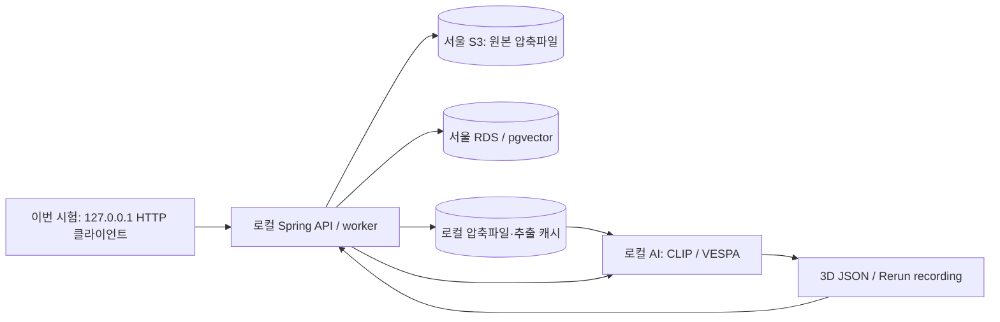

# VESPA·CLIP 최적화와 AWS 전체 사이클 검증

측정 기간: 2026-11-17~18 KST. 원본 로그 폴더 이름은 UTC다. 기준 코드는 `878297b`, 실제 모델은 기존 로컬 RTX 5060 Ti 16GB, 원본 저장소와 DB는 기존 서울 S3·RDS다. 코드 최적화와 배치 위치 변경의 효과를 섞지 않는다.

사용자 요청으로 GPU 작업을 중지하고 오늘 결과를 확정했다. 중단·미실행 항목은 성과로 계산하지 않는다. [코드 위치](optimization-code-map-2026-11-18.md), [인증·캐시·쿼리 학습과 다음 후보](request-cache-query-study-2026-11-18.md), [검토용 원본 증거](evidence/optimization-2026-11-18/README.md)를 함께 제공한다.

## 버전별 변화와 판정

아래 버전은 실험 단계 식별자다. 제품의 SemVer 릴리스나 서로 같은 입력을 사용한 연속 벤치마크를 뜻하지 않는다.

| 실험 버전 | 문제·변경 | 검증 범위 | 결과·판정 |
|---|---|---|---|
| B0 / C0 | 최신 CLIP scheduler 이후 기준선 | B0 AI 단독 / C0 정상 전체 업로드 | B0 185.016초, C0 전체 626.906초. 경계가 달라 개선율로 나누지 않음 |
| G0 | Grounding 반복 호출 계측 | 6장, 클래스 10개 | 전처리·forward 각 60회. 동기화 진단 실행 |
| G1 | 같은 이미지의 CPU 전처리 텐서 재사용 | 12장 × 3쌍 | 65.377→57.659초, 11.81% 감소. 검출 36쌍 완전 일치 |
| G2 | G1을 실제 전체 VESPA runner에 적용 | scene-0061 전체 39프레임·234카메라·1,308박스, 1쌍 | 전체 2,242.293→2,173.204초, 3.08% 감소. 검출·최종 3D·track·GT 지표 일치. 채택 |
| C1 pilot | pending Source 재사용 | 두 씬 474장 × 3쌍 | 출력은 일치했으나 backend 재시작 조건 불일치. 19.50% 수치는 채택하지 않음 |
| C1 controlled | 매번 backend 재생성 후 재측정 | 474장 × 3쌍, 벡터 1,422쌍·검색 54개 비교 | 49.192→42.948초, 12.69% 감소. 품질·조건 검사 통과. hybrid에서 채택 |
| A1 | 채택 설정의 정상 전체 서비스 경로 | 전체 원본 4.168GB·10씬·2,424장, 한 씬 라벨·3D | 업로드·2,424개 벡터·18개 검색 일치. 39프레임·1,308박스 RDS 왕복 완전 일치, RRD 생성·다운로드·Range 통과 |
| S1 | 추출 캐시 / 로컬 압축파일 / S3 복구 분리 | 동일 신규 전체 데이터셋의 정상 파일 GET·해시 | 0.359 / 71.078 / 431.500초. 원본·조회 파일 해시, 전체 inventory·metadata·catalog 유지 |
| T3 | CPU 스레드 1·2·4개 비교 | 검출·고정 박스 SAM 각각 6장 × 각 3회 | 검출·mask byte 일치. 단계 중앙값 합 40.491 / 32.502 / 31.646초. 2스레드를 전체 씬 검증 후보로 선정 |
| T4 | 2스레드 후보 전체 씬 검증 | scene-0061·새 중간 캐시·seed 42, G2/reuse 품질 기준 | 한 박스의 9개 수치가 달라 보류. 운영 1 유지 |

| A2/P | attention/정밀도 교차 비교 | 6카메라·60 forward·3반복 | attention 설정 미지원. AMP FP16 30.198→22.428초지만 출력 차이로 보류 |
| R1/R2 | 실제 모델 export/ORT/TRT | 한 이미지·car. 고정 입력 | ONNX/ORT GPU/TRT parse 성공, ORT raw parity 실패. TRT 빌드 중 사용자 중단 |
| S2/Q2 | S3 병렬도 / 실제 RDS SQL | 비교 코드·품질 검사 준비 | 미실행. 다음 후보로 보존 |

## 구조와 실험 경계



실제 RDS·S3를 사용했다. 공개 Vercel→인증→터널 경로의 새 브라우저 시험, EC2 GPU 이전, API와 RDS를 같은 리전에 두는 비교는 이번 실행 범위 밖이다. 전체 mini 업로드 검증은 10씬이지만 3D 품질 회귀는 scene-0061 한 씬 전체다.

## 선정 1: 반복 전처리와 전체 3D 품질

Grounding pipeline은 같은 이미지에 클래스별로 image processor를 반복 호출한다. 이미지 전처리 텐서만 호출 안에서 재사용하고 클래스별 tokenizer·forward·후처리는 유지했다. 신경망 image encoder 특징 재사용, 프롬프트 병합, FP16, GPU batch 최적화를 구현한 것은 아니다.

G1에서 전처리는 360→36회로 줄었지만 forward는 양쪽 모두 360회였다. G2에서는 고정 seed 42·스레드 1·새 중간 캐시를 사용해 운영 runner 전체를 실행했다. 검출 234쌍, 최종 JSON의 위치·크기·회전·속도·클래스·track 및 track_frames가 완전 일치했다. 수치 최대 차이 0, 양의 크기·유한값·회전 quaternion 검사도 통과했다.

| G2 경계 | baseline 초 | reuse 초 | 시간 감소 |
|---|---:|---:|---:|
| 전체 실행 | 2,242.293 | 2,173.204 | 3.08% |
| Grounding DINO | 1,213.790 | 1,122.069 | 7.56% |
| SAM 추론·후처리 | 577.922 | 583.761 | -1.01% |
| 지면 제거 | 149.112 | 160.802 | -7.84% |
| DINOv2 | 130.278 | 126.221 | 3.11% |

전체 씬 1쌍이므로 평균·p95 개선을 입증한 결과는 아니다. G1 소량 검출의 11.81%를 전체 서비스 개선율로 확대하지 않는다. 상위 타이머와 하위 단계는 중첩될 수 있다.

**품질 보존과 절대 정확도는 다르다.** 같은 39개 sample에 공식 nuScenes devkit filtering/matching을 적용한 mAP 0.15510248, NDS 0.19750182는 양쪽이 같았다. 전체 split의 리더보드 점수가 아니다. 기존 confidence 1.0·빈 attribute를 유지했고, 필터 후 GT 2,310개 대비 예측 1,211개였다. barrier 누락과 car/truck의 약 3.13rad 방향 오차는 별도 품질 개선 문제로 남는다. [공식 평가 설명](https://github.com/nutonomy/nuscenes-devkit/blob/master/python-sdk/nuscenes/eval/detection/README.md).

현재처럼 한 이미지에 여러 클래스 후보를 평가할 때 유리하다. 클래스가 하나거나 SAM·LiDAR 단계 비중이 큰 작업에서는 효과가 작다. Transformers 4.49의 현재 모델과 격리된 직렬 runner에서 검증했으며, 같은 pipeline 인스턴스의 동시 호출로 확장하지 않는다. 원복은 `VESPA_GROUNDING_PREPROCESS=baseline`이다.

## 선정 2: CLIP과 원격 DB의 반복 왕복

pending 목록에 이미 필요한 Source를 포함하고, missing 조건을 확인한 같은 조회 결과를 재사용했다. 이미지마다 별도 Source·exists SELECT를 반복하지 않는다. 64개는 DB 목록 크기이며 GPU 배치 크기가 아니다. 수동 이미지 임베딩 경로의 기존 확인은 유지한다.

| 반복 | baseline 초 | prefetch 초 | 시간 감소 |
|---|---:|---:|---:|
| 1 | 49.192 | 42.948 | 12.69% |
| 2 | 50.598 | 42.436 | 16.13% |
| 3 | 48.657 | 43.609 | 10.37% |
| 중앙값 | 49.192 | 42.948 | 12.69% |

실행 순서는 B/P, P/B, B/P다. 같은 두 이미지 digest, backend 인스턴스 6개, AI 인스턴스 1개를 확인했다. 모든 벡터 값과 검색 순위·점수·최상위 이미지가 완전 일치했다. 서버 CLIP_INDEX 경계의 시간이며 S3 업로드나 10초 polling을 포함한 전체 체감 시간과 구분한다.

Source 누적 시간의 중앙값은 3.733초, exists는 3.634초에서 각 0으로 줄었다. 474장당 코드 경로상 SELECT 948회를 제거한다. 기존 RDS에는 pg_stat_statements가 없어 SQLSTATE 42P01을 기록했으므로 서버 통계에서 관측한 호출 감소라고 표현하지 않는다. extension 설치·공유 통계 reset도 하지 않았다.

원격 DB 왕복이 누적되는 신규 인덱싱에 유리하다. DB가 매우 가깝거나 모델이 지배적이면 이득이 작다. 조회 후 다른 요청이 먼저 저장하는 경쟁에서는 중복 추론이 가능하지만 최종 `ON CONFLICT DO NOTHING`이 저장된 벡터를 보존한다. 이 경쟁을 통합 테스트로 검증했다. hybrid만 기본값 true이며 원복은 `EMBEDDING_INDEX_PREFETCH_ENABLED=false`다.

## 전체 원본 업로드와 규모 확대 검증

dataset 21에 원본 `v1.0-mini.tgz` 4,168,148,189바이트를 정상 API로 올렸다. 입력 SHA256은 `e5d9c2b5ced29f9e3d39651e2093d27e892d0571f10962409974b21033a254ee`다. 10씬·404키프레임·31,206개 센서 파일·18,538개 GT box를 등록하고 카메라 2,424장을 모두 인덱싱했다.

| A1 경계 | 초 | 포함 범위 |
|---|---:|---|
| 업로드 시작→인덱싱 완료 확인 | 850.547 | 상태 polling 지연 포함 |
| 클라이언트 전송 | 127.937 | loopback 정상 분할 업로드 |
| 서버 업로드 전체 | 462.510 | 아래 복사·해제·S3·등록 포함 |
| 파일 복사 | 19.626 | 서버 로컬 I/O |
| 압축 해제 | 68.559 | 전체 원본 검증·추출 |
| S3 원본 보관 | 362.158 | 실제 원격 보관 구간 |
| RDS 메타데이터 등록 | 12.165 | metadata import |
| CLIP 인덱싱 | 253.359 | CLIP_INDEX 시작→완료 |
| 이미지별 AI HTTP 요청 합 | 218.052 | 네트워크·검증·AI 포함, 인덱싱의 하위 구간 |
| 벡터 저장 합 | 30.482 | RDS 클라이언트 경과시간 |

CLIP/AI 이미지 이벤트 각각 2,424개, 모든 저장 상태 STORED·source pending_batch, 수집 오류·실패 이벤트 0이다. 별도 read-only 비교에서 기존 전체 dataset 7과 **벡터 2,424쌍 및 검색 18개가 완전 일치**했다. 모델·전처리·catalog·메타데이터 checksum도 같다. `dataset.sourceChecksum`은 이름별 metadata JSON을 해시한 값이며 원본 압축파일 SHA256과 다르다. 원본 byte 해시는 S1에서 따로 확인한다.

**전체 업로드는 C0의 626.906초보다 느렸다.** S3 보관이 C0 145.571초에서 이번 362.158초로 늘었다. 이 두 실행은 동일 조건 반복 비교가 아니므로 C1 변경의 인과적 전후 수치로 쓰지 않는다. 자원 로그에는 낮은 호스트 가용 메모리와 디스크 활동 변동도 있다. Wi-Fi 링크 표시는 780Mbps였지만 실제 WAN 대역폭을 보장하지 않으며, 이번 관측만으로 S3 서비스·회선·디스크 중 하나를 원인으로 확정하지 않는다. CLIP DB 최적화와 전송 경로 최적화가 별도 케이스인 이유다.

## S1: 캐시가 있을 때와 복구해야 할 때

같은 dataset 21의 첫 키프레임에서 카메라 6·LiDAR 1·Radar 5·map 1, 총 13개 파일을 정상 GET으로 읽었다. 캐시를 삭제하지 않고 고유 백업 위치로 rename해 조건을 만들었다. 해시 계산은 요청 경과시간 측정 밖에서 수행했다.

| 조건 | 첫 GET 초 | 13개 GET 합계 초 | 실제 내부 작업 | 적합한 상황·한계 |
|---|---:|---:|---|---|
| 추출 캐시 있음 | 0.016 | 0.359 | 준비된 파일 읽기 | 반복 씬 탐색·추론에 유리. 로컬 디스크 필요 |
| 추출 캐시 없음, 로컬 압축파일 있음 | 70.828 | 71.078 | archive 준비 0.004초·해제 70.804초 | 네트워크 없이 복구 가능. 원본 전체 해제 비용 발생 |
| 추출·압축파일 모두 없음 | 431.282 | 431.500 | S3 다운로드 369.100초·해제 62.330초 | 호스트 캐시 유실 후 복구 가능. 첫 조회 지연과 전송 비용 발생 |

세 조건에서 압축파일 4,168,148,189바이트의 SHA256, 조회한 13개 파일의 byte 해시, 추출 파일 31,225개·총 5,374,922,749바이트, metadata JSON 13개의 해시가 같다. RDS catalog 행 수도 유지됐고 수집 오류·실패 이벤트는 0이다. **전체 추출 파일의 내용을 각각 해시한 검사는 아니다.** 전체 원본 hash·파일 inventory·metadata hash·표본 센서/map hash를 함께 검증했다.

현재 한 파일 GET도 캐시가 없으면 큰 원본 아카이브 전체 복원이 필요하다. S3의 영속 원본 역할은 유지하면서 로컬 캐시를 보존하는 구성이 반복 사용에 적합하다. 모든 요청마다 cold 복구하는 stateless worker에는 불리하다. 이 수치는 캐시 조건별 1회 관측이며 알고리즘 개선 배율로 표현하지 않는다.

후속 후보는 캐시 용량/보존 정책, 필요한 씬을 먼저 준비하는 방식, 씬별 archive 또는 개별 객체 저장이다. 개별 객체는 첫 읽기 범위를 줄일 수 있지만 객체·요청 수와 metadata/경로 검증 구현이 늘어난다. 이번에는 동시에 구현하지 않았다. API/GPU를 S3와 가까운 AWS 리전에 옮기면 WAN 경로가 달라지지만 그 효과·운영비는 별도의 배치 비교가 필요하다. [AWS S3 성능 고려사항](https://docs.aws.amazon.com/AmazonS3/latest/userguide/optimizing-performance-guidelines.html).

실험 백업은 `/uploads/experiment-backups/20261117T162317Z-*`에 보존했다. 원본 S3 객체·DB·이전 데이터셋을 삭제하지 않았다. 복원 후 maintenance=false를 확인하고 정상 라벨 작업으로 이어갔다.

## A1: 정상 라벨 생성·RDS 재조회·3D 기록

dataset 21에서 정상 API로 job 13을 생성했다. 상태 시각 기준 실행은 2,419.217초(약 40분 19초), worker의 AI 요청 2,420.229초, 결과 저장 11.570초다. 상태 시각은 트랜잭션 완료·단계 타이머와 경계가 달라 합산하지 않는다. 입력 준비·기존 캐시 상태와 seed가 고정된 G2와 다르므로 이 실행으로 G2의 개선율을 다시 계산하지 않는다.

모델 원본과 RDS 결과 API의 **39프레임·1,308박스**를 모두 대조했다. 위치·크기·회전·속도·클래스·점수·attribute·track ID 및 프레임 안 순서가 완전 일치했고 최대 수치 차이는 0이었다. 최종 artifact의 정규화 checksum, 유한값·양의 크기·quaternion 및 좌표계 의미도 통과했다. API가 노출하지 않는 최상위 필드는 최종 artifact checksum으로 확인했다.

recording 13은 READY가 됐으며 모든 sample과 예측 ID가 연결됐다. RRD **17,202,643바이트**를 정상 HTTP로 전부 내려받고 크기·SHA256을 기록했다. `Range: bytes=0-11`의 HTTP 206 및 해당 byte 일치도 통과했다. Rerun export는 6.184초였다. 계측 이벤트 2,335개, 수집 오류·실패 이벤트 0이다.

G2의 전체 3D 수치·GT·비교 그림과 A1의 저장·기록 전송 검증은 통과했다. 이번 A1은 **새 브라우저에서 RRD를 열어 본 시각 검증은 포함하지 않는다.** 기존 공개 Vercel 배포는 pause 상태로 유지했다.

## CPU 스레드 실험의 목적

스레드를 늘리는 것과 작업 여러 개를 동시에 GPU에 넣는 것은 구분한다. 이번 T3는 별도 프로세스마다 OMP·OpenBLAS·MKL 및 PyTorch intra-op 스레드 수를 1·2·4로 제한하고 직렬 실행한다. 입력·모델·정밀도·전처리 재사용은 동일하다. 모델 로딩·warmup을 측정 구간에서 분리하고 순서를 1/2/4, 4/1/2, 2/4/1로 바꾼다.

Grounding 검출과 고정 입력 박스를 사용한 SAM 추론·CPU 마스크 후처리를 따로 비교한다. SAM은 마스크 개수·shape·dtype·모든 mask byte의 SHA256을 비교한다. 소량 시험에서 유리한 후보가 나오면 기존 seed 42·스레드 1의 G2/reuse 결과를 기준으로 새 전체 씬 결과를 검사한다. 과거 기준 실행과의 시간 차이는 동시기 통제 비교가 아니므로 전체 씬의 인과적 개선율로 주장하지 않는다.

실행 전 선택 기준은 **Grounding과 SAM 각각의 3회 중앙값을 더한 값이 가장 빠른 설정의 5% 이내라면 더 적은 스레드를 우선**하는 것이다. 1스레드가 이 범위면 그대로 유지한다. 이 합은 같은 6장 입력의 단계별 추정이며 전체 파이프라인 시간이 아니다. 2·4가 후보가 되더라도 검출·mask 회귀와 전체 씬 검증을 모두 통과해야 기본값 변경을 검토한다. 5%는 CPU 여유를 위한 운영 기준이며 통계적 유의성 기준이 아니다.

호스트는 Intel Core Ultra 7 258V, 물리/논리 CPU 8개다. 컨테이너에서도 affinity 8개와 CPU quota 제한 없음이 관측됐다. 이번 VESPA 스레드 설정은 Java의 GZIP 압축 해제나 네트워크 전송의 병렬도를 바꾸지 않는다. 그 단계는 별도의 구현·메모리·I/O 비교가 필요하다.

T3 실제 결과는 다음과 같다. 검출 비교 36쌍과 각 설정의 SAM 전체 mask byte 해시가 같았다. 각 프로세스의 실제 PyTorch intra-op 제한도 검증했다. inter-op/OpenCV는 기존 8로 유지했고 이번 변경 대상이 아니다.

| native 스레드 | Grounding 중앙값 초 | SAM 중앙값 초 | 단계 중앙값 합 초 | SAM process CPU 초 |
|---|---:|---:|---:|---:|
| 1 | 29.355 | 11.136 | 40.491 | 11.145 |
| 2 | 29.406 | 3.096 | 32.502 | 4.589 |
| 4 | 28.950 | 2.696 | 31.646 | 6.080 |

Grounding에서는 스레드 증가 이득이 작았지만 SAM의 추론·CPU 마스크 후처리 구간은 크게 줄었다. 2스레드 합은 최고 관측값보다 2.71% 느려 사전 5% 기준에 들어간다. 4스레드는 SAM 벽시계 시간을 약 0.400초 더 줄이지만 process CPU 시간을 4.589→6.080초로 더 쓴다. 따라서 **2스레드를 전체 씬 시험 후보**로 골랐다. CPU 일부를 다른 서비스에 남기려는 선택이며 4스레드가 thrashing을 일으켰다는 뜻은 아니다.

Grounding/SAM 자원 표본은 각 15/6개였으며 OOM kill 증가는 0, 호스트 가용 메모리 최저는 4,427/4,173MB였다. 30초 표본의 CPU pressure some avg10 최대는 0.01/0.00, memory는 0.05/0.00이었다. SAM의 involuntary context switch 중앙값은 1/2/4스레드에서 2,067/18/85회였다. 이 관측은 1스레드의 지연과 함께 기록하지만 스케줄러 원인이나 thrashing을 단독으로 확정하지 않는다. 모델 로딩·warmup은 처리 시간 밖이지만 자원 표본에는 포함된다.

문맥 전환 횟수만으로 thrashing이라고 단정하지 않는다. 경과시간, process CPU 시간/경과시간 비율, involuntary/voluntary context switch, 메모리 pressure·swap, GPU 사용 샘플을 함께 본다. CPU 시간에는 GPU 응답을 기다리는 host thread의 작업도 포함될 수 있어 CPU/wall 비율만으로 CPU 병목을 확정하지 않는다. Docker CPU 100%는 대략 논리 CPU 하나 분량이지 PC 전체 포화를 뜻하지 않는다.

순수 Python 계산은 일반 CPython의 GIL 때문에 ThreadPool만 늘려도 다중 코어로 가속되지 않을 수 있다. 파일·네트워크 대기는 스레드, Python 계산은 프로세스, PyTorch/BLAS의 native 연산은 해당 라이브러리의 스레드 설정을 구분해 선택한다. CUDA 모델 프로세스를 여러 개 띄우면 모델 메모리 중복과 VRAM 경쟁이 생기므로 이번에는 하지 않는다. [Python threading](https://docs.python.org/3.13/library/threading.html), [PyTorch CPU 스레드 설정](https://docs.pytorch.org/docs/stable/generated/torch.set_num_threads.html), [과도한 CPU 스레드 사용 방지](https://docs.pytorch.org/docs/stable/notes/multiprocessing.html#cpu-oversubscription).

## T4: 전체 씬에서 2스레드를 보류한 이유

과거 G2/reuse의 1스레드 2,173.204초와 새 2스레드 1,907.406초가 관측됐다. 이 12.23% 차이는 동시기 통제 비교가 아닌 역사적 참고값이다. 234개 카메라 검출은 완전 일치했으나 **최종 1,308개 박스 중 한 박스의 9개 수치가 달라 품질 게이트에 실패했다.** 위치·크기·회전·속도 차이가 있으며 최대 속도 성분 차이는 0.363812m/s였다. 39프레임과 박스 수, geometry 유효성은 유지됐다.

단일 씬 GT mAP/NDS 및 세부 metric은 같았지만 이는 모든 출력 보존을 뜻하지 않는다. 따라서 **운영 native 스레드는 1로 유지**한다. 작은 Grounding/SAM 시험만으로 전체 파이프라인을 채택하지 않은 실례다. 어느 CPU 단계가 차이를 만들었는지는 아직 분리하지 않았으며 스레드 증가가 정확도를 낮췄다고 단정하지 않는다. 후속은 SAM 구간만의 thread 제한과 나머지 단계의 1스레드를 분리하는 케이스가 적절하다.

원본: `.local/hybrid/measurements/20261117T172817Z/report.md`, `scene-quality-with-gt.json`, `thread-scene-decision.json`. 기준·후보의 최종 JSON·234검출·모든 단계 이벤트를 보존했다.

## A2 / P1–P3: Attention과 정밀도

현재 설치된 Transformers 4.49의 `GroundingDinoForObjectDetection`에 실제 `attn_implementation=sdpa` / `flash_attention_2`를 전달했다. 모두 모델의 미지원 ValueError로 초기화에 실패했다. 이는 지금 버전·architecture의 결과이며 FlashAttention 자체가 모든 모델에서 불리하다는 뜻은 아니다. 내부 BERT attention 일부와 전체 Grounding backend의 지원도 다르다.

실제 manifest에서 `custom_deformable_kernel_loaded=false`, ninja/nvcc 부재도 확인했다. 일반 attention과 multi-scale deformable attention은 다른 경로다. 단순히 flash-attn을 설치하거나 GPU 크기만 올려 해결된다고 가정하지 않는다. CUDA 개발 환경에서 deformable custom kernel을 빌드하는 경우도 별도 정확도·호환성·속도 케이스로 삼을 수 있다.

| 정밀도 | 6카메라 검출 중앙값 초 | 최대 allocated VRAM MiB | 출력·판정 |
|---|---:|---:|---|
| FP32 | 30.198 | 2,207.2 | 기준 |
| 전체 FP16 / BF16 변환 | 실행 실패 | 성능값 없음 | Float/Half 및 Float/BFloat16 linear 입력 dtype 불일치 |
| autocast FP16 | 22.428 | 2,595.8 | 45개 검출 수 유지, 최소 IoU 0.994792·최대 score 차이 0.008755. 보류 |
| autocast BF16 | 22.481 | 2,592.2 | 기준 45개 중 1개 누락, 최소 matched IoU 0.981818. 보류 |
| matmul TF32 | 24.575 | 2,207.2 | 45개 검출 수 유지, 최소 IoU 0.999371·최대 score 차이 0.003904. 보류 |

각 모드는 seed 42·native 1·동일 입력 6장·10클래스·60 forward이며 3번씩 교차 순서로 새 프로세스에서 실행했다. 로딩·warmup은 위 처리 시간 밖이다. AMP FP16은 약 25.73% 줄었지만 모델은 FP32로 남고 cast/cache도 생겨 allocated VRAM은 오히려 증가했다. “반 정밀도면 전체 메모리가 반드시 절반”이라는 가정을 뒷받침하지 않는다.

모든 후보가 출력 보존 기준에 미달하므로 운영 정밀도를 유지했다. 작은 검출 시험에서 이미 차이가 있어 추가 전체 씬 채택 시험은 실행하지 않았다. 향후 근사 출력을 허용한다면 다중 씬 GT/track·허용 가능한 누락·score/box 변동을 먼저 정의해야 한다. INT8/INT4 calibration은 이번 FP16/BF16 시험에 포함되지 않는다. 원본: `.local/hybrid/measurements/20261117T180150Z/report.md` 및 `variant-comparison.json`.

## R1/R2: 추론 엔진을 바로 채택하지 않은 이유

동일 HF checkpoint·한 이미지·`car.` 입력의 FP32 raw forward를 검사했다. 첫 dynamo export는 텍스트 마스크의 데이터 의존 분기에서, 기본 legacy export는 `aten::__ior_`에서 실패했다. 실험용 bool OR 변환 규칙을 추가하고 작은 4조합 진리표를 통과한 뒤 실제 ONNX export/checker에 성공했다(33.960초). PyTorch private 모듈 경로에 따른 도구 오류 2회도 원본과 수정 이력을 별도 보존했다. 모델·가중치·운영 소스는 변경하지 않았다. legacy symbolic API는 deprecated이므로 장기 운영 경로로 확정하지 않는다. [PyTorch ONNX API](https://docs.pytorch.org/docs/2.15/onnx.html).

ORT 1.32.0의 CUDA 실행을 확인했고 profile node 이벤트는 CUDA 4,411개·CPU 10개였다. 개수는 연산 시간 비중이 아니다. 같은 host tensor→GPU forward→host array 경계에서 warmup 3회 후 10회 중앙값은 PyTorch 0.438242초, ORT 0.373754초였다. **raw logits/box 배열 비교는 실패**했다(logits 최대 차이 4.088332, normalized box 성분 0.968349). query 슬롯 순서 변화와 실제 검출 변화의 분리는 아직 하지 못했으므로 이 차이를 AP 하락으로 단정하지 않는다. 추가 진단 코드는 준비했으나 GPU 중지 요청 이후 실행하지 않았다. 운영 엔진 채택이나 전체 서비스 개선으로 보고하지 않는다.

TensorRT 11.4.0.106 parser는 성공했다(13.384초, 72,903 layers, 입력 5·출력 2, parser error 0). **엔진 빌드 중 사용자가 소음 때문에 GPU 중지를 요청해 컨테이너를 종료했다.** exit 137은 이 조작에 따른 중단이며 OOM이나 TensorRT 성능 실패로 분류하지 않는다. 완성된 엔진·추론 시간·품질 결과가 없다. 선택적 패키지는 `/results/experiments/.../dependencies`에 격리했으며 운영 Python 환경은 유지했다.

원본은 `20261117T181124Z`(원래 exporter), `181435Z`·`181632Z`(도구 오류), `181902Z`(변환 성공·ORT·TRT 중단) 측정 폴더다. 고정 입력 trace가 다른 문장·해상도·모든 클래스에서 일반화된다고 주장하지 않는다.

## 추가 S3/RDS·캐시 후보의 상태

S2의 같은 109MB 파일 multipart/Range 1·2·4 비교와 Q2의 실제 검색 SQL `MATERIALIZED` 비교 코드를 준비했다. **추가 AWS 비교 실행은 하지 않았다.** S1/A1에서 수행한 실제 S3/RDS 검증과 구분한다. 기존 S3 원본은 유지했고 S2 실험 객체는 생성되지 않았다. 새 후보는 반복 검색어 임베딩 캐시, key별 복원 잠금과 bounded 병렬도, metadata 요청 묶기다. 기존 auth/React Query 캐시와 Elasticsearch·Kafka·Spark의 적용 조건은 [학습 문서](request-cache-query-study-2026-11-18.md)에 실제 코드 근거와 검증 기준으로 정리했다.

## 도구 선택과 회귀 기준

| 도구 | 선택한 이유 | 한계 |
|---|---|---|
| 기존 정상 HTTP API | 업로드·S3·DB·worker를 실제 경로로 검증 | 브라우저/공개 경로 성능은 아님 |
| JSONL 단계 로그·명령·이미지 digest | 전후 경계와 실제 실행 조건을 재검토 가능 | 중첩 타이머 합산 금지, 누락은 0으로 취급하지 않음 |
| 전체 JSON/벡터 비교 | 박스 수만 같거나 검색이 빈 결과인 거짓 통과 방지 | 단일 씬 회귀가 모든 데이터의 정확도를 보장하지 않음 |
| 공식 nuScenes devkit | 기존 filtering/matching 계산 재사용 | 한 씬 제한·상수 confidence를 명시해야 함 |
| read-only JDBC snapshot | 저장된 pgvector를 직접 확인 | 선택적 pg_stat_statements 부재를 숨기지 않음 |
| nvidia-smi·Docker·호스트/cgroup | CPU/GPU·메모리·I/O 경쟁을 같은 시간축에서 확인 | 30초 표본이므로 순간 peak나 모든 kernel을 포착하지 않음 |
| 캐시 rename·SHA256 | 원본 삭제 없이 실제 S3 복원 경로와 무결성 검증 | 실험 백업은 디스크를 차지하며 자동 삭제하지 않음 |
| 기존 Spring 통합 테스트 | 중복 저장·재시도·동시성 회귀 검증 | 성능 수치는 실제 RDS 측정에서 별도 확보 |

## 실패·제외 기록

1. 최초 G1 pytest 호출은 해당 환경에 pytest가 없어 실행되지 않았다. 설치 환경을 바꾸지 않고 unittest로 동일 회귀를 수행했다.
2. C1 pilot은 Compose가 같은 설정의 backend를 유지해 재시작 조건이 달랐다. 모든 원본을 보존하고 조건 검사와 `--force-recreate`를 추가해 3쌍을 다시 측정했다.
3. controlled C1의 dataset 16은 서버에서 474장 완료했지만 Windows의 최종 JSON 파일 교체가 접근 거부로 실패했다. 원인 프로세스는 미확정이다. 고유 임시 파일·제한된 PermissionError 재시도, 중단된 케이스만 새 폴더로 이어가는 resume를 추가했다. 실패 원본은 덮어쓰지 않았다.
4. 재기동 직후 API probe의 연결 종료, PowerShell Java `-D` 인자 해석, Docker UTF-8를 cp949로 읽은 도구 오류는 각각 준비 완료 대기·명시적 인자·UTF-8 지정으로 해결했다. 서비스 알고리즘 실패와 구분해 실행 증거에 남겼다.
5. 최초 S1 무결성 검사에서 스크립트가 저장 파일을 `.tgz`로 가정했지만 실제 DatasetArchive는 `.tar.gz`로 정규화했다. 캐시 이동 전 검사에서 실패했고 maintenance를 정상 해제했다. 실제 형식에 맞게 수정하고 audit stderr 저장을 추가한 뒤 새 폴더에서 재실행했다.
6. 전체 인덱스 비교의 `sourceChecksum` 필드 이름을 원본 압축파일 checksum으로 잘못 표기했던 것을 metadata checksum으로 정정했다. 원본 보고서·스크립트와 정정 기록을 모두 보존했으며 벡터·검색 비교값과 판정은 변경하지 않았다.
7. T3 SAM의 첫 실행은 한글 작업 경로가 든 UTF-8 JSON을 Windows 기본 cp949로 읽다 실패했다. 모델 호출 전 실패였으며 명시적인 UTF-8 읽기로 수정하고 새 측정 폴더에서 재실행했다. 원본 스크립트와 실패 로그를 보존했다.

## 검증 코드와 실제 실행의 역할

| 검증 | 결과 | 확인한 것 |
|---|---|---|
| 격리 PostgreSQL/pgvector + Spring 통합 테스트 | **21개 통과** | 기존 경로 10개·prefetch 경로 10개·worker 동시성 1개. 중복 저장·경쟁·재시도와 검색 계약 |
| 설치된 Transformers/VESPA 환경의 전처리 테스트 | **6개 통과** | 실제 image processor와 tensor 완전 일치, 클래스별 chunk 독립성, 예외 시 monkey patch 복구 |
| 격리 runner wrapper 테스트 | **3개 통과** | 선택 모드·추적 입력·예외 복원·잘못된 설정 거절 |
| host 계측·비교·보고서 파일 교체 회귀 | **44개 발견, 42개 통과·2개 명시적 skip** | 누락·비유한 값·벡터/순위/track 변경·실험 조건 불일치 검출, PermissionError 재시도. skip 2개는 Docker 인증 gateway 통합 테스트 |
| runtime raw 배열 비교 guard | **2개 통과** | NaN·inf 부호·shape·박스 변화 검출. 모델 성능 시험과 구분 |
| 실제 GPU·기존 RDS/S3 | G2·C1·A1·S1 통과 | 모의 AI 테스트와 별도로 앞의 성능·품질·복원 결과 확보 |

로컬의 2개 skip을 통과로 계산하지 않는다. 새 Q2 Java CLI는 실제 RDS 실행을 하지 않았으며 최종 remote CI에서 컴파일한다. GitHub CI는 `RUN_GATEWAY_INTEGRATION=1`로 해당 통합 테스트를 포함하며 전체 Java·프론트·업로드/편집 브라우저 계약도 실행한다. GPU·AWS 실험은 CI가 대신하지 않는다. 최종 push의 CI 결과는 해당 commit의 Actions 기록으로 확인한다.

## 최종 CI에서 발견한 테스트 자원 제한

첫 push `5d0f70b`의 원격 CI는 Java 컴파일·JAR 생성은 통과했으나 85개 테스트 중 마지막 worker 컨텍스트가 DB 연결에 실패했다. PostgreSQL 로그의 `FATAL: sorry, too many clients already`와 여러 Hikari pool 종료 기록을 확인했다. 새 prefetch 비교 컨텍스트까지 캐시되며 연결 풀이 누적된 사례다. `build.gradle`의 **test JVM에만** maximum-pool-size=4, minimum-idle=1을 지정해 전체 테스트를 다시 실행한다. 운영 RDS나 서비스 풀 설정을 늘리지 않았다. 최종 결과는 해당 후속 commit의 GitHub Actions를 확인한다.

검토용 증거의 source SHA는 원본을, export SHA는 Git에 들어가는 LF 텍스트를 기준으로 한다. Windows CRLF 정규화에 따른 23개 텍스트 hash 차이를 검출해 exporter와 manifest를 수정했고 341개 staging blob을 다시 대조했다. 수치·판정·원본 로그는 변경하지 않았다.

## 재현과 원복

정상 운영은 보호된 compose.env와 기존 시작 절차를 사용한다. 실험 도구의 비밀값은 명령행·로그에 넣지 않는다. 재현 시 기존 작업이 없는지 확인하고 새 증거 디렉터리를 만든다.

```powershell
python scripts/hybrid/record_command.py --experiment A1-full-upload -- python scripts/hybrid/benchmark_clip.py --directory '{directory}' --archive 'C:/Users/User/Downloads/v1.0-mini.tgz'
python scripts/hybrid/run_index_cases.py --help
python scripts/hybrid/benchmark_storage_cycle.py --help
python scripts/hybrid/benchmark_label_cycle.py --help
python scripts/hybrid/run_thread_cases.py --help
```

원본 JSONL·stdout/stderr·자원·입력/이미지/소스 해시·단계별 보고서는 `.local/hybrid/measurements`와 `.local/hybrid/experiments`에 보존한다. Git에는 검토용 요약·비밀정보를 제외한 계측 증거·재현 코드를 보관하고 원본 nuScenes·모델·credential·대용량 벡터 덤프는 넣지 않는다.
