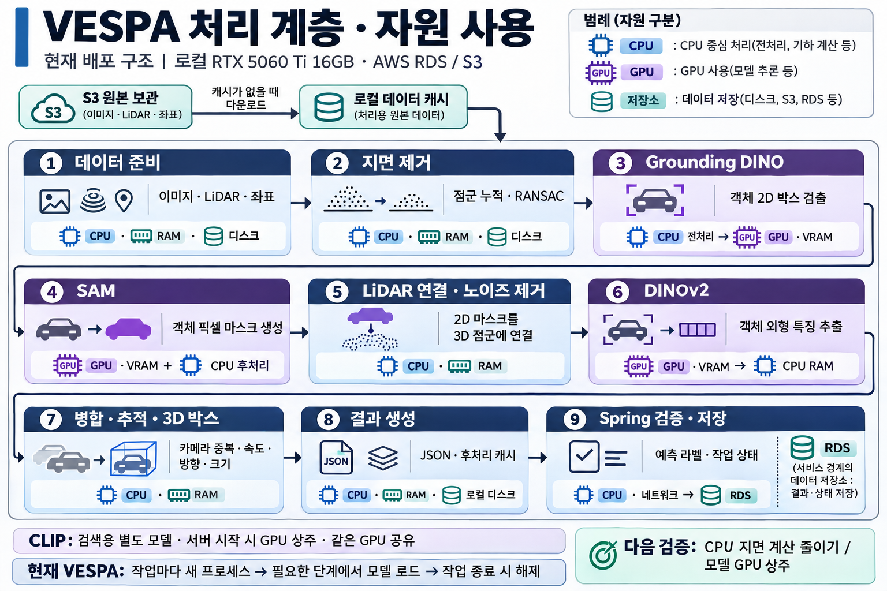

# 2026-11-18 시험 마감 보고서

사용자 요청에 따라 로그를 보존하고 추가 실험을 중단한 뒤 로컬 서비스·AWS RDS·Vercel 공개 배포를 종료했다. S3 원본, DB 데이터, 모델, Docker 볼륨은 보존한다. **G3 지면 제거·R3 모델 상주는 미적용**이다.

[검토용 로그·SHA256 manifest](../../evidence/session-close-2026-11-18/manifest.json) · [수집기 report.md](../../evidence/session-close-2026-11-18/measurement/report.md) · [기계 판독 요약](../../evidence/session-close-2026-11-18/summary.json).

## 완료된 사용자 시험

| 항목 | 확인 결과 |
|---|---|
| 업로드·인덱싱 | dataset 22, 10씬, CLIP 이미지 2,424장 등록 완료 |
| 라벨링 | job 14 / scene-0061 / run `da39e1de-71e0-4ae3-aa7f-20c102fe7a36` |
| 시작·완료 | 19:34:27 → 20:42:23 KST, API `COMPLETED`, 오류 없음 |
| 전체 결과 | 39프레임·1,308박스·39 track 프레임 |
| RDS 저장 후 재조회 | 모든 프레임·박스 순서·좌표·크기·회전·속도·클래스·점수·attribute·track 값 **정확 일치**, 최대 수치 차이 0 |
| 기하 기본 검사 | 유한 수치, 양의 크기, 단위 quaternion 검사 통과 |
| 마감 수집 상태 | 11,096이벤트, 실패 이벤트 0, 수집 오류 0 |

이번 마감에서는 새 GT 평가나 3D 렌더링을 실행하지 않았다. RDS 왕복과 기본 기하 검사를 전체 GT 품질 검증으로 해석하지 않는다. 이전 G2의 전체 씬·GT 회귀 통과는 [별도 기록](../../optimization-results-2026-11-18.md)이다.

## 이번 실행의 병목

AI executor는 **4,072.075초(약 67분 52초)**다. API 시작·완료 시각 차이 및 backend AI 요청 timer는 경계가 달라 별도로 보존했다.

| 구간 | 초 | 의미 |
|---|---:|---|
| 라이브러리 import / 데이터 로딩 | 17.425 / 22.641 | CPU 환경 준비·로컬 데이터 읽기 |
| CPU 지면 제거 | 349.953 | 382개 원본 sweep 순회·점군 누적·RANSAC·NPZ |
| 이미지 검출·분할 전체 | **3,139.559** | executor의 약 **77.1%**, 아래 Grounding·SAM을 포함 |
| Grounding DINO | 1,569.743 | 234회 검출, CPU 준비·전송·추론·후처리 포함 |
| SAM | 1,395.867 | 추론·후처리 233회 |
| DINOv2 특징 추출 | 217.388 | 객체 외형 특징 |
| LiDAR 재투영 / 점군 노이즈 제거 | 52.137 / 25.650 | CPU 기하·군집 |
| 카메라 병합 / 속도·추적 | 57.833 / 45.763 | CPU 후처리 |
| 후처리 캐시 저장 | 89.569 | 로컬 중간 상태 저장 |
| backend 결과 저장 | 29.466 | executor 바깥 DB 저장 구간 |

부모와 자식 구간은 중첩되므로 표를 모두 더하지 않는다. wall time은 GPU 커널 시간과 다르다. 이번 `dataset_prepare`는 0.002초로 로컬 캐시를 사용했다. 이 실행의 장시간 추론을 S3 다운로드 시간으로 설명할 수 없다.

첫 모델 getter는 **Grounding 15.594초, SAM 5.746초**, 이후 38회 중앙값은 각각 0.000015초·0.000006초다. 작업 안에서는 모델을 재사용하지만 다음 작업은 새 프로세스다. 배포 runner의 DINOv2 getter 시간은 미계측이다. [모델 로딩 보고서](../../evidence/session-close-2026-11-18/user-job14/model-load.md).

이전 G2/reuse 2,173.204초와 이번 4,072.075초는 PC 부하·메모리 상태를 통제한 전후 쌍이 아니다. Windows 메모리 사용률 95~97%인 관측도 있었지만 이를 유일한 원인으로 확정하지 않는다. 더 오래 걸린 사실과 원인 미확정을 함께 남긴다.

## 적용·보류·중단을 구분한 케이스

| 케이스 | 문제·도구 선택 이유 | 결과·장단점 |
|---|---|---|
| G2 | 클래스별 Grounding 이미지 전처리 중복 | 전체 씬 3.08% 감소, 3D/GT 회귀 통과. forward 수는 유지 |
| C1 | CLIP 이미지별 SELECT·원격 RDS 왕복 | 474장 × 3쌍 중앙값 12.69% 감소, 벡터·검색 일치 |
| Q2 | 검색 거리 중복 계산·불리한 계획 | 데이터셋 SQL 789.562→55.290ms. 검색 전용 설정, 계획 비용·임시 I/O 고려 |
| Q3 | 같은 문장의 CLIP 중복 추론 | 반복 32요청 추론 32→1. 모두 다른 문장에는 효과 없음·소량 회귀 관측 |
| S3-J.1 | 큰 파일 전송·중단/취소 경합 | 1GiB 초과·16MiB·동시 4파트 opt-in. 실제 4.17GB 3쌍 편차가 커 일률적 개선 주장 안 함 |
| CPU 스레드·AMP·TF32 | 병렬 계산·정밀도 후보 | 일부 빨라졌지만 출력 차이로 기본값 채택 보류 |
| SDPA·FlashAttention2 | attention 구현 교체 | 현재 모델·Transformers 조합 미지원. GPU 하드웨어 불가 판정 아님 |
| ORT·TensorRT | 서빙 엔진 교체 | 제한 입력 실행 성공, 출력 차이·전체 3D 미검증으로 보류 |
| G3 | 버려지는 비키프레임의 지면 계산 생략 | 후보 준비. 첫 기준선 중 사용자 종료 요청으로 중단, exit 143. **개선율 없음** |
| R3 | 작업 간 모델 GPU 유지 | 후보 준비·GPU 상주 비교 미실행. 메모리·복구·3D 검증 전이므로 **미적용** |

이번 업로드는 **single PUT 기준선**이다. 업로드 후 multipart를 켰으므로 이번 업로드가 병렬 전송으로 빨라졌다고 주장하지 않는다. [도구 선택·비용·장단점](../../optimization-decisions-and-costs-2026-11-18.md) · [시도·실패·병목](../../vespa-bottleneck-diagnosis-2026-11-18.md) · [Java S3 전후 비교](../../s3-java-optimization-2026-11-18.md).

## 테스트와 미완료 사항

- helper·지면 선택·워커 재사용/실패/시간 초과·계측: **11개 통과**. GPU 모델 대신 테스트용 프로세스 사용.
- hybrid 운영 스크립트: **52개 중 50개 통과, 환경 의존 2개 skip**.
- 확대 AI 계약 시험: 진행 미완료로 자체 프로세스를 종료했다. 통과로 집계하지 않음.
- G3: 유휴 확인·기준 로그 보존 후 첫 all-frame 기준선 실행 중 사용자 요청으로 SIGTERM. 성능 실패/OOM으로 분류하지 않음. 운영 접수 복구 완료.
- R3·전체 씬 전후·새 GT/3D 비교: **미실행**. 기본값 유지, 후보 코드는 로컬에 보존.
- 미검증 runtime/테스트 파일 19개와 tracked diff를 실험 폴더의 `unpublished-candidate-source/`에도 보존했다. 워커 실패 후 readiness·API 복구 검토와 확대 계약 시험부터 재개한다. 이번 push는 문서·검토 로그만 포함한다.
- 기존 `2edc483` [CI #23](https://github.com/DriveScene2Label-Team/DriveScene2Label/actions/runs/44289944474) 성공은 이후 미커밋 후보 코드의 CI 성공을 뜻하지 않음.

## 종료 상태

원본 로그 마감 후 **21:06 KST RDS stopped까지 확인**했다. [종료 증거](../../evidence/session-close-2026-11-18/shutdown/summary.json).

| 대상 | 상태 |
|---|---|
| 로컬 backend·AI·인증 컨테이너 | 20:57 KST 네 컨테이너 모두 `exited`, 실행 0개 |
| 공개 터널·AWS 자격 갱신 helper | 기록된 helper 프로세스 모두 종료 확인 |
| 계측 수집기 | STOP 후 마지막 수집 완료, 원본 보존 |
| AWS RDS `ds2l-hybrid-database` | **stopped**, 21:06 KST 확인 |
| 서울 EC2 / EKS | 조회 결과 인스턴스·클러스터 없음 |
| 서울 ECS `ds2l-ecs` | 실행 0·대기 0·서비스 0, 빈 클러스터 보존 |
| Vercel `drivescene2label` | pause 성공, 공개 URL HTTP 503 / `DEPLOYMENT_PAUSED` 확인 |
| S3·DB 내용·모델·Docker 볼륨 | 보존, 삭제 없음 |

backend와 AI는 `docker compose stop` 후 exit 137, 두 인증 컨테이너는 exit 0이었다. 네 컨테이너 모두 `OOMKilled=false`이고 중지 직전 활성 작업은 0이었다. 이를 정상 graceful shutdown 완료 또는 OOM으로 단정하지 않는다. 종료 후 GPU 전체 메모리는 686MiB였으며 Windows·다른 앱의 사용까지 0이 되었다는 의미는 아니다.

RDS는 최대 7일 후 자동 재시작하며 스토리지·백업 및 해당하는 공개 IPv4 비용은 남는다. S3 원본 보관비도 남으므로 “비용 0”이나 “영구 종료”가 아니다. [AWS 중지 동작](https://docs.aws.amazon.com/AmazonRDS/latest/UserGuide/USER_StopInstance.html). Vercel은 프로젝트 삭제 대신 production pause로 설정을 보존한다. [Vercel 문서](https://vercel.com/docs/projects/managing-projects#pausing-a-project).

## 로그 위치와 재개 조건

- 원본 수집: `.local/hybrid/measurements/20261118T091728Z/`의 `report.md`, `report.json`, `events.jsonl`, `manifest.json`.
- 사용자 결과·모델 로딩: `.local/hybrid/experiments/20261118T111302Z-ground-resident/user-job14/`.
- 중단 기록: 같은 실험 폴더의 `ground-host.json`, `ground-execution.log`, `ground-command.json`, `source-manifest.json`.
- 컨테이너 로그 스냅샷: 같은 폴더의 `final-stage-snapshot/`. watcher cursor를 덮어쓰지 않은 별도 수집.
- Git 검토 증거: `docs/evidence/session-close-2026-11-18/`. 원본/내보낸 SHA256 보존, 비밀·센서 원본·모델·전체 라벨 JSON 제외.

재개 시 새 실험 ID로 G3 3쌍과 전체 3D/GT를 검증하고 R3의 시작 시간·작업 지연·RAM/VRAM·CLIP 공존·복구를 별도로 확인한다. 중단된 기준선을 완료 표본으로 사용하거나 검증 전 운영 flag를 켜지 않는다.

AWS가 반환한 RDS 자동 재시작 예정 시각: `2026-11-25T12:06:27.076000+00:00`.
