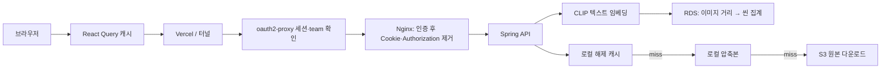

# 요청이 느린 이유를 찾는 순서: 인증·캐시·SQL·비동기

오늘 측정한 개선은 [결과 보고서](optimization-results-2026-11-18.md)에 있다. 이 문서는 실제 코드를 읽어 확인한 구조와 다음 후보를 설명한다. 사용자 요청으로 GPU를 중지했으며 아래 새 후보의 성능을 측정했다고 주장하지 않는다.

## 한 요청이 지나가는 길

검색과 파일 읽기는 서로 다른 경로다. 검색은 텍스트 임베딩·DB 계산을 거치며, 파일 읽기는 로컬 캐시가 있으면 S3를 다시 읽지 않는다. 먼저 느린 요청의 각 구간 시간을 확인해야 어떤 도구가 효과가 있을지 판단할 수 있다.

## 인증은 무엇을 하는가

[AuthGate.tsx](../frontend/src/app/AuthGate.tsx)는 화면을 열 때 `/oauth2/auth`를 확인해 로그인 화면을 보여 주는 UI다. 실제 API 보호는 [oauth2-proxy 설정](../compose.hybrid-auth.yml)의 OIDC/Cognito와 `team` 그룹 검사다. cookie 만료 8시간·refresh 30분이며 `SKIP_CLAIMS_FROM_PROFILE_URL=true`로 설정되어 있다. 모든 요청이 곧 Cognito 로그인이나 RDS 사용자 조회를 다시 한다는 뜻은 아니다.

인증을 통과한 다음 [Nginx](../infra/local/auth-upstream.conf)가 Spring에 필요 없는 Cookie·Authorization을 제거한다. Range·멱등 키·요청 body는 전달한다. 현재 Spring 경로에서 요청마다 사용자를 RDS에서 찾는 인증 구현은 확인되지 않았다. 따라서 사용자 조회를 가정해 캐시를 만드는 최적화는 근거가 없다. 게이트웨이를 우회하는 내부 backend 포트는 인증 경계 밖이므로 현재 loopback/내부망 노출 제한을 유지해야 한다.

먼저 확인할 값은 Nginx의 `duration_s`와 `upstream_s`, Spring request ID, 인증 refresh 시점이다. 이 둘의 차이만으로 앞단 oauth2-proxy·터널 시간을 추정할 수는 없다. 실제 인증된 브라우저의 네트워크 타임라인이 추가로 필요하다. 이번 loopback 성능 실험은 공개 인증 경로 시간을 측정하지 않았다. 기존 gateway 테스트는 헤더 제거·body·Range 보존을 검증하며 실제 Cognito 로그인 지연 시험과 구분한다.

## 이미 있는 캐시와 실제로 남은 중복

| 위치 | 현재 구현 | 남은 확인·후보 |
|---|---|---|
| React Query | dataset/scene 5분, 검색 60초. 불변 sample·calibration·pose는 `staleTime: Infinity`, 메모리 정리 30분 | 같은 query key의 요청 재사용을 이미 사용. 네트워크 기록으로 새 key·불필요한 invalidate·polling을 구분 |
| calibration | dataset ID + calibrated sensor token으로 캐시 | 파일별로 같은 calibration을 다시 캐시하는 문제는 이미 피함 |
| 검색 서버 | `SceneSearchService.search`가 AI 텍스트 임베딩 후 RDS 검색. AI HTTP를 DB transaction 밖에서 수행 | 같은 문장을 다시 보내면 `ClipService.encode_text`에서 다시 추론. 모델 로딩 캐시와 텍스트 결과 캐시는 다름 |
| 이미지 인덱싱 | C1에서 pending source 재사용 | 오늘 채택한 중복 SELECT 제거. 원자적 INSERT 충돌 처리는 유지 |
| 파일 캐시 | 해제 디렉터리 → 로컬 archive → S3 순으로 복원 | S1 13 GET 합 0.359 / 71.078 / 431.500초. 한 파일 때문에 전체 TGZ 복원하는 cold 경로가 큼 |
| 복원 잠금 | `DatasetStorage.archive/restore`가 인스턴스 전체 `synchronized` | 같은 key 중복 복원은 이미 방지. 다른 dataset도 함께 기다리므로 동시 cold 요청에서 병목 후보 |

근거 코드: [queries.ts](../frontend/src/api/queries.ts), [queryClient.ts](../frontend/src/app/queryClient.ts), [SceneSearchService](../src/main/java/com/example/demo/nuscenes/service/SceneSearchService.java), [ClipService](../ai-server/services/clip_service.py), [DatasetStorage](../src/main/java/com/example/demo/nuscenes/storage/DatasetStorage.java).

## 다음 실험 후보와 채택 기준

| 우선순위·ID | 변경 후보 | 왜 선택하는가 / 유리한 상황 | 불리한 상황·검증 |
|---|---|---|---|
| 1 · Q2 | distances CTE를 `MATERIALIZED`로 고정 | 반복 cosine 계산을 줄일 가능성. 실제 SQL·EXPLAIN 비교 CLI 준비 | materialization/임시 I/O가 더 비쌀 수 있음. 3벡터×필터 2×집계 3×3쌍의 결과·순위 완전 일치와 client/server 시간을 확인. **아직 실행 안 함** |
| 1 · S2 | 16MiB multipart/Range, 동시 1·2·4 | 네트워크 대기를 겹침. 실제 S3 SHA256·request/retry·CPU 및 소유 객체 정리 도구 준비 | 회선이 이미 포화면 이득 작음. Python SDK 결과만으로 Java 서비스 개선을 주장하지 않음. **아직 실행 안 함** |
| 2 · Q3 | 서버의 제한된 텍스트 임베딩 캐시 + 동일 요청 진행 중 결과 공유 | 같은 문장을 여러 번/여러 브라우저에서 검색할 때 GPU 호출·lock 대기를 줄임. RDS 검색은 매번 수행해 새 데이터 반영 가능 | model/weights/tokenizer 버전·정확한 전처리된 문장을 key에 포함. LRU/TTL·실패 미캐시·동시 miss 1회 처리·전체 벡터 일치·hit/miss·메모리 검증. 서로 다른 문장만 검색하면 이득 작음. **후보 설계** |
| 2 · S3-C | key별 복원 잠금 + 전체 복원 동시 수 제한 1·2·4 | 서로 다른 dataset cold 요청의 대기 분리 | 같은 key는 1회 복원, 임시 파일 원자적 게시, 실패 후 재시도, 최대 동시 수, 전체 byte hash 검증. 단일 dataset cold 복원 자체를 가속하지 않음. **후보 설계** |
| 3 · Q4 | calibration/pose 등 필요한 metadata를 응답에 묶기 | 화면에서 여러 짧은 HTTP/SQL 왕복이 관측될 때 | 기존 query cache 때문에 이미 줄어든 요청 수부터 측정. payload 증가·불필요한 조회·404 계약을 함께 비교. 존재 검사를 무작정 제거하면 없는 dataset의 404가 빈 200으로 바뀔 수 있음. **후보 조사** |
| 3 · S4 | 씬별 파생 archive / 필요한 객체별 저장 | 여러 GB 원본에서 일부 씬만 자주 cold 접근할 때 | 원본 S3는 유지. manifest·hash·sweeps 의존 파일·누락 복구·객체/요청 비용·저장 중복 검증. TGZ에 Range만 붙여 임의 내부 파일을 바로 추출할 수 있다고 가정하지 않음. **설계 비교** |
| 3 · C2 | 로컬 캐시 용량·활성 데이터 pin·정리 정책 | 디스크가 차서 수동 캐시 삭제가 반복될 때 | 읽는 중인 파일 삭제 방지·최종 접근 정보 신뢰성·복원 비용 필요. 이번에는 자동 삭제·eviction을 추가하지 않음. **정책 조사** |

검색 **결과 전체**를 캐시하면 dataset·filter·aggregation·imageTopK·모델·인덱스 revision·권한 범위까지 key와 invalidation에 반영해야 한다. 그래서 먼저 입력에만 의존하는 텍스트 임베딩 캐시를 후보로 삼았다. 이것도 오늘 적용한 기능은 아니다.

## 스레드·비동기·연결 풀을 구분하기

비동기는 요청을 기다리는 방식이고, 병렬 처리는 동시에 자원을 사용하는 방식이다. 이미 [worker scheduler](../src/main/java/com/example/demo/nuscenes/config/AutoLabelScheduling.java)가 업로드·라벨·기록을 HTTP 요청과 분리한다. 작업 상태와 선점은 RDS에 있다. worker를 늘리면 공유 GPU와 DB·디스크 경쟁도 늘므로 단일 작업 지연과 여러 작업 처리량을 따로 측정한다.

S3 I/O에는 제한된 병렬 연결이 유효한 후보다. PostgreSQL의 내부 parallel worker와 Java 연결 풀은 다른 제한이다. parallel query는 worker마다 메모리·CPU/I/O 비용이 생길 수 있고 모든 SQL이 이득을 보지 않는다. 이번에는 연결 풀·RDS 전역 파라미터를 임의로 늘리지 않았다. [AWS S3 병렬/Range 가이드](https://docs.aws.amazon.com/AmazonS3/latest/userguide/optimizing-performance-guidelines.html), [PostgreSQL parallel query](https://www.postgresql.org/docs/current/parallel-query.html), [worker별 자원 사용](https://www.postgresql.org/docs/current/runtime-config-resource.html).

## Elasticsearch·Kafka·Spark는 언제 필요한가

| 도구 | 역할 | 이 프로젝트에서 도입을 검토할 조건 |
|---|---|---|
| Elasticsearch / OpenSearch | 검색용 별도 인덱스, 텍스트/벡터 검색 | 데이터·검색 부하가 커지고 pgvector의 실제 실행계획 개선으로 부족할 때. RDS와의 동기화·재색인·recall·비용 검증 필요 |
| Kafka | 이벤트 보존·전달·consumer 분산 | 여러 독립 서비스가 업로드/라벨 이벤트를 재처리하고 처리량을 분산해야 할 때. S3 다운로드나 모델 1회 연산을 직접 단축하는 기능은 아님 |
| Spark | 큰 데이터의 분산 batch/집계 | 대규모 offline metadata/벡터 분석·재계산을 여러 머신으로 나눌 때. 웹 요청마다 Spark job을 띄우는 경로부터 시작하지 않음 |

현재 검색은 **eligible 이미지 전체를 씬별로 집계한 뒤** 씬을 제한한다. Elasticsearch approximate kNN의 top-k 대상 집계로 바로 바꾸면 MAX/AVERAGE/TOP_K_AVERAGE 결과 의미가 달라질 수 있다. Spark의 JDBC partition 수를 늘리면 원본 RDS 연결 수도 늘어나 원본 DB가 병목인 문제를 자동 해결하지 않는다. 위 도입 판단은 현재 코드·측정 범위에 근거한 추론이며 세 제품의 성능을 직접 비교한 결과가 아니다. [Elastic kNN 집계 범위](https://www.elastic.co/docs/solutions/search/vector/knn/approximate-knn-query-examples), [Kafka 공식 개요](https://kafka.apache.org/documentation/), [Spark JDBC 병렬도](https://spark.apache.org/docs/latest/sql-data-sources-jdbc.html), [Spark SQL 캐시·튜닝](https://spark.apache.org/docs/latest/sql-performance-tuning.html).

공부할 때는 “도구 이름”보다 **한 요청의 시간 경계 → 반복 호출 수 → 같은 결과를 재사용할 조건 → 병렬 처리 시 자원 제한 → 데이터가 바뀔 때 갱신 방법**을 순서대로 설명할 수 있는지 확인하면 된다.
