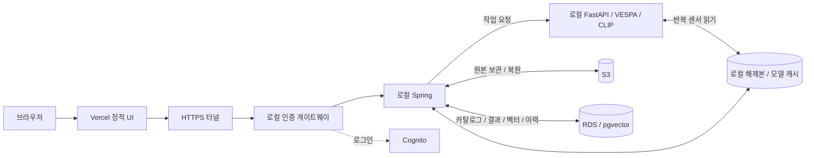
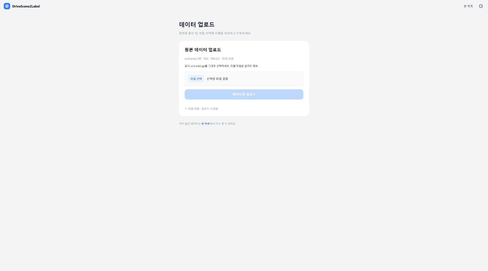
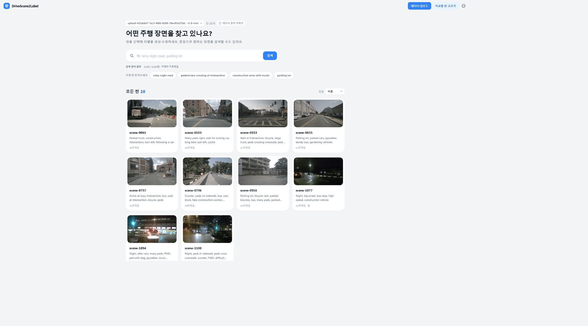
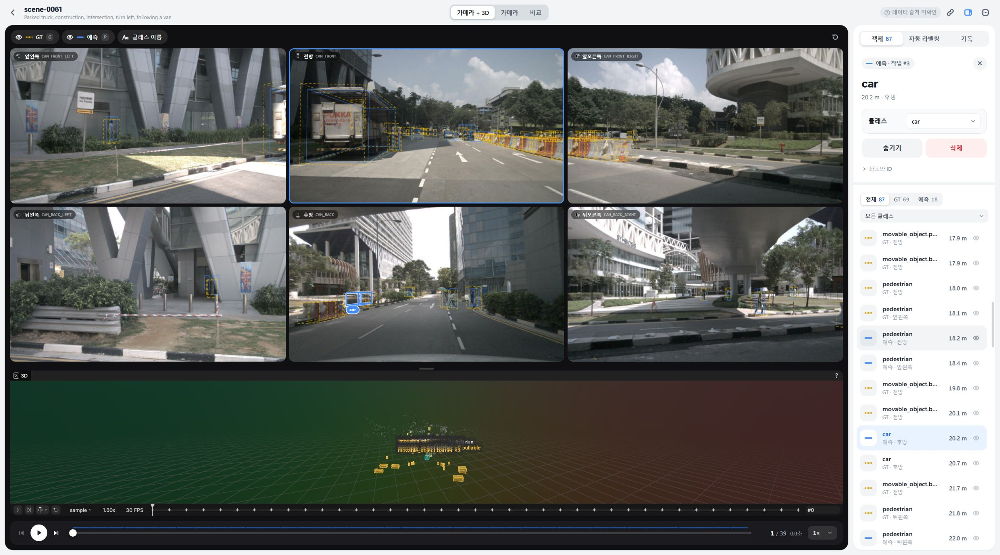
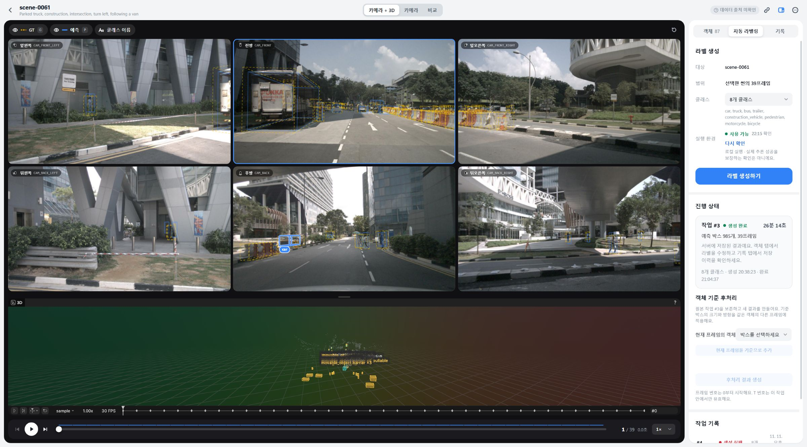
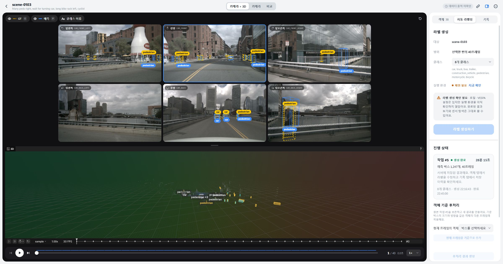

# 하이브리드 MVP: 장애 해결과 남은 성능 개선

기준일: 2026-11-11 KST. 사용자 실행 기록, 로컬 코드, 실제 Vercel UI를 함께 확인했다. **구현·운영 확인·개선 후보를 구분하며, 이 문서의 수치는 통제된 벤치마크나 전체 데이터셋 평균이 아니다.**

## 1. 현재 결과

- 프론트: Vercel. 인증된 요청은 Cloudflare 터널 → 로컬 oauth2-proxy → Spring으로 전달된다.
- 연산: 로컬 Docker/WSL2의 Spring과 FastAPI, RTX 5060 Ti 16GB. EC2/ECS/EKS를 재가동하지 않았다.
- 저장: S3에 원본 ZIP/TGZ, RDS PostgreSQL/pgvector에 카탈로그·임베딩·작업·라벨·편집 이력. 모델·해제본·추론 중간 파일·RRD는 로컬 볼륨이다. **모든 파일이 S3에 백업되는 구조는 아니다.**
- 데이터: 사용자가 올린 공식 mini TGZ 4,168,148,189바이트 → 데이터셋 #5, 10개 씬. CLIP 이미지 2,424장 인덱싱 완료.
- 완료 결과: `scene-0061`, 작업 #3, 39개 키프레임·8class·985개 예측, 26분 14초.
- 3D: 기존 작업 #3을 읽어 v3 recording #3 READY, 17,193,052바이트. 실제 공개 Viewer에서 카메라 6장·LiDAR·GT·예측 확인.
- 최신 UI: `feature/frontend-renewal`의 `b8376e4`를 기존 하이브리드 기능과 통합. 업로드 전용 `/uploads`, 씬에서 객체 편집·추론·이력 조회. 기존 `/labels` 링크는 호환 유지.
- 새 실행: 작업 #5 `scene-0103`은 22:16:45 시작 → 22:45:00 완료, **40개 키프레임·1,247개 예측**. 실행 약 28분 16초(생성 시각부터는 약 28분 18초)이며 UI는 초 이하를 버려 28분 15초로 표시한다. 기존 결과를 사용한 3D도 공개 화면에서 확인했다.

## 2. 왜 전체 AWS에서 분리했나

기존 전체 AWS는 공개 웹/API, GPU, 저장소를 클라우드에서 운영했다. 현재는 보유 eGPU로 연산을 옮겨 GPU 서버 실행 비용을 피하면서, 팀원이 사용할 HTTPS 주소와 원격 원본·DB를 유지하려는 MVP 선택이다. 노트북 저장공간이 적다는 제약도 S3/RDS를 남긴 이유다.

대신 로컬의 가동 시간·전원·GPU 드라이버·Docker·터널에 서비스가 의존한다. RDS 왕복과 S3 원본 전송도 추가된다. **비용·운영 조건을 바꾼 결정이며, 추론 속도 최적화를 대체하지 않는다.** 전체 로컬은 원격 DB 왕복을 없앨 수 있지만 원본·DB·백업을 로컬 디스크에서 관리해야 한다.



카메라 이미지를 추론할 때마다 S3에서 하나씩 받아 GPU로 보내는 구조가 아니다. 캐시가 있으면 로컬 파일을 읽는다. 캐시가 없을 때는 **한 씬을 실행하더라도 데이터셋 압축 원본 전체를 복원**할 수 있다. 이는 데이터 준비 범위이고, 모델의 씬 추론 범위와 다르다.

## 3. 씬별 실행은 어떻게 보장하나

1. 프론트는 현재 선택한 `datasetId + sceneToken`과 classMode를 요청에 고정한다. 재시도는 동일 Idempotency-Key를 사용한다.
2. Spring은 해당 dataset의 scene을 확인하고, 그 scene의 sample 목록만 작업 대상으로 저장한다. 동일 token이 여러 데이터셋에 있으면 datasetId를 명시해야 한다.
3. AI wrapper는 `--scene` 인자 하나로 runner를 실행하고, runner는 그 이름으로 `process_scene_rigid` 또는 `process_scene`를 한 번 호출한다.
4. 결과를 저장할 때도 요청에 속한 sample인지 검증한다. 다른 씬의 결과를 합쳐 보여주지 않는다.

실제 작업 #5의 프로세스 인자를 확인했다:

```text
vespa_runner.py --scene scene-0103 --class-mode 8
               --dataset-version v1.0-mini --rigid
```

실행 중 API의 datasetId=5·sceneId=15·sceneName=scene-0103과 실제 프로세스 인자를 대조했다. UI의 범위는 **선택한 씬의 40프레임**이다. 로그의 389는 해당 씬의 LiDAR 처리 루프이며, 389개 씬이나 전체 데이터셋을 뜻하지 않는다. 이전 `scene-0061`도 LiDAR 382프레임 안에서 이미지 키프레임 39개를 처리했다. 초반 루프 ETA는 무거운 이미지 추론이 포함되는 간격에 영향을 받으므로 전체 완료 예상 시간으로 사용하지 않는다.

코드 근거: [useJobState](../frontend/src/features/labeling/useJobState.ts), [AutoLabelService](../src/main/java/com/example/demo/nuscenes/service/AutoLabelService.java), [vespa_runner](../ai-server/services/vespa_runner.py). classMode 1/3/8은 출력 매핑이며, 1class로 바꾸면 계산량이 1/8이 된다는 의미가 아니다.

## 4. 증상별 원인·해결·검증

|증상|확인한 원인|조치|검증과 남은 범위|
|---|---|---|---|
|`Environment is stopping`으로 업로드 불가|DB의 종료 준비 플래그가 남아 쓰기만 차단. GET health는 정상일 수 있음|인증된 운영 resume, 시작 시 쓰기 검증 경로 확인|maintenance 해제 및 잘못된 업로드가 400 검증 응답까지 도달. 원본·계정 삭제 없이 복구|
|`nuScenes ZIP 형식 오류`|사용자 ZIP 601,354,240바이트에 ZIP 최종 디렉터리 없음. 원본과 수신본 모두 동일|UUID·처리 단계·원래 예외 로그, 손상 압축 안내, 공식 TGZ 직접 지원|gzip/TAR 무결성 확인 후 실제 공개 TGZ 업로드·등록 성공. 확장자 변경으로 손상 파일을 고친 것이 아님|
|큰 파일 전송이 오래 걸림|공개 프록시 경유 전송과 서버 S3 보관 시간이 별개. 등록 전 동기 S3 보관이 큼|4MB 분할·재전송, 전송/검증 상태 분리, 같은 PC의 loopback 업로드 경로|전송 성공·재개 계약 확인. 병렬 multipart나 S3 직접 업로드는 아직 미구현|
|씬은 있는데 검색 사용 불가|해당 업로드 데이터의 이미지 임베딩 미생성, 이전 인덱서의 root 제한|업로드 root 지원, 백그라운드 인덱싱과 준비 상태 UI|2,424/2,424 완료, 실제 검색 결과 확인. 검색 유사도는 정확도/확률이 아님|
|라벨은 완료됐는데 `저장된 라벨 없음`|JSON 문서 목록과 자동 라벨 작업 저장소가 별개. 기존 작업 목록은 브라우저 receipt에 의존|씬별 서버 작업 목록 API, 최신 완료 결과 자동 복원, 업로드와 편집 화면 분리|새 job query 없는 씬 URL에서 작업 #3 자동 복원. #4 실패가 #3을 가리지 않음. 데이터 유실로 확인된 문제는 아님|
|업로드 씬의 3D 생성 불가|Spring의 업로드 dataset 차단, AI의 기본 dataset root 사용, recording worker 비활성|DB에서 dataset key/version 전달, 업로드 캐시별 RecordingService, 기능 준비 상태 분리, worker 활성|작업 #3의 기존 라벨로 v3 recording 생성·공개 Viewer 확인. 라벨 추론 재실행 없음|
|요청한 최신 디자인과 화면이 다름|`main`과 별도 `feature/frontend-renewal`의 변경이 달랐음|최신 리뉴얼 브랜치 통합, 기존 검색·후처리·업로드 기능 복원|실제 공개 업로드/목록/객체/작업 패널 캡처. 기존 V7과 충돌한 새 편집 migration은 V12로 변경|
|객체 선택 후 후처리 기준 선택이 안 맞음|리뉴얼 객체 키와 기존 PostprocessPanel의 key 비교가 다름|공통 `objectKey`로 선택값과 옵션 통일|선택된 예측을 기준 객체로 찾는 회귀 검사 통과. 팀 T1/T3 예시 전체 재현은 별도|
|GPU 사용률은 낮고 RAM/디스크는 높음|CPU 전처리·로딩·메모리 압박과 GPU 단계가 섞임. 그래프 한 장으로 GPU 미사용 판단 불가|단계 로그·CUDA 실행·VRAM을 함께 확인|실제 CUDA 추론·완료 결과 확인. 드라이버 TDR의 근본 원인과 반복 부하 안정성은 미확정|
|한 씬에 26분 이상|이미지 검출·분할이 로그상 19분 56초. 모델은 작업별 subprocess로 시작|결과 재조회·3D 생성에서 불필요한 새 추론 제거, 단일 씬 범위 명확화|한 번의 추론 자체를 빠르게 한 결과는 아직 없음. 아래 단계별 최적화가 후속|

### 저장의 의미

- 자동 라벨 원본은 `auto_label_job`과 예측 테이블에 저장한다. 완료 결과를 여는 GET은 새 작업을 만들지 않는다.
- 객체 편집은 원본을 덮지 않고 `label_override`와 `label_edit`/대상 이력으로 저장한다. 최신 편집부터 되돌리며 충돌을 검증한다.
- 별도 JSON 문서/버전 저장은 `/label-files`의 레거시 편집 기능이다. 해당 목록이 비었다고 자동 라벨 예측도 없는 것은 아니다.
- **RRD는 현재 원본 GT·예측의 스냅샷이다. 객체 편집 override를 3D에 반영하는 작업은 남아 있다.**

## 5. 병목은 어디였나

### 업로드 한 번의 서버 측 측정

|구간|관찰 시간|해석|
|---|---:|---|
|압축 해제·검증|47.8초|CPU/디스크와 안전 검사|
|S3 원본 보관|358.1초|등록 완료 전 원본 원격 보관을 기다림|
|DB 메타데이터 등록|13.0초|importer는 이미 JDBC 500건 배치 사용|

브라우저 전송은 위 표에 포함하지 않았다. 이 실행에서는 S3 보관이 주요 대기였으며, JPA를 JDBC로 전면 교체하거나 Nginx를 추가해야 한다는 근거는 아니다. HTTP/2 또는 스레드 수만 바꿔 가정상의 속도 향상을 기록하지 않는다.

### VESPA 작업 #3 한 번의 측정

|구간|관찰 시간|전체 대비 대략|
|---|---:|---:|
|지면 제거|2분 18초|9%|
|이미지 검출·분할|19분 56초|76%|
|DINOv2 특징|1분 56초|7%|
|전체|26분 14초|100%|

나머지는 준비·기타 후처리·결과 저장 등이다. 이전 AWS L4 실행은 22분 43초였지만 캐시·코드·실행 조건을 통제하지 않았으므로 GPU 성능 비교로 일반화할 수 없다. DINOv2 특징과 자연어 검색용 CLIP 임베딩도 다른 연산이다.

### 다음 최적화 순서와 합격 기준

|순서|개선 후보|측정·합격 기준|
|---|---|---|
|1|준비/캐시 적중/모델 로딩/CPU/GPU/DB 시간을 작업 ID별로 기록|같은 씬·코드·설정, warm/cold를 분리. 총 시간과 구간 합계 설명 가능|
|2|Grounding DINO에서 같은 이미지의 텍스트와 무관한 backbone 특징 재사용|텍스트 결합 뒤 특징을 잘못 재사용하지 않음. 출력 박스·클래스·좌표 일치와 검출/분할 시간 비교|
|3|VESPA 모델 상주 및 제한된 전처리 병렬화|CLIP 동시 사용까지 포함한 최대 RAM/VRAM 측정. OOM·GPU reset 없이 반복 실행. BLAS 1 유지 상태에서 작업 병렬 수 1/2/4 비교|
|4|S3 전송 방식 개선|multipart/직접 전송/로컬 경로를 별도 비교. 체크섬·재개·보관 완료 의미 유지. 비동기 백업은 원본 보존 실패 상태 설계 후 적용|
|5|CLIP 실제 배치·결과 INSERT 배치·RDS 왕복 감소|모델 batch 처리와 요청 묶기를 구분. 쿼리 횟수·p50/p95·transaction 결과 보존. 이미 batch인 importer를 중복 개선했다고 쓰지 않음|
|6|객체 기준 후처리 품질 평가|같은 GT에 대해 위치·크기·방향·프레임 간 일관성을 비교. 박스 개수나 detectionScore=1.0을 정확도로 사용하지 않음|

위 중복 검출 제거·상주화·배치화는 실험 계획이다. 결과 재사용과 범위 명확화 외에, 아래 SAM 추론 모드와 전체 단계 계측을 추가했다. CPU 스레드를 무작정 늘리면 작은 RANSAC/BLAS 연산의 과도한 병렬 실행과 메모리 경합으로 느려질 수 있어 일괄 변경하지 않았다.

### scene-0103 내부 분석과 실시간 인프라 계측

작업 #5의 기존 tqdm 로그에서 지면 제거 **3분 9초**, 검출·분할 **21분 7초**, DINOv2 **2분 1초**를 확인했다. 검출·분할은 전체 실행의 약 75%다. 이 값은 새 계측 코드를 적용하기 전 기준이다.

현재 설치된 `/opt/vespa/src/image/grounding_sam.py`와 Transformers의 `zero_shot_object_detection.py`에서 다음 구조를 확인했다.

1. `generate_segmentation_masks`는 키프레임만 선택한 뒤 카메라 6장을 순차 처리한다. 0103은 40×6=240장이다.
2. `_vlm_detection`은 8개 후보 클래스를 pipeline에 넘긴다. 설치된 pipeline의 `preprocess`는 클래스 루프 안에서 같은 이미지의 `image_processor`를 호출하고, 각 항목마다 모델 전체 forward를 호출한다. 캐시가 없을 때 구조상 240×8=1,920회 검출 모델 호출이다.
3. `_sam_segmentation`은 SAM 모델을 직접 호출하고 `pred_masks.cpu()` 뒤 원본 크기의 마스크 후처리를 CPU에서 수행한다. `_refine_masks`는 OpenCV contour, `_non_max_suppression`은 NumPy 마스크의 중첩 비교다. GPU 사용률이 연속 100%가 아닌 이유를 순수 GPU 연산 외의 구간과 함께 봐야 한다.
4. 모델 singleton은 한 subprocess 안에서 재사용된다. 모든 이미지마다 모델을 다운로드하는 것은 아니며, 새 작업 간 모델 준비는 반복된다.

22:31:42–22:34:32 KST, 10초 간격 18개 샘플을 같은 실행에서 수집했다. 이 관찰 중에는 이미지 검출·분할이 진행됐다.

|지표|관찰|해석|
|---|---|---|
|GPU 사용률|2–81%, 샘플 중앙값 49%|GPU/CPU 처리가 섞인 순간 표본. 전체 실행의 시간 가중 평균은 아님|
|GPU 사용 메모리|13,092MiB|모델이 올라가 있음. 남는 VRAM만 보고 병렬 씬을 추가하지 않음|
|AI 네트워크 누적 증가|표시값 기준 수신 약 10KB·송신 약 23KB|이 구간에서 GB 단위 S3 복원은 없음. Docker 표시는 반올림된 값|
|작업 상태 API|15–203ms, 중앙값 31ms|로컬 API와 관련 DB 조회 경로. 모든 SQL의 성능을 대표하지 않음|
|Windows 여유 RAM|1,213–2,177MB|호스트 메모리 여유가 작고 페이지 읽기 관찰. 특정 프로세스 원인으로 단정하지 않음|
|AI cgroup swap/OOM|swap 0, OOM 0, memory pressure 0|관찰 구간에서 AI 컨테이너의 메모리 고갈·swap 병목 근거 없음|
|AI 컨테이너 block I/O|읽기 표시값 272MB 유지, 쓰기 약 0.5MB 증가|Windows 전체 디스크 활동을 VESPA 디스크 대기로 그대로 해석하면 안 됨|

원본 JSONL은 Git에서 제외된 `.local/hybrid/diagnostics/job-5-20261111-223142.jsonl`에 보존했다. **현재 추론 병목은 S3/RDS 대용량 통신보다 로컬 검출·분할 파이프라인 쪽으로 좁혀졌다.** RDS 결과 저장은 별도 신규 로그로 분리하며, S3 업로드의 앞선 358.1초 병목과 혼동하지 않는다.

### SAM 추론 모드 수정과 작은 비교 실험

SAM의 직접 모델 호출에는 autograd 비활성화가 없어 추론 중에도 계산 그래프를 구성했다. 프로젝트 runner에서 `_sam_segmentation`만 `torch.inference_mode()`로 감싼다. upstream 파일, 모델 weights, 입력 해상도, 정밀도, 임계값, 마스크 연산은 바꾸지 않는다.

실제 `scene-0103` 첫 키프레임 CAM_FRONT, 고정 박스 3개로 baseline/inference 모드를 번갈아 4회씩 실행했다. 첫 회는 워밍업으로 제외하고 나머지 3회 중앙값을 비교했다. 8회 모두 마스크 SHA-256이 같았다.

|지표|기존 autograd 활성|inference_mode|
|---|---:|---:|
|SAM 전처리·추론·후처리 벽시계 중앙값|0.793초|0.697초|
|해당 시험 프로세스의 최대 CUDA 할당량|8,042MiB|2,796MiB|

주된 확인은 **동일 마스크를 유지하면서 SAM 시험의 최대 할당량을 줄인 것**이다. 시간은 약 12% 감소했으나 한 이미지·3박스 실험이며 병행 시스템 부하와 변동이 있다. 전체 씬 속도 개선률이나 전체 파이프라인 최대 VRAM 감소율로 일반화하지 않는다. 원본 측정은 `.local/hybrid/sam-benchmark.log`에 보존한다. 작업 #5는 수정 전 결과이고 전체 씬 재실행을 이 검증에 포함하지 않았다.

### 추가한 로그와 읽는 방법

|로그|구분하는 범위|연결 키|
|---|---|---|
|`[UPLOAD_TRANSFER]`|세션 생성, 조각 수신 시간, 로컬 파일 지속화+DB/상태 조회 시간, 등록 제출|upload UUID, offset, bytes|
|`Dataset upload`|COPYING, EXTRACTING, STORING_ORIGINAL, IMPORTING_METADATA, TOTAL 및 실패 단계 소요 시간|upload UUID → datasetId|
|`[CACHE]`|캐시 hit/miss, S3 복원, 압축 해제|upload UUID|
|`[CLIP]`|이미지별 AI 요청, 벡터 저장, 전체 소요 시간|datasetId, sensor file ID|
|`[VESPA_STAGE]`|데이터 준비, subprocess 전체, 결과 검증, Spring AI 요청, DB 결과 저장|jobId, scene, runId|
|`DS2L_STAGE`|import, 지면 제거, 검출/분할, DINOv2, reprojection, denoising, merge, tracking, yaw, cache, filtering, JSON 저장|jobId, scene, runId, stage, call|
|`DS2L_STAGE` 내부 세분화|모델 준비/cache 접근, Grounding DINO 검출, SAM 추론+CPU 후처리, mask refine, mask NMS|같은 run의 단계별 호출 번호|
|`[RERUN_STAGE]`|DB에서 요청 구성, AI exporter, 검증·DB 상태 저장|recordingId|

단계 로그는 시작/완료/실패와 UTC 시각·벽시계 시간·CPU 시간을 기록한다. Python의 `cpu_seconds`는 현재 프로세스 CPU 시간이며 CUDA 커널 시간이 아니다. 단계 내부 GPU 연산과 CPU 복사를 분리한 CUDA profiler는 아직 적용하지 않았다. 상위 검출/분할 시간에는 하위 DINO/SAM 시간이 포함되므로 **부모·자식 시간을 모두 더하면 중복 집계**된다.

```powershell
# 서버 측 전송·DB·작업 로그
docker logs --since 30m drivescene-hybrid-backend-1
docker logs --since 30m drivescene-hybrid-ai-server-1
# 특정 run의 내부 로그와 구조화된 단계 이벤트 (새 계측 적용 이후 실행부터)
docker exec drivescene-hybrid-ai-server-1 cat /results/<run-UUID>/stage-events.jsonl
# 기존 작업도 중단 없이 표본 수집 가능: GPU/CPU/메모리/디스크/네트워크/진행 로그
python scripts/hybrid/diagnose.py --job 5 --run d0143a18-8f61-4d3e-bcd6-748dfbaa71a7 --samples 18 --interval 10
```

계측은 실행 중인 작업 #5에 소급 삽입하지 않았다. Docker backend/AI 로그는 각각 25MB×4개로 회전하고, 실행별 `execution.log`·`stage-events.jsonl`은 결과 볼륨에 보존한다. 파일 경로·비밀번호·토큰·벡터 내용·센서 이미지 본문은 신규 계측 값에 출력하지 않는다. 과거 실행의 시간은 기존 로그로 분석하고, 새 상세 이벤트는 새 runner 실행부터 생성된다.

## 6. 실제 검증 범위

|검증|결과|범위·한계|
|---|---|---|
|프론트 Vitest|89개 통과|리뉴얼·업로드·작업·후처리 로직|
|프론트 typecheck/build|통과|제품 빌드|
|Playwright 관련 시나리오|29개 통과|desktop-1440, jobs/labels/renewal/layout/saved-scene. API fixture이며 운영 GPU 실행을 대체하지 않음|
|Spring 관련 테스트|28개 통과|AutoLabel 9, LabelEdit 8, Recording 8, SystemStatus 3. 격리 PostgreSQL, V11→V12 적용 포함|
|AI recording/capability|23개 통과|업로드 root와 CLIP 실패 시 recording 독립 상태 포함|
|계측 관련 Spring|33개 통과|AutoLabel 9, DatasetUpload 5, Recording 8, SceneSearch 8, UploadStorage 3. 위 리뉴얼 검사와 중복되므로 합산하지 않음|
|씬 이력 회귀 추가 후|AutoLabel 10개 통과|같은 scene token의 다른 데이터셋·다른 target 제외, 최신순·잘못된/없는 sceneId 응답 확인|
|AI 단계/업로드 계측|21개 통과|StageTimer 2, uploaded datasets 19. 예외 전파·씬/run 연결·시간 필드 검증|
|VESPA 캐시 후처리|1개 통과|실제 설치 런타임에서 CPU fixture 재생, 구조화 로그·기준 프레임 전파 확인|
|시작 명령 Python|13개 통과|Vercel CLI 응답·환경 변경·배포 재사용 포함. 실제 연결 갱신 READY와 두 번째 실행 no-op 확인|
|운영 브라우저|직접 확인|공개 `/uploads`→목록→scene-0061/0103. URL에 job 없이 #3 복원, #5 완료 결과와 실제 3D, 객체 편집 컨트롤·작업 날짜 표시|
|운영 편집 저장|이번 캡처에서는 수행하지 않음|사용자 라벨을 임의로 바꾸지 않음. 저장·되돌리기 계약은 격리 DB/브라우저 테스트로 확인|
|추론|작업 #3·#5 완료|#5는 scene-0103만 40프레임·1,247개 예측. 품질 정량 평가는 별도|

테스트 수는 전체 프로젝트 모든 검사의 합이 아니라 이번 변경의 관련 검사 수다. GitHub CI 결과는 해당 release-version 커밋의 Actions 기록으로 별도 확인한다.

계측/SAM 변경을 포함한 backend·AI 이미지는 작업 #5와 recording 생성이 끝난 뒤 적용했다. 재시작 후 두 서비스 healthy, maintenance=false, 활성 라벨·recording 0, 비로그인 공개 API 401을 확인했다. 실행 runner와 로컬 소스의 SHA-256이 일치한다. #3·#5는 COMPLETED, recording #3·#5는 READY이며 #5 결과 1,247개·40프레임이 그대로 조회된다. recording #5는 16,968,013바이트다. 신규 상세 추론 로그는 다음 작업부터 생성되며 #5의 과거 실행 로그를 바꾼 것이 아니다.

### 실제 UI 캡처







## 7. 운영 시 주의할 실제 제약

- 실행 중인 작업이 있으면 배포를 위해 로컬 backend/AI를 재시작하지 않는다. 새 이미지를 준비해 두고 작업이 끝난 뒤 quiesce와 활성 작업 검사를 거쳐 교체한다.
- Vercel 소스 배포와 로컬 서비스 배포는 별개다. Git push는 CI를 실행하며, 이 구성에서 EC2/ECS/EKS를 켜지 않는다.
- Vercel 터널 연결 갱신은 기존 production 소스를 재배포한다. 로컬 수정 코드를 자동으로 공개하지 않는다. CLI 인증은 공식 저장소에 남기며 token·암호를 README에 기록하지 않는다.
- S3는 인스턴스 시작 명령이 없다. 현재 RDS는 별도 실행 상태와 비용이 있고 로컬 stop으로 중지되지 않는다.
- 이름·날짜 중심의 데이터셋 목록 정리, RRD 편집 반영, 추론 단계 진행률·모델 상주·실측 성능 개선은 남아 있다.
- 팀의 T1/0프레임·T3/18프레임 결과는 예시다. 로컬 작업의 track ID가 같은 객체인지 확인하고 기준을 지정해야 하며, 코드 통합만으로 그 예시를 재현했다고 하지 않는다.

면접에서 설명할 핵심은 **실패를 전송·검증·원격 보관·DB·GPU·표시 계층으로 나누고, 실제 로그로 원인을 좁혀 수정한 뒤, 확인하지 못한 성능·품질은 남은 과제로 명시했다는 것**이다.
