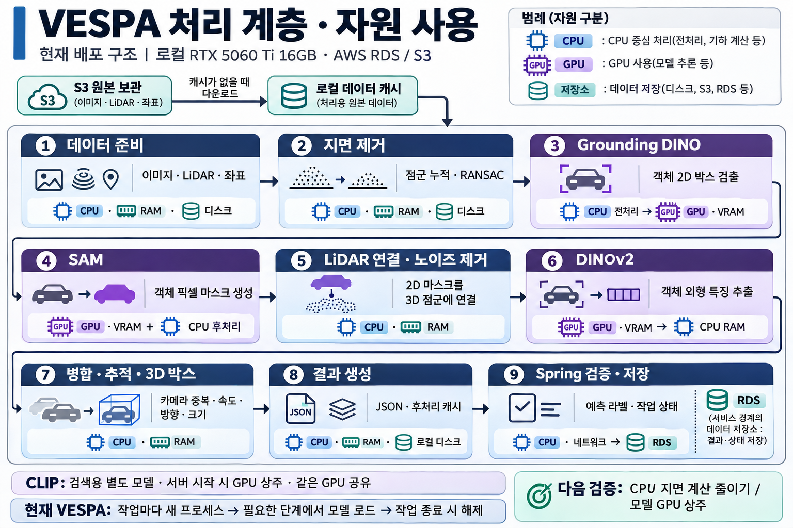

# VESPA가 느린 이유와 다음 두 실험

상태: 2026-11-18, G3(지면 계산 대상 선택)·R3(모델 상주)는 **검증 후보**이며 아직 운영에 적용하지 않았다. [자원별 코드 지도](vespa-resource-map-2026-11-18.md), [기존 시도·장단점·비용](optimization-decisions-and-costs-2026-11-18.md), [검토 가능한 이전 로그](evidence/optimization-resume-2026-11-18/README.md)를 함께 본다.

**마감 후속:** 사용자 요청으로 G3 첫 기준선 중 실험을 중단하고 서비스를 종료했다. R3는 실행하지 않았다. 아래 후보 구현은 로컬 작업 트리에 보존하며 미검증 runtime 코드는 이번 문서 push에 포함하지 않는다. 완료 job 14와 실제 종료 상태는 [마감 report.md](reports/2026-11-18/report.md)를 따른다.

위 그림은 CPU 지면 제거·모델 상주 실험 **이전 배포 구조**다. 상주 실험을 채택하면 아래쪽의 작업별 프로세스 설명이 바뀐다. 색은 코드가 사용하는 자원을 나타내며 단계별 실측 사용률을 뜻하지 않는다. Grounding DINO, SAM ViT-B, DINOv2 ViT-B/14가 현재 모델이다. DINOv3·SAM2를 배포한 것이 아니다.

## 1. 가장 큰 시간은 어디서 쓰나

완료된 이전 G2/reuse 전체 씬 한 번의 실행 시간은 2,173.204초다. 동일 실행의 측정 경계끼리 비교한다.

| 측정 구간 | 시간 | 전체 대비 | 해석 |
|---|---:|---:|---|
| 이미지 검출·분할 전체 | 1,782.832초 | 82.04% | 아래 Grounding·SAM을 포함하는 부모 구간 |
| Grounding DINO 검출 | 1,122.069초 | 51.63% | CPU 전처리·전송·GPU 추론·후처리를 포함, 순수 GPU 커널 시간 아님 |
| SAM 추론·후처리 | 583.761초 | 26.86% | 마스크 생성과 후처리 |
| CPU 지면 제거 | 160.802초 | 7.40% | 점군 누적·RANSAC·마스크·중간 파일 |
| DINOv2 특징 추출 | 126.221초 | 5.81% | 추적에 사용하는 외형 특징 |

부모와 자식 시간은 중첩되므로 표를 모두 더하면 안 된다. 이전 G2 한 쌍에서 전체 시간은 2,242.293→2,173.204초로 **3.08% 감소**했다. Grounding 전처리 재사용은 소량 검증에서 360→36회로 줄였지만, 클래스별 모델 forward는 360회 그대로였다. 전처리 절감률이 전체 실행 절감률로 이어지지 않는 이유다.

사용자 job 14에서는 지면 제거만 349.953초였다. 첫 모델 getter는 Grounding 15.594초, SAM 5.746초이고 같은 작업 내 두 번째 getter는 거의 즉시 반환했다. **작업 내부에는 캐시가 있지만 작업 프로세스가 끝나면 모델도 해제되는 구조**다. 현재 배포에는 DINOv2 getter 계측이 없으므로 그 로딩 시간은 추정하지 않는다.

job 14 중 Windows 물리 메모리 사용률이 95~97%인 시점도 있었다. 다른 실행의 160.8초와 이번 350.0초의 차이를 최적화 효과나 GPU 고장으로 단정할 수 없다. 동일 입력·동일 설정의 교차 순서 비교와 실행 당시 자원 기록이 필요하다.

## 2. 지금까지 해본 것과 남은 한계

| 시도 | 실제 결과 | 채택 또는 보류 이유 |
|---|---|---|
| G2 이미지 전처리 재사용 | 전체 씬 234검출·39프레임·1,308박스·track·GT 지표 일치 | 채택. 반복 CPU 작업은 줄였지만 클래스별 forward는 유지 |
| CPU 스레드 2·4 | 일부 단계는 빨라졌지만 2스레드 전체 씬에서 한 박스 9필드 차이 | 엄격한 출력 일치 기준 때문에 1스레드 유지. 스레드 수 자체가 많을수록 좋지는 않음 |
| SDPA / FlashAttention2 설정 | 현재 Transformers 4.49.0 Grounding DINO 조합에서 미지원 오류 | 해당 조합에 바로 켜는 방식은 실패. 하드웨어가 FlashAttention을 영원히 못 쓴다는 뜻 아님 |
| 모델 전체 FP16/BF16 cast | Float/Half 등 dtype 불일치 | 단순 cast 경로 실패 |
| AMP FP16 | 60 forward × 3회 중앙값 30.198→22.428초, 45박스 유지, 최소 IoU 0.994792 | 검출 값 차이 존재. 전체 씬 3D 동등성 미검증이라 보류 |
| AMP BF16 / TF32 | BF16은 45개 중 1개 누락, TF32도 점수·박스 값 차이 | 정확히 같은 결과를 유지하는 기본값으로 채택하지 않음 |
| ONNX Runtime CUDA | export/checker/실행 성공, raw 출력 일치 실패 | 제한된 한 이미지 결과만으로 운영 엔진을 바꾸지 않음 |
| TensorRT | 엔진 빌드 143.666초, 제한된 추론 중앙값 0.2122초 | 자동차 6카메라 검출은 대응하지만 값 차이, 전체 클래스·3D 미검증. 빌드와 추론 시간 분리 |
| INT8 / INT4 | 아직 실행하지 않음 | 보정 데이터·품질 기준 준비 전. 성공 또는 실패로 기재하지 않음 |
| CLIP DB·검색 C1/Q2/Q3 | DB 왕복·실행 계획·반복 문장 추론 개선 | 업로드/검색 최적화이며 VESPA의 Grounding forward를 줄이지 않음 |

수치별 입력·비교 범위는 연결한 실험 문서와 원본 로그를 따른다. 특히 작은 엔진 벤치마크의 0.2122초를 전체 씬 2,173초와 나누어 개선율로 제시하면 안 된다. 이전 TensorRT exit 137은 사용자 요청으로 중지한 이력이므로 OOM 증거로 사용하지 않는다.

## 3. G3: 버려지는 지면 계산만 생략

현재 지면 제거는 scene-0061의 원본 382개 sweep을 순회한다. 다음 이미지 분할 단계는 `is_sample`인 39개 키프레임만 남긴다. 후보는 **이후 소비되는 키프레임의 지면만 계산**한다.

원본 Scene과 프레임 인덱스는 그대로 두고, 각 키프레임의 과거·미래 LiDAR 누적에는 원래 모든 이웃 sweep을 사용한다. 입력 Scene부터 39개로 잘라버리면 누적 점군과 결과가 달라지므로 그렇게 구현하지 않았다.

- 구현: `ai-server/services/ground_runtime.py`, runner의 `--ground-removal keyframes`.
- 독립 비교: `ai-server/tools/benchmark_ground.py`. all/keyframes 순서를 바꾼 3쌍, 매번 새 중간 파일, 모든 소비 키프레임의 제거 마스크·지면 변환·cone 값을 정확 비교.
- 후속 검증: 전체 씬의 최종 3D 박스·track·GT 지표를 비교. CPU 중간 값만 같다고 전체 검증 완료로 취급하지 않는다.
- 장점: 모델·정밀도·CPU 스레드를 바꾸지 않고 불필요한 CPU 계산과 NPZ 기록을 줄인다.
- 한계: 이후 단계가 비키프레임의 지면 결과를 사용하는 다른 파이프라인에는 이 최적화를 그대로 사용하면 안 된다. GPU 검출 시간은 그대로다.

## 4. R3: 모델은 유지하고 작업 데이터는 해제

현재 FastAPI가 시작할 때 CLIP은 로드하지만 VESPA는 요청마다 새 자식 프로세스를 띄운다. 후보는 **서버 수명 동안 한 직렬 워커에 Grounding·SAM·DINOv2 가중치를 유지**한다. CPU 지면 최적화와 분리해, 두 비교 실행 모두 같은 keyframe 정책으로 맞춘다.

- 구현: `resident_client.py` / `vespa_resident_worker.py` / `resident_models.py`. 외부 포트 없이 부모-자식 stdin과 작업별 응답 파일 사용.
- 작업별 출력 경로·계측 wrapper·설정은 `runtime_scope.py`로 복원하고 nuScenes 데이터 캐시는 작업 종료 시 해제한다. 서로 다른 작업의 로그·데이터가 섞이면 실패로 본다.
- 로딩 실패·실행 오류·시간 초과 시 워커를 폐기한다. 부분 작업을 자동 재실행하지 않는다. 새 워커의 준비 상태와 실제 복구를 별도로 검증한다.
- 시작 시 가중치를 올리는 **preload**와 실제 입력으로 수행하는 **inference warmup**은 다르다. 이번 후보는 가중치 preload이며 첫 forward 비용까지 없앴다고 주장하지 않는다.
- 장점: 다음 작업의 라이브러리 import와 모델 로딩 지연 절감. 사용자가 요청하기 전에 준비 상태를 확인할 수 있음.
- 비용: 유휴 시에도 CPU RAM·GPU VRAM을 점유하고 CLIP과 같은 GPU를 공유한다. 서버 시작이 느려질 수 있으며 GPU 사용료가 시간제로 부과되는 환경에서는 상시 운영 비용이 생긴다.
- 한계: CPU 지면 제거·클래스별 반복 forward는 그대로다. 전체 라벨링이 몇 배 빨라지는 변경으로 예상하지 않는다.

## 5. 기록과 적용 기준

실험 계획과 원본: `.local/hybrid/experiments/20261118T111302Z-ground-resident/`. 사용자 job 14의 원본 run은 `da39e1de-71e0-4ae3-aa7f-20c102fe7a36`이며 결과를 덮어쓰지 않았다. 수동 수집기는 `.local/hybrid/measurements/20261118T091728Z/`에 최종 11,096이벤트를 남긴 후 종료했다.

GPU 없는 helper/worker 시험 11개는 통과했다. hybrid 운영 스크립트 시험 52개 중 50개 통과·2개 환경 의존 skip이다. 이 결과는 실제 GPU 모델 상주나 3D 품질 통과를 뜻하지 않는다. 기존 자원 지도 커밋 `2edc483`의 [CI](https://github.com/DriveScene2Label-Team/DriveScene2Label/actions/runs/44289944474)는 성공했지만 이후 후보 코드까지 검증한 CI는 아니다.

사용자 라벨링이 API에서 완료되고 업로드·인덱싱·라벨·기록 작업이 모두 유휴 상태일 때만 비교를 시작한다. 실험마다 명령·설정·해시·stdout/stderr·종료 코드·단계 시간과 실패도 보존한다. CPU 중간 결과, 전체 3D/GT, 상주 복구, 공유 GPU 메모리를 확인한 뒤 통과한 후보만 적용한다. 기본값 `all` / resident `false`는 검증 전 유지한다.
