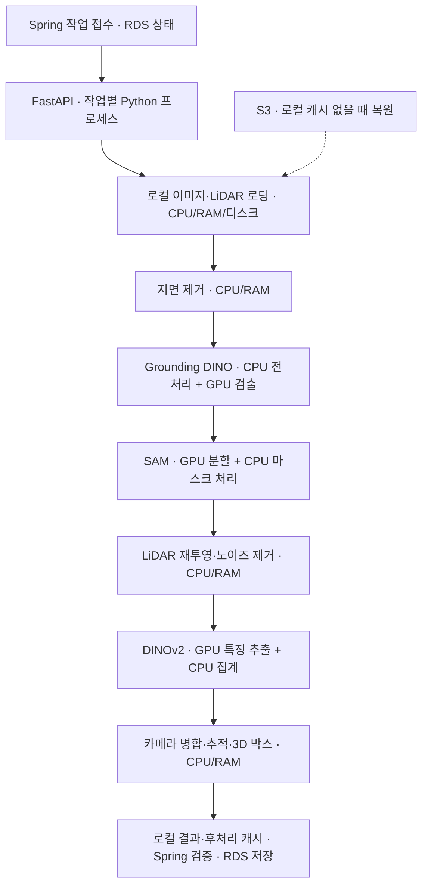

# VESPA 처리 계층과 자원

현재 배포의 실행 순서를 기준으로 한 지도다. 계층은 설명을 위한 구분이며 각 단계가 별도 서버라는 뜻은 아니다. **주요 계산 위치는 코드로 확인했지만 단계별 CPU 사용률·VRAM peak를 모두 실측한 표는 아니다.** 시간 로그와 자원 사용률은 다른 측정이다.

| 계층 | 처리·출력 | 주로 쓰는 자원 | 실제 코드/계측 경계 |
|---|---|---|---|
| 0. 요청·작업 관리 | 입력 검증, 중복/동시 실행 제어, 작업 상태 | Spring/FastAPI CPU·RAM, RDS 연결·네트워크. 이 단계 자체는 모델 추론 없음 | `VespaService.generate`, backend AUTO_LABEL_STAGE |
| 1. 실행 환경·데이터 | Python 라이브러리 import, 이미지/점군/좌표 로딩 | CPU, RAM, 로컬 디스크·파일 캐시. 원본 캐시 miss일 때 S3 네트워크·압축 해제 추가 | runtime_import, dataset_prepare, dataset_load |
| 2. 지면 제거 | 앞뒤 LiDAR 누적, global/cone RANSAC, 지면 mask | **CPU·RAM**, NumPy/scikit-learn. 프레임별 압축 NPZ 쓰기로 CPU·디스크도 사용 | ground_removal; upstream `src/pointcloud/remove_ground.py` |
| 3. Grounding DINO | 이미지/텍스트로 2D 박스 찾기 | resize/normalize/tokenization은 CPU·RAM, 모델 forward는 GPU·VRAM, CPU↔GPU 복사 | detector_model_get, grounding_dino_detection |
| 4. SAM | 박스를 받아 객체 픽셀 마스크 생성·정리 | 모델은 GPU·VRAM, 입력 준비·마스크 변환·NMS 등은 CPU/GPU 연산이 섞임. 최종 마스크 RAM·NPZ 디스크 | sam_model_get, sam_inference_postprocess, mask_refinement, mask_nms |
| 5. 2D↔3D 연결 | LiDAR를 마스크에 투영, 객체 점군 노이즈 제거 | **CPU·RAM**, NumPy/OpenCV/scikit-learn; 중간 배열·압축 캐시 디스크 | lidar_reprojection, cluster_denoising |
| 6. DINOv2 외형 특징 | 이미지 patch 특징, 객체별 외형 임베딩 | CPU 이미지 정규화 → **GPU·VRAM forward** → CPU RAM으로 feature map 복사·마스크 집계 | dinov2_features; 새 코드의 dinov2_model_get |
| 7. 병합·추적·3D 박스 | 카메라 중복 병합, 속도·yaw·크기·track, 클래스/필터 | **CPU·RAM**, NumPy/SciPy·기하 계산. 중간 캐시 디스크 | multicamera_merge, velocity_tracking, tracklet_build, yaw_estimation, bbox_inflation, object_filtering 등 |
| 8. 결과 저장·조회 | JSON·후처리 상태 저장, Spring 검증·예측 DB 저장 | CPU 직렬화/압축, RAM·로컬 디스크, **RDS I/O·네트워크**. 원본 S3와 결과 저장 경로를 구분 | rigid_cache_save, result_json_write, result_validation, backend AUTO_LABEL_STAGE |
| 별도 3D 시각화 | Rerun 파일 생성·전송, 브라우저에서 3D 그리기 | 서버 CPU·RAM·디스크·네트워크, 사용자 브라우저 GPU | RERUN_STAGE. VESPA 모델 추론과 별도 요청 |

현재 사용 모델은 `grounding-dino-base`, `sam-vit-base`, `dinov2_vitb14_reg`다. **CLIP은 검색/임베딩 경로이며 위 3D 라벨링 순서의 한 단계가 아니다.** 다만 같은 GPU를 공유하고 서버 시작부터 상주하므로 메모리 경쟁은 고려해야 한다. DINOv3/SAM2로 바꾼 상태가 아니다.

## 모델 로딩과 메모리 수명

CLIP은 FastAPI startup에서 로드한다. VESPA 모델은 작업별 자식 프로세스에서 첫 접근할 때 로드하고 그 작업 안에서는 singleton을 재사용한다. 모델 파일의 로컬 캐시와 VRAM 모델 상주는 다르다. 모델을 쓰기 전 CPU 단계에서는 GPU가 한동안 한가할 수 있다. 이미지·점군 전체를 VRAM에 올려두는 구조도 아니다.

작업 관리자 GPU 메모리 사용량은 모델 가중치 외에 activation·CUDA workspace/cache·다른 앱의 사용을 포함할 수 있다. GPU 전체 사용량 7.9GB를 특정 모델 가중치 크기로 표시하지 않는다. stage의 wall time은 CPU 대기·전송도 포함하므로 CUDA kernel 시간과 같지 않다.

## 이번 사용자 작업 14에서 확인한 값

19:43 KST 중간 관측: runtime import **17.425초**, dataset load **22.641초**, CPU ground removal **349.953초**, detector 첫 접근 **15.594초**, SAM 첫 접근 **5.746초**. 두 번째 접근은 각각 **0.000106 / 0.000013초**로 같은 프로세스의 캐시를 사용했다. [원본 단계 로그와 보고서](evidence/optimization-decisions-2026-11-18/README.md).

지면 제거는 `scene.frames` 전체를 순회한다. 이번 실행 progress에는 **382개**가 표시됐고, 영상 모델 단계는 `is_sample`인 **39키프레임 × 6카메라**를 처리한다. 이는 서로 다른 입력 범위다. 앞뒤 프레임 누적과 downstream 기하 결과에 영향이 있어 단순히 382개를 39개로 줄이면 같은 결과라고 가정하면 안 된다. NPZ 쓰기도 포함돼 CPU 연산과 압축/디스크를 다음 계측에서 나눌 후보다.

## 로그와 다음 비교

- 현재 수집: `.local/hybrid/measurements/20261118T091728Z/report.md`, `events.jsonl`, 30초 주기. 작업별 runner 파일은 `/results/<run_id>/stage-events.jsonl`이며 API 컨테이너 로그와 함께 보존한다.
- `model_load_report.py`는 첫 접근/이후 접근을 초 단위로 구분한다. DINOv2 getter의 새 계측은 아직 실행 중 AI 컨테이너에 적용하지 않았다.
- 단계별 자원 비중을 수치로 비교하려면 stage timestamp와 host/container RSS, host commit, GPU utilization·VRAM, 디스크 I/O·swap 변화 표본을 연결해야 한다. 현재 단일 GPU 스냅샷을 단계별 peak로 간주하지 않는다.
- 후보를 **상주 worker의 반복 로딩 감소**, **CPU 지면 제거/캐시**, **Grounding/SAM forward 가속**, **결과 저장 DB 왕복**으로 분리한다. 작업 중 새 GPU 실험·재시작은 하지 않는다.

코드 연결: [서비스/실행기](../ai-server/services/vespa_service.py), [단계 계측](../ai-server/services/vespa_runner.py), [rigid 처리 순서](../ai-server/vespa-remote/main_pseudo_vlm_scene_ver2.py), [모델 로딩 보고서 도구](../scripts/hybrid/model_load_report.py). [장단점·가격·상주 후보 설계](optimization-decisions-and-costs-2026-11-18.md).
