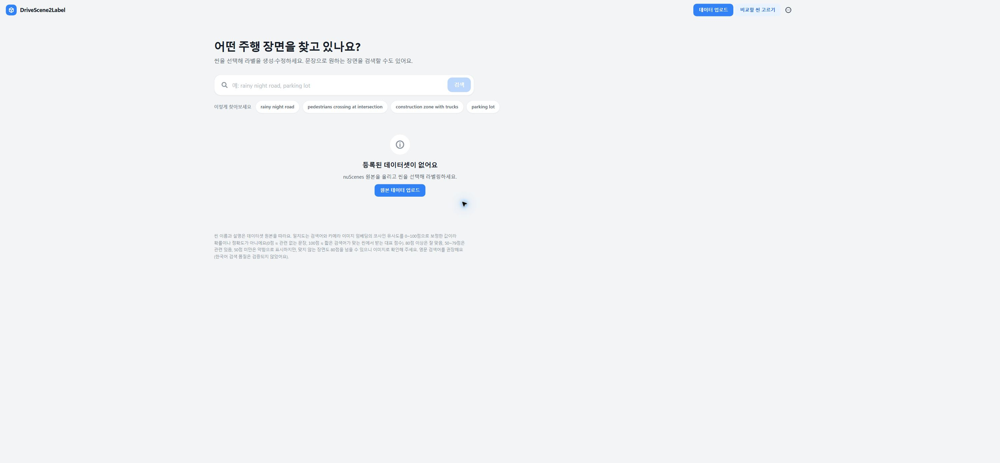

# 실행·검증 기록 — 2026-11-12

## 재개 후 완료 상태 (16:20 KST 기준)

- 재부팅 후 호스트 RTX 5060 Ti와 컨테이너 CUDA 연산(`sum=16.0`) 정상 확인. backend/ai/auth healthy, maintenance=false, runningLabels=0, runningRecordings=0을 초기화 직후 확인했다.
- 새 프론트 소스를 Vercel에 배포했다. 시작 명령의 환경 동기화 후 production은 `dpl_HacR7xKnAWKFhfs1ZJMueD3yGqML`, READY이며 공개 주소는 그대로다. 로컬 코드 기준은 `7ba61ee`에 이번 계측·연결 변경을 더한 버전이다.
- Microsoft 비공개 터널을 사용한다. connect 토큰은 서버 전용이며 기존 Cognito 팀 로그인 유지. 사용자 로그인 후 기존 dataset 5의 10개 씬·검색 준비 2,424장 표시를 확인했다.
- 공개 검증 후 쓰기 차단·worker 정지 → DB 백업·별도 DB 복원 검증 → 앱 데이터 초기화 → 보존된 볼륨으로 서비스 재생성·쓰기 재개를 수행했다. 초기화 중 검색 상태 요청 실패는 일시적인 서버 정지였으며 이후 공개 빈 화면을 확인했다.
- DB 덤프 `pre-app-reset-20261112-161344.dump`: 18,818,252바이트, SHA256 `14d8c767cbe19873224956c43fa99068dac09d88750715daf0b8e0f2e753082c`. `%LOCALAPPDATA%/DriveScene2Label/hybrid/`에만 보관한다. 33개 테이블 복원 행 수 일치, S3 10객체 key·size·ETag 전후 일치. 계정·코드·캐시 볼륨 보존. 중단된 작업 #6의 RUNNING 상태도 백업에 포함했다.
- `.local/hybrid/app-reset-report.json`, `reset-20261112.log`, `verification-20261112/public-deployment.json`, `start-20261112-private.log`에 운영 증거를 남겼다. 보호된 원본 데이터·백업·비밀은 Git에 올리지 않는다.
- 실수로 기본 리전이 없는 STS 조회가 실패해 **삭제 전에 중단**된 첫 시도가 있었다. 서울 리전을 명시해 백업·검증부터 다시 수행한 후 초기화했다.
- 시작·수집 테스트는 **26개**로 늘었고 모두 통과했다. 기존 backend 45 + HTTP 1, frontend 100, fixture E2E 4, AI 33 검사도 통과했다. CI에도 hybrid 검사를 추가했다.
- Docker 로그의 시간 조회 누락을 발견해 감지 코드를 추가했다. 유휴 컨테이너 재생성 뒤 새 측정 구간에서 실제 HTTP 이벤트·수집 오류 0을 확인했다. 이전 불완전한 사전 측정은 따로 남겼다.
- 사용자 시험 수집기는 `.local/hybrid/measurements/20261112T071715Z/`에 보고서를 쓴다. 시작 시 작업 트리는 미커밋 상태였으므로 manifest의 dirty=true를 유지한다. 새 ZIP·씬 추론은 **사용자가 직접 실행**한다. 계측은 최대 48시간이며 PC 종료 후 다시 시작해야 한다.
- README는 현재 구조·전환 이유·실측·한계·시험 순서 중심으로 재구성했다. 과거 전체 AWS 명령은 [AWS 이력](aws-deployment-history-2026-11-09.md), 전체 로컬 개발 설명은 [개발 참고](local-development.md)로 옮겼다.

## 15:28 중간 저장 이력 — 아래 내용은 당시 상태

사용자 요청: 현재 상태를 저장하고 다음에 이어서 진행한다. 이 문서는 배포 완료 보고가 아니다.

## 목표·승인 범위

- README에 하이브리드와 전체 AWS/전체 로컬의 장단점, 실제 JWT/쿠키/세션/OIDC, JPA/JDBC/트랜잭션, 병목 근거를 정리한다.
- 구간별 로그·테스트·결과 보관을 구현한 뒤 실제 배포한다. 프론트 Vercel, 백엔드/GPU 로컬, 원본 S3, DB RDS. EC2/ECS/EKS를 켜지 않는다.
- **마지막에** 앱 데이터를 모두 초기화하되 S3 원본·검증한 DB 백업·계정·코드는 보존한다. 사용자 명시 승인 있음. 새 ZIP은 사용자가 직접 올린다.
- 이전에 push/release-version 배포가 승인됐지만, 이번 수정은 아직 commit/push하지 않았다.

## 저장한 변경

- `release-version`을 원격 `7ba61ee`까지 fast-forward했다. 이전 기준 `ec987cf`. 최신 일반 CI는 통과한 상태였지만 GPU 이미지에는 PyArrow 중복 pin이 있어 별도 수정했다.
- [구조·면접·계측 상세](architecture-and-measurement-2026-11-12.md), README, README_API 갱신.
- ApiTimingFilter: 서버 생성 request ID, HTTP route/status/duration. query/body/cookie 미기록.
- 브라우저 분할 업로드 시간·재개 바이트 기록과 선택적 `/metrics` 보고; 전달 실패는 업로드 결과와 분리.
- 조각 수신/DB 잠금/파일 fsync/DB update/transaction/status 조회를 분리 계측.
- import 테이블별 JDBC batch 수/시간, 검색 AI/DB 구간 시간.
- `scripts/hybrid/measurement.py`: 단계 이벤트를 모아 JSONL·JSON·Markdown 보고서 저장. 실행별 내부 VESPA stage-events도 읽음. 중첩 시간/누락/실패 구분. **사용자 시험용 watch는 아직 시작하지 않음.**
- 터널 발급 실패 로그의 제어 API 주소를 공개 origin으로 오인하지 않도록 수정하고 시작 오류 안내를 개선.

## 검증 결과·증거 파일

|항목|결과|로컬 증거 (`.local/hybrid/` 아래)|
|---|---|---|
|백엔드 핵심|45 통과|`tests-20261112-backend.log`, `verification-20261112/backend-main/`|
|HTTP 필터|1 통과|`tests-20261112-http.log`|
|프론트 단위/빌드|100 통과, 빌드 성공|`tests-20261112-frontend.log`, `build-20261112-frontend.log`|
|브라우저 fixture 흐름|4 통과|`tests-20261112-e2e.log`|
|AI|33 통과, 고정 checkout 패치 적용 포함|`tests-20261112-ai.log`|
|운영·보고서|22 통과|`tests-20261112-hybrid.log`|
|실제 이미지 빌드|backend/ai 성공|`build-20261112-backend.log`, `build-20261112-ai.log`|
|로컬 적용|backend/ai/auth healthy|`deploy-20261112-local.log`|
|공개 연결 시도|실패, 미완료|`start-20261112.log`, `start-20261112-retry.log`, `tunnel.stderr.log`|

로컬 테스트 DB `ds2l-measure-test-db`는 따로 만들었다. 다음 작업에서 테스트/백업 복원 검증을 마친 후 이 컨테이너만 제거한다. 운영 볼륨은 지우지 않는다.

## 마지막으로 확인한 운영 상태

- RDS는 available, S3 자격 증명 갱신 성공. 새 EC2/ECS/EKS 생성·기동 없음. AWS 로그인은 이번 작업 중 갱신했다. 다음 작업에서는 만료 여부를 확인한다.
- 새 backend/ai 이미지로 컨테이너 재생성 완료. `/api/datasets`와 `X-Request-ID` 응답 확인. 게이트웨이 직접 익명 요청은 401.
- GPU 이미지의 일회성 시험에서는 RTX 5060 Ti CUDA tensor 연산이 성공했다. 이후 **Windows 호스트와 컨테이너 모두 GPU lost/NVML 실패**. 15:27 호스트 메시지: `GPU is lost. Reboot the system to recover this GPU`. GPU device request 누락은 아님. 재부팅 후 다시 확인해야 한다.
- Cloudflare Quick Tunnel POST 발급 요청이 두 번 timeout. 새 공개 origin 없음. `cloudflared` 버전 2026.10.7. 제어 API의 HEAD 405는 정상 공개 터널 주소의 증거가 아니다. 기존 Vercel을 새 로컬 연결로 확인하지 못했다.
- 기존 Vercel production: `dpl_EA7UHcxwhpPHKSpSSSFPjw2c2x4s`. **새 소스 Vercel 배포는 아직 호출하지 않음.** `.local/hybrid/vercel-source.json`은 오늘 프론트 143개 파일을 준비한 것일 뿐 배포 성공 증거가 아니다.
- 데이터셋 #5 유지. 작업 #3/#5 완료 결과 유지. #6(scene-0553)은 전날 시작 후 DB RUNNING으로 남았고 현재 AI에는 uvicorn만 있음. 중단된 실행의 잔여 상태로 의심되며 재계산을 시작하지 않았다.
- **앱 초기화·새 DB 백업·S3 삭제 모두 실행하지 않았다.** 초기화 스크립트의 사전 조회 호출은 자동 승인 검토가 배포 전 조기 삭제 위험으로 거절했다. 배포 완료 후 백업/복원 검증을 먼저 해야 한다.

## 다음 순서

1. 재부팅 후 호스트 `nvidia-smi`, Docker GPU, CUDA, `/api/system/status?refresh=true` 확인. HTTP healthy만으로 GPU 준비를 판단하지 않는다.
2. 터널 발급 실패를 복구하고 인증 게이트웨이 익명 401 확인. Vercel BACKEND_URL을 정상 origin으로 갱신. 토큰/비밀번호 출력 금지.
3. 새 프론트 소스로 Vercel production 배포하고 READY·공개 API·로그인 UI 확인. 재시작 스크립트의 redeploy만으로 새 로컬 소스가 올라가는 것은 아니다.
4. 쓰기/worker를 안전하게 정지하고 active 작업을 확인한다. #6 잔여 상태를 숨기지 말고 백업과 보고에 남긴다. 현재 reset helper의 테이블 allowlist는 오래되어 dataset_search_index, dataset_upload_session, label_edit/target/override를 검토해야 한다.
5. 보호된 로컬 경로에 pg_dump와 SHA256, 별도 테스트 DB에서 복원 검증을 남긴다. S3 원본 목록/크기 보존을 확인한다. 그 후 승인된 앱 데이터 초기화. 시퀀스는 계속 유지하고 코드·인증·볼륨 원본은 보존한다.
6. 빈 앱·쓰기 가능·검색 인덱스 초기 상태를 확인하고 계측 수집기 begin/watch 시작. 사용자가 ZIP을 올리고 한 씬을 실행할 수 있게 인계한다.
7. 실제 완료 상태로 README를 갱신하고 변경을 commit/push, 해당 commit CI 확인. 테스트 통과와 새 전체 GPU 추론 성능 측정을 혼동하지 않는다.

보호된 환경파일은 `%LOCALAPPDATA%/DriveScene2Label/hybrid/`에 있다. 내용은 문서/Git/로그에 복사하지 않는다. 현재 변경은 작업 트리와 `.local/hybrid/checkpoint-20261112/`의 diff·신규 파일 사본에 보관한다.
